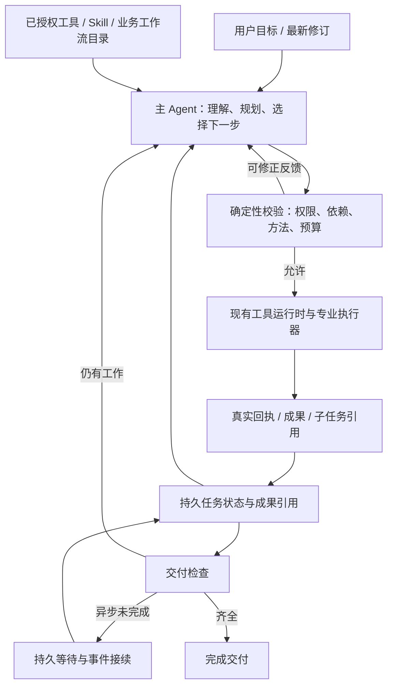

# Agent 通用任务编排与执行闭环：整体方案

## 当前确认范围（2026-10-31，372接续）

用户已明确：保留原ERP Agent，暂停新增ERP写操作适配，继续其它升级。原erp_agent入口、专业规划/部门Agent、查询和追问上下文、权限/预算/工作区/原结果协议保持；86项新增写入终态契约从本次实施及放行范围中移出，不再继续逐项扩展。已开发的ERP恢复和防重复代码/账本保留，冻结不等于已经验收或删除旧效果。原ERP功能兼容仍属本次回归范围；默认新任务总开关仍false，未作生产配置变更。

本次不新增共享群聊的进度读取权限。当前媒体/异步协议仅支持个人作用域，因此群聊新任务继续原Actor/Skill流程；个人新任务才可进入新版编排。已有_task_bootstrap/_task_execution优先按原恢复协议处理，不被新的准入条件删除或降级。新准入边界不影响原群聊功能，不表示群聊新版媒体编排已适配。

发布前仍需完成：非ERP范围最终调用链/迁移与在途恢复审查、原两个Skill在原素材上的真实供应商与最终页面验收、确定最终候选后的受控发布检查。复用已有效的本地与页面证据，不重复生成已有图片；付费前先给预计费用并取得用户确认，整套本次范围验证通过后才部署。

日期：2026-10-29。状态：基于源码调查的方案草案，供用户评审；未实施、未作新发布。当前代码基线 `6fce2e641760b8eff62adad512f4096fb1502fed`。

安全与功能保留约束见 [审查验收记录](VERIFY_Agent升级安全与功能保留.md)。独立设计审查提出的交付要求保护、上下文锚点、跨回合副作用身份及能力接入资格已在本版补充；补充不等于实现已通过验证。

用户目标：AI 理解目标后能自主选择已有能力、拆解有依赖的任务、承接真实成果、根据结果调整步骤，并完成交付；不局限于 Skill 或电商图片。保留既有功能与授权边界。这里的“自主思考”指可观察的任务决策能力，不要求存储或展示模型私有思维链。

## 1. 项目调查结论

调查覆盖当前主聊天、PromptBuilder、工具目录/权限/运行时/结果、Skill、Actor/检查点/父子任务、ERP 循环、计划任务执行与发布 Planner、图片工作流、前端消息块。没有审计所有业务工具的内部算法，以下完整性指相关控制链，不指全仓库已逐文件验证。

| 实际代码 | 已有能力 | 需要解决的缺口 |
|---|---|---|
| `services/handlers/chat/actor_enqueue.py`、`executor.py`、`execution_engine.py` | 消息入队、Actor claim、主模型与工具多轮循环、流式输出、重试与终态提交 | 入口仍可在主模型决策前强制绑定领域方法；无工具调用通常结束当前回合，不核对完整用户目标 |
| `services/prompt_builder/layers/static_layer.py`、`templates/workflow.md`、`modes.md` | 静态、动态、历史及权限上下文 | 默认依赖任务进入 ERP 分析并展示计划后强制停止；与 auto 的立即推进规则有矛盾。规划活动和权限 plan 模式混用 |
| `services/tools/spec.py`、`registry.py`、`policy.py`、`execution.py`、`runtime.py` | 权限、模式、效果、并行属性、发现、资源检查、确认、工具错误封装 | 不应重建目录或授权；缺少面向上层任务步骤的前置成果/完成回执衔接 |
| `services/tools/result.py` | 保留原结果，区分开始/完成/失败/不确定及 artifacts | 当前是进程内无损封装，源码明确不是持久化协议；不能直接 JSON 化替代业务账本 |
| `services/skills/runtime.py`、`coordination.py`、`context.py` | 版本、来源、组合所有权、工具上限、上下文、回放 | 阶段成果没有独立事实；当前参与方法上限按活动集合求交，不能直接支持受限规划方法结束后合法接续执行 |
| `services/conversation_execution.py`、`conversation_turn_runtime.py`、`replay_checkpoint_store.py` | 租约、fencing、安全点、取消/暂停/恢复、原子终态、回放 | 这是执行尝试的生命周期，不是跨多条回复的用户目标生命周期 |
| `services/conversation_subtasks.py`、迁移 140、`conversation_state.py` | 父子关联、完成事件和安全点注入 | 本次检索服务代码，register_subtask 的业务接入未找到；迁移 140 在父任务非 running 时把通知记 ignored。不能据存在模块宣称异步闭环已接通 |
| `services/handlers/chat/execution_engine.py::_terminal_image_pending` | 图片受理后以真实子任务占位交付并结束本轮 | 适用于纯生图；“生图后整理文件”等还有后续步骤时缺少可靠续接 |
| `services/tool_invocation_store.py`、图片受理 RPC | 调用执行/回放/uncertain；付费图片防重 | 必须复用；重规划不能通过新 call_id 重复已有副作用 |
| `services/agent/tool_loop_executor.py`、`stop_policy.py` | ERP/计划任务工具循环、hook、停止和预算策略 | 与主聊天存在多个终止策略；不宜为统一而一次重写所有执行器 |
| `services/planner/*` | 计划候选、能力描述、校验、发布快照 | 调用点主要在计划任务创建/变更；PlanStep 没有通用动态依赖、成果与恢复状态，不是现成的聊天编排器 |
| `services/agent/plan_builder.py` | ERP 域路由、提参和降级 | 名字包含 plan，但不是通用任务规划器 |
| `services/scheduler/*`、`scheduled_task_agent.py` | 草稿/预检/确认、授权工具快照、完成 gate、重试、结果提交与投递 | 要共享任务执行语义，不能取消已有配置确认、动态扩大后台工具或借自主编排新建周期任务 |
| `frontend/.../MessageContentBlocks.tsx`、`chatImageDisplay.ts` | Skill/工具/图片/文件等消息展示，过滤旧图片提交回执 | 暂无通用任务进度视图；不能用自然语言裁剪承担新阶段结果展示 |

两条原 Skill 生产案例及固定开源版本见 [源码研究记录](INDUSTRY_Skill动态选择与阶段接续.md)。旧单循环、持续任务、Skill v2 文档都是历史范围记录，不据其标题判定新目标已实现。本方案扩大的是后续拟开发范围，不追认旧文档中的待开发项已完成。

## 2. 外部设计依据与选择

1. [OpenAI orchestration](https://developers.openai.com/api/docs/guides/agents/orchestration)：区分移交会话控制权与主 Agent 调用专家；建议先从单 Agent 开始，只在能力或策略隔离有实际价值时增加专家。适合保留主聊天作为用户目标负责人。
2. [Anthropic Building effective agents](https://www.anthropic.com/research/building-effective-agents)：区分代码预定义路径与模型动态决策，按需增加复杂度。该文章发表于 2024 年；其当前补充指向下面的 Managed Agents 设计，不把旧建议冒充最新产品全部实现。
3. [Anthropic Managed Agents](https://www.anthropic.com/research/managed-agents)：会话日志、harness 和执行环境解耦；会话不能等同于模型上下文窗口。适合区分持久任务事实、模型上下文投影和实际工具执行。
4. [LangGraph persistence](https://docs.langchain.com/oss/python/langgraph/persistence)：线程检查点与跨线程长期存储分离。我们已有 PostgreSQL 检查点和记忆，不为采用此原则另换框架。
5. Grok Build 固定源码的计划状态、真实文件交接、批次边界和反馈继续；Deep Agents 的按需 Skill/工具披露；OpenCode 的方法加载与权限分离，见研究记录中的固定提交链接。

这些是厂商建议或具体实现，不是统一行业标准，也不证明某产品内部完全相同。没有与 Codex/Claude/Grok 做同任务、同模型的实测，不承诺产品能力完全等价。

推荐：一个主 Agent 负责用户目标，确定性运行时保护权限、成果、依赖与副作用，现有专业工作流作为受约束能力。保留当前模型网关，不默认换模型、采购托管服务或引入新 Agent 框架。不为每次决策额外串行调用规划模型、路由模型和评审模型。

## 3. 系统行为与不变量

| 编号 | 目标与规则 |
|---|---|
| A1 | 简单问答/单步操作直接处理，不要求建立多步计划，不新增固定规划模型调用 |
| A2 | 复杂任务保留目标、约束、必要交付与依赖；主模型可随着新证据细化后续步骤，不需要开头猜完所有参数 |
| A3 | 只有当前可用且授权的能力可执行；模型可建议步骤，不能批准权限或把计划文字变为授权 |
| A4 | 执行步骤必须有可核对的输入、依赖和真实结果；模型自称完成、调用返回、Skill 已启用都不能替代业务成功 |
| A5 | 自动推荐和手选共存；手选方法按任务/阶段应用，全局权限限制始终有效，同阶段最多一个控制者 |
| A6 | 规划是执行活动；permission_mode=plan 是权限约束。auto 中需要规划不代表切换权限模式或重复要求确认 |
| A7 | 可恢复失败返回模型调整；等待用户、等待授权、等待子任务、不确定副作用、不可恢复失败分别处理 |
| A8 | 模型上下文可压缩，目标、当前步骤、已保存成果和副作用回执不能仅存在于摘要里 |
| A9 | 回合结束、任务受理、整体完成分开。需要后续工作的异步任务完成后应可靠接续，不依赖浏览器保持连接 |
| A10 | 新用户要求通过可信消息更新目标和修订；附件/网页内容是资料，不能改变授权、触发新的周期任务或伪造用户决定 |

## 4. 推荐职责与流程

不新增一个和 Actor 抢控制权的调度器。状态变更由当前获得 fencing 的执行者提交；图中的模块是现有服务内职责，不是新增微服务。

### 4.1 主模型与计划控制

- 主聊天保留当前流式多轮循环。增加内部受校验的任务控制操作，建议 `update_task_plan`、`complete_task_step`；普通工具调用仍由模型直接提出，不新增包装所有业务调用的巨型 execute 工具。
- update 仅修改模型工作计划：目标摘要、步骤与依赖、当前步骤及修订依据；不接受用户/组织身份、授权确认、计费成功或数据库状态等可信事实。
- 用户验收要求与工作计划分开保存。每项必要交付使用稳定 requirement_id，绑定真实用户消息及适用方法的固定版本；工作步骤映射这些要求。模型可提议新增/细化要求，不能自行删除要求、改为可选或以换步骤 ID 规避检查。减少或改变既有用户要求必须绑定服务端验证的后续用户修订消息，并记录旧/新修订；工具输出或模型文字不能提供这种授权。初次自然语言要求提取仍可能漏项，须保留原始目标，在真实样本中评估提取及结束检查，不能宣称结构校验能理解全部语义。
- complete 只提出完成请求及现有证据引用。宿主检查对应回执/成果后归约，不因模型填写 succeeded 就完成。
- 有限宿主状态与开放业务步骤结合；不创造任意可执行 DSL。未来参数可标待解析，依赖完成后再具体化。
- 无 Skill 的跨工具任务同样可规划；单步任务沿用直接路径。专业流程已有更强计划协议时保存其 plan_id/revision 引用，不复制第二套业务计划。
- 任务控制调用与业务调用建立屏障：同批新计划必须提交后再调用依赖它的操作。计划更新若受新的工具结果影响，应在下一轮决策，不能并行抢写。

### 4.2 能力与 Skill

沿用 ToolRegistry/ToolSpec 目录，复用 effects、parallelizable、execution_modes、replay_requirement、policy_rules；Skill 保留自己的版本目录与按需加载，不把文档 Skill 伪装成有副作用的业务工具。

专业能力通过现有工具入口提供（ERP、搜索、图片策划等），由主模型决定何时调用；领域代码负责必要输入和业务校验，不再以产品词强制接管所有相关任务。现有语义路由可以提供候选，但不能替换用户指定方法或跳过主 Agent 的决策。

工具披露与真实调用都从同一任务/阶段事实投影，再经过 ToolPolicy。披露不是授权，缓存和计划快照不是新的授权来源。

方法限制区分两个层级：

- 会话/组织/用户/已批准计划任务的全局限制：始终求交，阶段完成不能放宽。
- 经宿主登记并验证的阶段方法限制：在该阶段参与求交；阶段完成后可以保留用户选择身份但退出当前执行职责，并合法交接下一阶段。

旧 allowed_tool_names 默认继续按原有上限解释。不能因它为空就自动改为阶段限制；只有精确核验的历史版本与新声明支持阶段方法时采用新语义。原 reference-image-prompts 和完整融合版需逐一验证其真实交接要求。未知方法缺口要如实反馈，不能自行抬权限来追求不中断。

### 4.3 成果与完成检查

保存轻量成果引用：artifact_id、类型、版本/摘要哈希、源工具/步骤、作用域、真实资源 ID、必要的规格信息。文件留在现有工作区/文件服务，图片留在原资产服务，电商规划留在原方案存储。

纯文本方法也可产生成果。正文按现有受控文件/检查点能力保存，模型回传引用；验证只检查宿主已登记的结构与必要内容证据，不能只存一个“已完成”布尔值。

任务级检查：必须交付项有真实可访问成果；所有 required 步骤有证据；子任务未结束不能声称整体完成。领域检查：电商五张图核对五份提示词、素材引用、规划要求、规格与五个结果；ERP/文件任务核对真实文件、查询口径、来源和缺失项。

完成检查以保存的用户验收要求为准，不只检查模型当前计划。删除“完整提示词”步骤、把“整理文件”改为 optional 或在重规划时漏掉其 requirement_id 均不得使任务通过。

通用层不证明任意自然语言语义绝对正确，也不假装存在覆盖所有领域的自动质量评审。首次交付可采用有界模型自检，关键领域使用已有结构校验/可执行检查；额外视觉或独立模型评审按质量证据决定，不固定增加所有任务成本。

### 4.4 持久状态、等待与跨回合续接

区分：当前 generation task 是一次可领取的聊天执行；逻辑任务是用户目标及其多次执行。复用 tasks 保存每次执行，不改变“纯生图受理后当前聊天结束”的既有语义。

建议新增最小 `agent_task_states` 逻辑状态记录，root_task_id 指向原 tasks；包含 version/revision、目标和可信输入引用、交付要求、步骤/依赖、当前状态、方法与成果引用、权限来源引用、预算消耗、当前执行任务引用。禁止保存账号密钥或完整模型私有推理。

建议新增 `agent_task_events` 作为该逻辑任务的持久接续事件/去重记录，复用现有 ConversationWorker 的进程与入队基础设施消费，不另启调度平台。事件以逻辑任务、子任务/业务回执和事件类型做唯一键，保存已处理和对应续接任务 ID；同一事务登记接续与事件消费。

为何需要：当前 checkpoint 绑定单次 generation task，子任务完成通知可能在父聊天终态后 ignored。仅在内存等候或往旧 messages 追加内容不足以保证跨回合接续。新表属于拟议数据库扩展，须评审与迁移验证，不能声称现有表已具备相同语义。

流程：

1. 有后续依赖时，在子任务接受边界原子记录逻辑关联和结果引用；业务调用结果不明先查受理账本，不能重发。
2. 当前回合交付“生成中，完成后继续整理”等真实状态并结束，不保持模型或网络连接空等。
3. 完成事件可靠写入，worker 按唯一事件建立原会话的内部续接 generation task；沿用原执行身份/权限来源，入队与执行时重新验证权限。
4. 获得 Actor claim 后按任务 revision 校验并消费成果，全部依赖就绪才继续相应步骤；不让五张图同时完成触发五次打包。
5. 用户可在等待期修改目标、暂停、取消或发起新任务。续接携带预期 revision；过期事件只记录结果，不覆盖新目标、不再启动旧后续动作。
6. 不复活旧已终止任务，不修改旧生图受理记录；只有启用新协议且明确存在后续步骤的任务建立自动续接。

#### 可信内部续接输入与上下文锚点

当前 `enqueue_web_chat` 要求真实 input_message_id/turn_id，`handlers/context_snapshot.py` 校验锚点消息为对应 turn 的 user 输入。因此不能将内部事件直接塞进 Web 用户入口，也不能改旧 ContextAnchor 或伪造 user 消息。

新增服务端内部专用 `continuation` 输入种类，由既有 Actor 入队设施的独立受信任适配器创建。输入绑定 logical_task_id、event_id、预期任务 revision、原始用户消息/授权引用、conversation/branch、执行作用域、通道、协议/方法版本与上下文边界。它不属于模型可调用的公开能力，客户端和工具结果不能自行构造受信任续接。

用户输入仍走原锚点路径。内部续接使用版本化 continuation context builder：固定已提交的历史边界和工具配对，加入任务最新已接受的用户修订、状态和事件成果引用，事件内容标记为系统运行事实而非用户授权。构造结果冻结后该次采样不漂移；发现任务 revision 或分支不匹配时重新领取/归约，不读取无界“当前全历史”凑上下文。

等待期间的新用户消息先经过正常 Actor 顺序和可信归属判断：修改本任务则推进 revision 并使旧续接失效；无关消息不自动修改旧目标或授权。并行分支严格隔离。权限/渠道/工作区变化按执行作用域重新核验，不能沿用更宽身份。压缩仅影响上下文投影，不删除任务要求、事件来源及成果引用。旧用户 ContextAnchor 和旧 checkpoint 校验保持不变。

#### 跨执行回合的稳定副作用身份

现有工具调用账本绑定 task_id/turn_id/tool_call_id，新 generation task 会产生新身份。因此事件去重和状态 CAS 不足以单独防止跨回合重发。

为有副作用的步骤定义服务端 operation identity，绑定 logical_task_id、稳定步骤效果 ID、效果版本和规范化业务参数/资源版本摘要；它不是模型随意设置的 call_id。工作计划换名或重排不改变已存在效果身份；参数变化须与可信修订及业务协议对应，不能将未解决的旧调用自动视作新效果。

在任务状态中维护 operation→原 invocation/业务受理记录的映射和 `reserved / accepted / uncertain / completed / failed_before_dispatch` 状态。派发前以当前 Actor fencing、任务 revision、未暂停/取消及当前权限，在同一事务预留 effect 并关联实际 invocation；映射和完整结果一并回放。图片继续以原受理账本为权威，不另扣费。

跨回合再提议相同效果，先核对记录：已接受/完成返回原回执，reserved 由原所有者或恢复协议处理，uncertain 查原业务状态并禁止自动重发，确定未派发才允许重试。即使新模型产生新 call_id，也不能得到第二个外部派发权。用户取消/修订与预留共用锁/CAS 确定先后；预留后再次检查取消，已经实际发出的操作只能按现有供应商取消能力处理，不能承诺撤销已发生效果。

对于不支持稳定幂等键或状态查询的外部工具，保留 uncertain 并报告待核实，不声称可实现外部 exactly-once。恢复不得通过新 operation identity 掩盖旧的不确定结果。

逻辑任务状态建议 `active / waiting_input / waiting_approval / waiting_dependencies / paused / completed / partial / failed / cancelled`。这是拟议任务状态，不替代现有 ConversationState 或计划任务 status。

状态行、当前 generation checkpoint 与必要组合/事件投影由 Actor 同一事务提交并做 revision CAS；事务失败不继续执行。数据库是权威事实，WebSocket/Redis 仅负责通知与加速，断线后可重新查询。

跨步骤累计预算不能因新 generation task 重置。保留现有单次 wall-time/turn/credits 上限，新增逻辑任务累计限额与修正计数；默认值需依据已有预算和基准测试确定，不要求用户每次填写预算。耗尽时交付真实部分成果和下一步，禁止无限续接。

### 4.5 失败与结束策略

| 事实 | 行为 |
|---|---|
| 参数错误、选错方法、可选能力冲突 | 保存拒绝事实和允许的下一步，回到主模型有界修正；不执行副作用 |
| 方法确实要求的素材缺失 | waiting_input，问必要问题并保留输入和进度 |
| 已有确认机制要求授权 | waiting_approval，沿用原表单/ChangeSet，不让模型自行批准 |
| 子任务排队或运行中 | waiting_dependencies；等待事件，不反复轮询模型 |
| 外部调用可能已经执行 | uncertain，查原调用/业务账本；不可因超时直接重复写入或收费 |
| 权限撤销、取消、租约失效 | 保留原安全停止；不换工具绕过拒绝 |
| 同因失败、无进展、预算耗尽 | 收敛为部分交付或失败，不无限重规划 |
| 模型无工具调用、准备结束 | 简单问答直接结束；存在逻辑任务时检查 required 成果，缺少可执行工作则有界提醒，确实无法完成则报告缺口 |

不将所有错误一律 retry；现有业务回执里的 error、基础设施返回 succeeded、模型文字成功要分别处理。

## 5. 用户体验

- 普通问答和一步操作保持现有体验。
- 多步任务显示简短进度：步骤名称、进行中/等待/完成和真实结果；默认折叠技术细节，不展示私有推理。
- 规划摘要可读，方法要求完整提示词时提供可展开的完整成果。展示由类型化块驱动，不依赖匹配“现在开始生成”来裁剪新成果。
- 自动选择不要求用户逐次挑选 Skill。手选仍清楚保留；因作用域不适用时解释当前用法，不静默替换。
- 输入齐全且用户已授权的正常接续不重复确认；保留真正缺项和现有外部写入审批。
- 图片任务只要求生成时，沿用直接展示图片；有后续整理时等待完成后接续，并显示结果而非声称“已提交=已完成”。
- 页面刷新恢复真实任务进度；用户暂停/取消操作明确作用于当前逻辑任务，已接受外部工作是否可取消沿用供应商实际能力。

## 6. 文件与接入范围

拟新增 `services/task_execution/`：`contracts.py`（版本化状态/证据）、`reducer.py`（纯状态变更与依赖）、`controller.py`（主循环接入与完成检查）、`store.py`（Actor 事务存取）、`continuations.py`（事件到现有入队）、`artifacts.py`（引用适配）。职责可在实施时按真实依赖拆分，不按固定行数制造文件。

| 修改位置 | 变化与保留 |
|---|---|
| PromptBuilder templates/workflow、modes、skills | 统一规划/权限/结束规则；删除默认跨域必须 ERP 分析及无条件停止，保留真实 plan/ask 约束 |
| chat execution_engine、executor、conversation_turn_runtime、worker | 接入任务控制/步骤检查/检查点/续接；保留流式、claim、fencing、安全点与旧终态 |
| tools spec/registry/policy/runtime、控制工具定义 | 新控制操作沿用统一入口；补充前置证据检查，广告与派发同源，不替换业务 handler |
| skills runtime/coordination/context/contracts | 阶段参与与全局限制分离；保留来源、锁定身份、不可变版本与兼容回放 |
| ecommerce workflow、image_handler 与受理 RPC | 将强制方法变成受约束能力；接入规划成果和异步依赖关联；保留 plan_source、ready、计费与去重 |
| agent tool_loop_executor、scheduled_task_agent、scheduler | 共享上层任务状态/证据适配；保留已批准快照、后台能力限制、原创建确认/提交/投递。先共享契约，不合并所有循环 |
| backend/schemas/message.py、前端 types/message、MessageContentBlocks | 增加版本化 task_progress/成果引用展示，保留旧消息和图片分组 |
| 新数据库迁移与回滚 | 逻辑任务状态/事件、RLS、CAS、原子保存和接续唯一约束；迁移编号在实施时按最新主干分配 |

现有 Planner 继续用于配置发布；可复用它的能力投影和校验组件，不把 approved PlanRelease 当作聊天动态计划，也不让动态任务修改已批准定时任务授权。

### 6.1 逐项能力接入资格

实施前从实际 ToolRegistry、模式/action 解析、专业执行器和入口生成接入库存，逐项记录：能力/action、入口/执行模式、完成证据、异步终态来源、幂等与 uncertain 处理、权限/确认、成果类型/作用域、上下文引用和测试。复杂工具按 action 分项，不能仅按工具名标为已支持。

每项状态为 `legacy_only / adapted / verified`。未适配者保留原有入口和 handler 行为，不删除原功能、不自动纳入新跨回合副作用执行；需要该能力的混合任务明确说明接续边界或采用经验证的适配路径，不能静默忽略步骤或宣称全部完成。不得通过开放更宽工具集补足缺口。

接入清单和真实样例是发布范围的依据。主聊天、ERP、图片/视频/音频、文件/代码执行、知识、MCP、计划任务与企微等有实际影响的消费者都要归类；不因本轮重点是图片就默认其他入口已兼容。库存未齐全时不能宣称通用升级已覆盖所有原功能。

## 7. 实施顺序与发布门槛

以下是一个整体方案的依赖批次，不是分别宣称根治的补丁；同一验收矩阵贯穿，用户可用发布候选必须包含完整闭环。

1. 固化当前项目地图与行为基准，建立目标任务样本；核对历史文档、发布候选与真实能力目录。
2. 实现通用任务/成果/依赖契约、状态归约、数据库事务与恢复；同时接通最小主循环控制，不能只有一张没有消费者的计划表。
3. 统一入口与权限提示，Skill 阶段协作、工具选择/派发与完成检查，覆盖无 Skill 的串行和并行任务。
4. 接入异步子任务持久等待、事件去重和 Actor 续接；适配图片及已有后台能力，验证跨回合/重启/用户变更。
5. 完成前端进度与成果交付、计划任务适配和全兼容验证；真实模型测试后形成整套发布候选。

不预估未经验证的固定工期。主要风险集中在阶段权限兼容、跨回合接续事务、旧检查点和所有入口的结束语义，不能只按文件数估算。

## 8. 验收矩阵与“好用”的衡量

| 组别 | 必须覆盖的端到端任务 |
|---|---|
| 基本体验 | 普通问答、单工具查询；无需任务计划，不新增固定模型规划轮次 |
| 无 Skill 编排 | 搜索→读取来源→分析→输出文件；文件读取→计算→报告；前序参数未知时按结果继续 |
| 并行与依赖 | 独立检索可并行；有依赖的计算/文件写入按序；不因模型同批调用越过前置成果 |
| 原两个 Skill | 原素材原请求，提示词完整交付后生图；仅要提示词不生图；所选方法不被主图入口抢占 |
| 业务路径 | 旧服务端策划/ready执行、已有提示词直出、局部编辑、解释；输入比例与数量保持正确 |
| 异步闭环 | 五张图→等待五个真实终态→打包文件；部分失败只处理缺项，不重复生成已成功项 |
| 后台与入口 | 原定时任务配置/确认/预检/快照/完成gate/投递；组织/个人、web/企微、直接媒体保持原边界 |
| 故障恢复 | 进程重启、浏览器断线、重复/乱序回调、提交响应丢失、租约丢失、回执不确定、超时与预算耗尽 |
| 用户控制 | 等待时修改目标、暂停/恢复、取消；过期成果不覆盖新要求，旧事件不再次收费 |
| 权限隔离 | 不越组织/用户；固定全局工具限制不能被阶段交接绕过；plan/ask、现有审批不退化 |
| 历史兼容 | 旧v1/v2 checkpoint、不可变Skill、原图引用、已受理任务回放、旧消息显示与无新逻辑任务路径 |

基准需记录候选 SHA、模型/参数、样本输入、工具环境、运行轨迹及结果。先用确定性假工具覆盖调度与故障，再用原业务样本和真实模型验证判断能力；付费生图使用最少必要样本，已有原素材无需新建测试 Skill。

衡量：端到端交付通过率、漏步骤率、人工接管次数、无必要追问、工具选择与参数正确率、恢复成功率、重复副作用、首字/总耗时、模型调用/Token/积分。先建立当前基线，再用同样例比较；禁止用调用次数或图片任务 completed 代替业务完成。

确定性门槛：权限越界/重复付费/缺必要成果仍执行为零容忍测试失败；关键原案例和故障用例必须通过。主观质量、延迟和成本的可接受阈值在基准完成后列为发布准入，不编造“大厂同等水平”百分比。

## 9. 兼容、灰度与回退

- 新逻辑任务协议独立 version，旧 checkpoint 按原版本恢复。新执行冻结协议/方法版本，恢复不自动重新发现和升级。
- 灰度以新任务为单位；先内部账户验证，再扩大。关闭新建开关不影响已在途任务的消费者和回调，避免留下永久等待任务。
- 数据库采用扩展式迁移。新逻辑任务产生后，不能直接降级到不理解新状态的旧二进制；保留兼容消费者，先排空或明确暂停在途任务再回退。业务账本不删除，已付费结果不重发。
- RLS、服务角色、函数所有权、租约、revision 与事务故障必须用真实隔离 PostgreSQL 验证，不能仅 mock。发布仍走本地 release.sh，设计完成不是发布授权或发布成功证据。

## 10. 需要评审的结论与尚未证明的部分

推荐确认的整体方向：保留现有运行时，新增跨回合逻辑任务状态与可靠续接，把模型决策、执行事实与能力权限分开；统一任务闭环，不整体换框架，不默认增加多 Agent 或额外模型裁判。

两个拟议持久表、阶段权限新语义和内部自动续接属于本次方案中的核心架构选择，尚未实施。实际 DDL/RPC 接口须结合最新主干与完整入口清单细化；新状态必须有唯一写入者和端到端消费者。

当前仍未知：所有业务工具的可重试/结果证据适配覆盖；后台入口是否可复用全部成果引用；现模型在跨域长任务的基准表现；额外模型调用和平均成本。通过适配库存与基准解决，不用框架宣传填补。

本方案可以建立更可靠的自主执行机制，不能保证所有模型判断、未来自然语言 Skill 或外部服务永远正确。与成熟产品接近的体验必须由真实任务评测和用户验收证明。

### 343图片续接的当前实现边界（2026-10-30）

持久图片终态事件经原Worker创建内部chat Task，复用原输入/turn作为来源且只创建新assistant；沿用原claim冻结新的base/through与图片来源，原检查点完整消息用于恢复。真实发布证明驱动图片Artifact/operation/步骤更新，原commit入口关闭新assistant，原用户消息不变。入队前新输入会延后旧事件；入队后保留现有串行FIFO，不把新user混入旧目标。此机制当前覆盖canonical方法图片路线；完整新要求修订、取消/暂停、所有入口和资源验收尚未完成。定向PG通过不代表整套发布验收。

## 2026-10-30 原样本发现的初始化覆盖审查增量（实施中，未发布）

真实原包/原图/qwen3.8-max规划样本中，reference方法完成五图完整规划后交接；完整融合版把原请求的实际五张图片漏提为只有提示词。保留original_goal不能阻止finish接受错误子集，不能用关键词自动增加付费图片，也不能只改工具描述宣称根治。

沿用现Actor主循环增加初始化覆盖审查阶段：start的提案先与真实输入锚点、原文及固定历史上下文绑定到checkpoint；在下一个正常模型轮次，宿主隔离Skill正文和执行工具，仅将真实用户请求/固定上下文/手选方法身份及提案作为待核对资料，要求独立覆盖判断。不是让执行模型调用coverage_passed工具自证。该轮沿用当前ModelGateway、正常预算、取消安全点、usage和稳定model_round，没有后台隐藏推理或额外派发权。覆盖通过才初始化不可变TaskState；缺项或不确定返回同主循环有界修订，原始要求及已有成果不得被替换；审查结果与提案/来源摘要一并原子存储，恢复不重解释已通过提案。

原无新状态检查点与旧入口保持原协议。默认入口仍关闭；本增量需验证原两方法、只要提示词、执行已有方案、上下文指代、保存丢确认/恢复、预算与取消、错误/伪造审查输出，以及真实模型覆盖样本。语义审查仍有模型判断边界，不能承诺永远正确。最终成果对原目标的覆盖及用户修订属于同一总体验收，不把本阶段开发等同整套通过。

## 当前增量协议：原图与回执、独立交付提取

新review version2不向核对模型暴露待审核提案或Skill事实。RequirementObservation只接收独立action、deliveries(kind/minimum/item_count/evidence)及限定的交付歧义；宿主根据当前原文证据逐义务比较，与待审核提案对应。宽泛引用同时匹配两用途时不通过；分析和五条提示词不会因同为text而跳过条数检查。observation连同host verdict进入同一原CP；restore重算。v1已保存review按原协议恢复。该层不负责商品事实、资源可用性或工具授权。

image_binding_version2保留完整规划artifact和追加的image.resources.bound证据。bind_task_image_sources调用既有原图解析器，固定选择顺序/角色、版本和内容指纹；既有文件授权边界与manifest透传。可选step_id只允许无业务capability/交付目标的就绪准备步骤，并可用实际绑定artifact完成其依赖。已预留或受理的全局槽位禁止改绑定。原生受理再次解析，比较最终ratio及完整资源指纹；原plan_source沿用原生方案冻结核验。新入口关闭不会移除已管理任务的受理前复核。

347 reconcile_agent_image_operation只核实当前有效Actor租约内同一逻辑操作的原生已提交child/event与assistant身份，验证原call/turn/hash/租户/会话。正证据更新logical operation和原CP为accepted；不改原unknown ledger，不新建paid IO，不把accepted算completed。无child为unresolved，不能据此重发。普通缺回执在保存uncertain后立即核实；重放同槽位也核实。owner已关闭/租约丢失等完整Actor恢复仍须全链验收。

## 实施补充：v3事实门禁与原生只读成果（2026-10-30）

新任务v3在结构/交付覆盖之外增加独立商品事实核验；v1/v2兼容恢复。事实轮使用原Actor模型循环与预算，来源通过现有ChatImageInputResolver和真实tool_invocations获取，隔离Skill正文。宿主保存原文草稿、来源快照与判断，approved证明只适用原身份/原目标/原消息/分支/规划SHA/来源版本；核验失败保持规划步骤未完成、支持有界修订，资源绑定和原生图片受理再次核对来源。此机制不保证语义模型永远正确。

原生只读成果适配复用既有invocation账本，不另建业务执行器。348 RPC核验当前Actor token/lease/revision/作用域，仅返回真实当前调用或已导入且同逻辑根的历史消费；规范参数见证留在原CP。当前工具权限和资源在导入前重新核对，只接受text/data，禁止模型伪造业务回执。缓存消费仍受当前Policy检查，记录原来源及cached事实，不派发第二次查询。事实来源可引用导入数据且重新核验原账本与摘要。

范围严格限制为已登记只读能力/动作；文件、副作用回执及其他后台入口仍须按其真实协议适配，不能根据工具名或“成功”文字自动宣布完成。能力库存中的领域状态须以相应端到端证据更新，本批局部测试不把整个工具系列提升为verified。默认新入口关闭，生产发布须等待整体功能账本闭合。

只读FileRef成果增量：原生只读结果可导入file，引用仍指向invocation，摘要包含实际内容SHA和FileRef元数据。复用当前ResourceAccessBoundary核验文件消费权限，原生staging结果使用既有结果消费的工作区包含约束；不绕过用户文件工具的staging禁用规则。原生ledger/文件当前状态在import/read/complete三处复核，损坏/过期/撤权不触发重做业务。这不覆盖代码执行生成或任意本地文件，后续须由其原领域适配器提供证据。

### Reach同步写的领域适配（2026-10-30实施）

复用341/139事务预留和原Reach平台适配器，按capability+原receipt requirement ID锁定稳定effect slot。仅在当前v3、唯一就绪写步骤、单项receipt minimum=1且现有Policy与内容确认通过时派发。349受限只读RPC把逻辑operation、原native ledger与reach_operations正证据关联；不返回secret，不创建业务或重试授权。宿主检查原回执及payload/audit后记录completed，import_task_receipt产生可信receipt成果。未知/partial/无回执继续uncertain；recovery_only无原预留不执行。旧版本和未适配工具保持原路径。更多领域须按真实回执/前置失败协议逐项适配，不从返回文字推测。

### 350恢复与只读领域接续实施（2026-10-30）

域派发前在原reserve事务把原Actor/native调用UUID与Reach操作关联，v3域id由native UUID派生，原供应商call_id只在原native账本内使用。正证据恢复只改logical state/CP，不覆写未知native结果；native账本保留后恢复仍绑定原task/turn/hash与组织。空/partial/处理待审核不当完成。确定not_dispatched走341显式领域拒绝核验与原确认，bounded retry受原预算next_eligible_at约束；不确定仍无重发权。350回退必须先消除所有租户native关联或拒绝回退，不能丢恢复证据。

只读适配扩为明确登记的local与knowledge操作，MCP只接当前完整受审且record_required/effects none的合成read connector。控制器重用原native证据读取核验，MCP原生文本在read/complete/reuse时保留验证身份，同root复用保留tags，跨root未经领域导入不降格为普通文本。原始消息、用户目标、旧版本CP、普通文本/提示词复用和现有确认体系继续沿用；新能力仍默认关闭。

## 原生代码与计划任务适配补充（本地机制已验证，整套待闭合）

v3 code_execute通过341/139预留，351读取原native结果；每次kernel独立ACK只确认实际代码SHA和request ID。finished只允许ok/error，unknown不自动再执行；not_started在原Policy下有界纠错。实际emit文件返回前在原workspace锁内采集SHA/版本，导入/完成核同一真实文件及当前scope。旧执行路径保持，真实worker/OSS仍需整体验证。

计划任务通过352受RLS保护的最小native UUID→operation/action/hash关联，先于原manager IO保存；复用原表单及ChangeSet，而不是另造任务定义器。原249提交receipt为完成权威，CS.status或成功文字不算交付。稳定direct key及原assistant/form key必须唯一对应当前用户组织/动作/资源；没有正回执不能重发。返回丢失保留原139未知状态，只用真实域回执推进logical operation。read_task_scheduled_result在控制批次中stage状态，与原assistant/tool pairs原子保存，不在model控制途中另写checkpoint。receipt成果导入及complete复核当前冻结作用域。352回退必须先drain全租户绑定。

当前352仍未提供确认/取消后的后台消费者；视频、ERP、文件动作等仍待业务可靠性适配。后续公共续接必须延用343队列/上下文/事件权属规则，保持原用户消息、冻结方法版本和预算，不创建假用户指令，不扩大工具权限。默认入口false，不以局部验证作为生产发布条件。

## 后台来源续接与剩余写适配任务地图（2026-10-30接续）

本轮继续implementation，并按dev-doc补足当前实现边界。后台353已接入原Actor队列：352被动fact读取核当前Actor/org/member和原native/域关联，活跃读包装仍保留351 token/lease/revision；343提取公共enqueue，image wrapper不变，scheduled source使用同一串行队列及原上下文锚点；353事件只带可信域来源，消费时重新读取原事实。receipt续接只恢复active及追加准确facts，不直接宣称交付、重发或新增用户授权。原image与receipt共享continuation_checkpoint深拷贝原history/方法状态，清理的仅为已结算owner usage及原owner参数见证。当前原调用次数/模型预算保持，非模型JSON可改。

取消/失败事实可以唤醒，但不把CS.failed且暂无receipt永久判成未发生写入；若之后有真实249回执，以不同dedupe key唤醒核实。等待状态在完整tool pairs和原表单/卡片展示CP保存时进入，先保存受理并崩溃仍可通过原native账本重放确认UI。345补充closed waiting_approval/waiting_input控制，保留暂停/取消/新输入优先。353回退保留未消费事件，352回退保留原域绑定。新入口仍false，均未部署。

下一连贯批次是持久native write领域适配：继续复用341 effect/native invocation/当前Policy确认与353来源续接，不新增业务执行器。ERP当前request_with_retry会重试网络/Token/429；managed写必须在原ApiEntry.is_write正确边界使用一次实际业务请求，先持久绑定原native identity及归一化method/参数hash，再捕获原API真实回执，不能从格式化成功文案推断。批量部分失败或异步受理需要保留accepted/unknown及明示领域核实，不泛化为全部用户要求已完成；未知不授第二次写入。原未管理路径/读取重试保留。

文件删除当前finally里fire-and-forget记录deleted_files；恢复先link再标purged，错误可能被吸收。managed适配须建立真实备份/文件版本与持久操作身份，解决物理变更后记录丢失及同路径新文件不能被旧重试删除的问题；不能仅把os.path.exists或成功文案当唯一证明。视频工具旧schema称异步但原chat实际同步wait；真实异步VideoHandler+TaskCompletion拥有原计费/回调链，接入必须解决原user turn已关闭后的独立产物发布、供应商受理丢返回不盲退积分重试、真实VideoPart与成果引用。上述仍未实现完，不能据此放行整套发布。

## ERP 原生发送与回执绑定（2026-10-30，本地机制验证，领域仍有边界）

354复用原341/139预留，不另建ERP执行器。唯一就绪receipt minimum=1步骤按原requirement+capability确定稳定effect，当前Policy及确认在预留前执行。prepare_erp在原ToolExecutor配置/Redis/参数验证之前，将真实running native UUID、Actor token、原参数hash及category/action绑定到受RLS保护的journal，私有dispatch nonce不进入模型返回。

实际ErpDispatcher完成原ApiEntry校验、映射及参数预处理后，在业务HTTP前记录method/归一化参数hash。派发记录按task→state→journal锁序重新核当前token/lease/active/member/reserved/native running；prepared→dispatched只允许一次，即使相同nonce/参数再次请求也不能再获发送许可。返回响应允许在原Actor失效后仅记录事实，不授予新发送权。原SDK request本身带tenacity重试，因此managed调用新增无decorator的request_once（同一原签名/请求/签名逻辑，单post），同时跳过request_with_retry、Token/429循环、broadening及fetch_all。旧调用仍用原request和request_with_retry。

实际原始API响应在格式化/模型/UI之前记录。read_task_write_result仅重读原journal，核当前冻结Actor/组织/工作区/会话/context_scope/personal与原Policy，保留原139未知/失败payload，不重造原调用成功。控制更新通过原model_bridge staging与assistant/tool完整pairs同一CP保存；导入和完成前再核不可变回执身份/hash。返回丢失或格式化失败只允许用正回执推进，不重发；原调用已明确prepared且正常返回验证错误时才允许原审批下有界纠错，新native attempt旋转nonce，旧nonce失效。原Redis锁和10分钟去重保留；managed明确未发送的参数失败不写done，以免阻断已证明安全的纠错。

完成语义必须按原生method准入，目前只明确验证erp.item.tag.add。其他method通用success最多accepted；已知async/job/partial/failCount等信号也只accepted，不能因为原格式化文字成功而完成用户目标。尚未覆盖的ERP异步查询/回调、逐方法部分失败结构及后台唤醒继续阻止全面准入。文件删除/恢复及异步视频仍保留原领域路径，未用该ERPjournal冒充其真实成果适配。354回退必须全租户drain，存在任一journal拒绝回退并恢复FORCE RLS。默认新入口仍false，未发布。

## 原生文件恢复与实际发布证明（2026-10-30，本地机制验证）

沿用原ToolRuntime资源解析、原PreparedFileCall/备份ETag、工作区写锁、OSS If-Match和no-clobber link。新355在原341/139稳定effect下将原deleted_files ID/Actor/org/path/key/备份ETag绑定真实running native UUID。FileRestoreLifecycle复用原native write生命周期的bind/proof_phase钩子，唯一就绪交付要求minimum=1，支持原file或receipt种类，保持原目标；ERP的默认receipt约束不变。旧无TaskState或v1/v2恢复入口沿原流程，不依赖新RPC。

备份下载进当前用户工作区受保护的.agent-task-effects/operation/native/snapshot，xb防覆盖、逐目录拒绝symlink、fsync保留完整字节。FileExecutor公共工具按路径段拒绝该内部命名空间，普通发现不披露。下载后重新验证原记录/目的地/备份版本；354派发记录按task→state→journal锁序再核当前Actor token/lease/member/active/reserved/native running，只有一次派发许可。实际link仍禁止覆盖已有目标，发布后再核inode+size+mtime与全SHA。ctime在link/unlink时会改变，所以不把它误当作字节变化证明；不存在路径或同名同SHA但不同inode均不能认领。

355领域settlement在同一事务将原deleted_files.purged=true和journal returned/原生回执保存。354拒绝file域绕过355使用通用returned。回执丢确认时保留snapshot和原139失败结果；控制器按当前冻结Actor/org/workspace/conversation/context_scope/personal/Policy及restore资源授权核对已发布目标与snapshot确为同inode，再只补记领域事实，不重下载/link，也不伪造原调用成功。文件交付额外要求当前read资源权限；产物kind来自原交付要求，import/complete均复核文件身份和字节。领域事实可以先于Actor CP归并为真实已发生动作，logical completed和assistant/tool pairs仍通过原model_bridge staging原子保存，CP失败不篡改运行内存事实。

只有prepared且正常返回错误才进入原341有界纠错；实际下载失败没有发布文件，可用新native ID旋转nonce重试，原call ID仅重放原错误。已dispatch但没有可验证发布的崩溃仍为unknown，不能自动再次恢复；未知snapshot保留，确认完成后清理。文件系统互斥仍遵守原single-host flock/NFS约束，不新增跨主机锁承诺。355回退先全租户drain file journal，失败保留FORCE RLS和原证据。原OSS30天协议、旧恢复路径和文件删除路径未改造为新成功逻辑。

剩余：file_delete必须解决物理删除与fire-and-forget恢复记录分离、原备份版本可能变化、批量部分删除及同路径新文件保护；需真实持久备份/每项领域回执与恢复，不能只因新restore已接好就宣称删除也闭环。其他ERP方法/异步后续、视频计费/受理/回调/真实发布、目标修订及多入口/UI/原两Skill整套验收仍阻止默认启用与部署。

## 逐文件删除与备份地址先行

356将删除领域事实独立于Actor/会话生命周期保存，原Task删除不被新FK限制；仅已armed的真实物理删除事实可在源任务消失后补原恢复记录，没有再发送权。原deleted_files新增可空native_status，NULL兼容旧记录，allocated只表示备份地址已登记，completed才可被恢复工具消费。原purge_after处理包括allocated，因此每次备份的唯一地址在任何OSS IO前都有既有30天清理责任；改为允许个人org=NULL，原查询/355均同义处理，不用新备份覆盖旧对象。

全批备份先验证原文件version+SHA、复制固定字节、禁止覆盖上传和ETag，然后354检查每个原生item均backed_up且未过期才armed+dispatch。每项再由当前Actor租约/原139 running/reserved核准，原inode rename到私有quarantine，逐项完成领域事实与deleted_files（保持正常30天期限）。部分发生后未知仍保留未完成步骤，当前control仅核实原quarantine identity/SHA及当前资源delete权限，不进行新的rename/删除。已有新同名文件保持；仅复制或路径不存在均不能自证。历史已完成删除不因后来恢复/新建文件而授予再次删除权。

视频单次SDK接口已可接原异步worker，保持旧接口；队列/积分、原生供应商结果与最终持久VideoPart发布及source自动续接仍在开发。新调用必须冻结原model/input/duration与计价，发送标记先于唯一POST，ACK先于返回；受理丢失不能走Smart retry或把临时URL降级当持久成果。无整套发布条件。

## 视频357/358落地边界

现已在原tasks/messages/credit_transactions、原media并发、原回调/poller/worker及资产服务之上实现v3 generate_video：冻结model/input/价格、one-shot派发、丢ACK的nonce关联、平台承担未知费用的有界退款、owned MP4持久化与原事务发布。受理不算成果；原generation权限保持，不新造ask确认规则。paused先不领取并发，claim后尚未派发时保留同一账本等待恢复；dispatch当前组织也须active。宿主标记与冻结snapshot不可由普通请求字段冒充。

视频结果提示使用原343通用continuation source及353完整CP流程，358只提供领域事实/路由hint；后台实际连接池逐源Actor重绑定，保留原history/opaque/要求，未关闭原用户Turn第二次。详情、证据、剩余边界见IMPL同名增量。视频仅完成原generate_video工具的text-to-video/10秒契约，本地机制验证不替代供应商/UI验收；其它视频API保留旧路径，不据此宣称已全部纳入任务编排。文件partial/ERP剩余方法/目标修订/多入口/UI等仍未完成，开关false，未部署。

## 359剩余原文件续接

沿原file_delete工具新增正常调用下的private prepared-resume，不新增模型写控制。新call原完整args hash必须匹配原uncertain effect；Policy/当前资源/原确认流程及workspace锁仍生效。原已完成项不进实际prepared targets，剩余项固定原version/SHA/备份ETag/有效期，359新139关联与逐项授权绑定当前Actor/token/lease/root及原armed evidence。原native不重写，原领域settlement仍独立保存真实已发生的detach。确认展示只列实际剩余项，opaque approval ID仍绑定原canonical call和prepared版本；pending batch只重放已有成功续接，不新发。详见IMPL/VERIFY本批记录。ERP嵌套回执解析仅防提前完成，尚未增加其它method的终态准入。

## 360受控ERP后置条件

沿原354 dispatch固定精确的宿主期待，沿原正常只读工具返回最小可信投影到139；360只读核对写后/同root来源/当前租户/fence/原生非cache见证。当前仅纯outer_id/title的item.general.addorupdate可用精确item.single.get后置状态完成，其它字段仍accepted。当前读/写Policy及import/complete都复核，回执hash包含原生读取，原消息/opaque CP不替换，完全unknown无受理不能靠同值读取自证。pending ERP详情读取绕过结果cache以获取新状态，不绕过权限或已完成调用重放。

来源指纹只存凭据派生SHA256、不存原值；跨账户/session不认领，正常refresh代码保持。暂缺稳定账户ID时跨refresh保守待核实并明确原因，不自动循环查询/重发。采购计算触发修正为原erp_execute写入口；原query/raw不能再触发，这是有意权限收紧，进度查询功能保留但不能猜测实例终态。详见IMPL最新证据和限制；其它ERP/多入口/目标修订/全产品验收继续阻止发布。

## 361来源连续性增量

360的跨session保守等待已扩展为可核验的原SDK provider refresh关系，未增加任何业务请求或重发。原缓存/持久化之后只记录严格成功和实际指纹变化；361按原tenant/身份保存不可变哈希关系，时间与最大32跳约束由SQL和Python双重验证，receipt只在有真实关系时增加证据。当前活跃org工厂已接入，原个人/未知transport/dedicated SYNC及缺链仍不授予自动完成；手工换号没有关系也不能认领。新表只存哈希，回退须全租户排空，原139/Actor/context/Policy保持。详见IMPL361证据与限制；其余业务协议和整体验收尚未完成。

## 362用户进度投影

原TaskState是进度权威，原139/业务回执是效果权威。新progress只投影步骤标题/逻辑状态/真实完成及待核实数量，绝不因助手消息结束或受理ACK宣称全部完成。原完整CP内保存仅root的task_progress发现标记，成功后发布原WS，后端outcome/ContentPart和前端历史parser贯通。GET只读RPC按当前actor/org/active成员、原assistant Task到同root绑定与user workspace范围校验，HTTP no-store；不要求旧Actor租约、不执行任务。user上传marker/夹带状态不能授读权，channel不降为user来展示。Card按可见性读取，terminal/明确拒绝停止，错误清旧状态、来源切换/取消请求拒绝旧响应。原授权、确认、控制和上下文不变；channel展示与整体验收仍待完成。验收证据/失败fixture及限制见IMPL362。

## 363追加用户输入的可靠交付基础

原STEER事件与完整CP同事务保存/ACK，typed inbox保留真实event/owner/原文摘要及delivered。模型文本或附件不能构造可信修订。新v3/bootstrap沿原Actor消费，重启重投未交付，同root可信continuation保留原sourceowner并允许交接；已有成果齐全或commit_ready不能跳过未交付输入。此操作不改变要求/授权/预算/效果版本，旧v1/v2及普通steer保持。CP guard保护来源和前缀、delivered单向，rollback先排空全部租户已ACK输入。尚未实现完整要求修订：真实后续消息/事件必须先独立核验关系，再以原root的新要求版本使旧后续派发失效，旧受理/未知效果及成果必须保留。不得把delivered当approval或伪造message UUID。证据、限制和接续点见IMPL363。

## 364/365 可信STEER语义核验、要求版本与旧派发屏障（2026-10-31）

沿用原Actor主模型轮、预算、SkillRuntime及完整checkpoint。v3遇到真实待核验STEER时只开放`propose_task_revision`，主模型区分继续、修改交付、旁支或含义不明确；下一原模型轮盲提取完整最新要求，不接触起草提案、Skill正文或业务工具。宿主核对关系、交付种类/数量、内部条数和真实文字证据。提取仍是可出错的语义观察，不是权限授权；最多三次，仍不一致则持久化waiting_input和原来源，不能继续旧写操作。新真实来源可开启下一次有界核验，不重置原模型预算。

364专用原事务接口核实真实event/owner/root/token/lease/成员、原inbox和旧projection，联合保存原完整CP、审查证据和新要求。修改时归档旧requirements/steps/gates/bindings，保留原goal、真实message IDs、执行身份、预算、全部artifact/result/operation；当前要求使用rN前缀，普通改计划不能修改历史。数据库按提案和实际固定Skill重建精确用户要求、host来源/规划要求、gate及method binding，固定manual/session与active+resident pin集合。原动态Skill控制仍有效，新版本后增加方法也沿原method-extension检查；不是新增技能选择器或权限系统。

新版本不复用旧规划/事实审核作为派发许可，原图绑定须重新对齐当前规划；真实修订原文作为有稳定user:revision:N定位的事实证据。完成只计算当前步骤/要求，但旧未决操作仍须核实，不能抹掉。已受理旧媒体由原continuation收尾，不因旧要求版本而丢弃事实；历史成图重新映射到新交付的受控复用尚待补齐，当前不得宣称“只补差额”已经完成。

旧派发有原ToolRuntime主机检查、原效果预留和原生最后边界：ERP/file prepared→dispatched，文件逐项删除及原版本续删，图片/视频worker marker，Reach实际写入前，sandbox原kernel锁后IPC前。无当前计划的v3 generation/business_write不落回旧无编排路径；原只读支持入口、Policy、确认、账本、计费和已发生结果继续保留。365 worker从已授权child派生真实Actor并恢复事务scope；统一conversation→owner/child→logical锁序，避免与暂停/取消倒置。未核验/暂停只等待，已退役未发child由原失败结算路径收尾，不重发。回退须全租户排空，不得先拆掉在途child的最后派发门。

此批只覆盖同一运行/原同root continuation内STEER修订。新用户Turn的目标接续、历史图片对新要求复用、其余ERP实例终态/多入口/真实页面及原两Skill供应商验收仍未完成；默认入口false，整套通过前不部署，付费验证须报价并取得确认。

## 366/367 同root新Turn与当前交付复用

followup.py在原Executor准备前读取真实同会话候选，原无工具模型轮仅判关系；新窗口先保存，367凭真实输入/source CP hash+revision/当前lease原子收养，再重入同一Executor恢复。root、原goal、全部历史和效果不变；新输入进363 inbox，364仍是修改要求的唯一核验/应用入口。原pin正文不替换，当前turn/context重新prepare；不同手选包不收养。原窗口私有CP及历次接续归档，原messages/新messages精确前缀和固定宿主后缀由SQL验证。丢ACK只重复本地CAS，不重复原工具。rollback367要求全租户排空followup delivery，防止拆掉仍被历史恢复引用的接口。

image_reuse.py以当前完成规划、原generate_image schema/尺寸解析、真实资源绑定生成规范请求；366 reader只给当前lease/actor/org/冻结历史内真实published child。输出再通过原ResourceAccessBoundary解析；typed ReusedImage绑定当前要求版本/slot/规划artifact/原请求SHA，当前CP事务guard拒绝伪造/重复计数。无图像效果预留或收费，模型轮照原账本。原参数中的source_task_id/plan_source/source_prompt尚未支持此适配，继续原工具路径。不能将旧规划仅凭相似文字充当新版本规划许可。

settle_images以原347 reconciliation核实unknown并收当前历史内终态；晚到图片交原343 consumer，不突破ContextAnchor，当前被旧effect挡住的生成进入原依赖等待。366真实终态触发器只在匹配原native事实/新artifact时消掉重复pending通知。历史视频/计划任务同样等待原consumer，独立规划/只读不必停。所有保存失败/不确定结果拒绝当已复用或生成完成；rollback366须排空typed复用状态。

本地覆盖与尚未验收范围见IMPL366/367；不提供零故障/全入口省费保证，不启用默认入口或部署。

## 368 已存方案跨阶段与各原生来源复用

原ImageHandler和复用共用chat_image_preparation.prepare_input的ready展开/原文source证明/尺寸与原图快照核对。validate_entry保留原ECOM进入边界和错误时机；prepare_request继承相同actor/org/会话/ready/版本/正文SHA/原图版本及用户尺寸，再调用verify_native_resources和原权限解析。复用无受理/新账本/费用，保存后才发布旧图；控制失败不推进。366按SavedPrompt、原ready行或普通规划核实当前slot映射，真实旧child仍须原published消息和冻结历史。

reuse_task_text可将已完成的ImageMethodDocument原文导入当前host.image_source，使用task-source:<root>:<artifact Key>；368同事务验证原成果身份/正文/SHA，跨root仍调用原340受限固定历史读取。Key允许冒号，SQL保留UUID后全部后缀。旧核验许可不复制；当前事实核验、原图绑定与规划门仍执行。原legacy SavedPrompt/ready的定位不改，最终source_prompt再次由原消息resolver验证。原用户明确再生成无稳定variant时仍实际重做；稳定重试只复用相同源和variant的既有子图，不能复用source本身。

rollback368全租户drain task-source；366也保留原全租户drain。原消息、旧结果和unknown操作完整保留。原两个正文SHA匹配仓库v3的本地流程见IMPL368，不替代生产完整export、真实供应商/页面验收或整套发布条件。

## 369 ERP恢复：目标观察与原写终态分开

原354 dispatch JSON新增宿主request_evidence（实际mapped参数、原hash、脱敏投影hash及incomplete），用于压缩/重启后核对批量原对象，不用于重发。控制读取给出原response逐项观察与原task/job字段定位，不猜供应商终态/回执；旧行无字段保持可读。异步/partial不能通过普通商品readback完成，COMPLETION_METHODS不扩大。

369沿原native results+write receipt租户/lease/owner核对读取139事实，dispatched未知原写必须先有本地原invocation completed_at，后续非缓存非重放详情查询才可形成目标观察；返回原真实write_phase和结束时间，不把dispatch时间叫returned时间。原session指纹和已观察刷新路径不变。重要约束：本地HTTP闭合和当前状态符合不证明供应商原请求已终止。unknown始终uncertain，target_state_observed与effect_terminal分列，不能mint receipt或解除旧effect屏障；等待供应商本次请求的终态/因果证明，不再反复读取相同状态。

原已ACK纯title写的postcondition协议、原confirmation/nonce/参数hash/ToolRuntime和账本继续。rollback仅还原361 reader，新JSON事实保留，无新状态契约或外部操作。未知批次/异步终态仍待方法契约，不作“全部ERP完成”的声明；证据和风险见IMPL369。

## 370 商品字段期望的有界扩展

原title-only协议不改，新增product.fields v2用于item.general.addorupdate的title加barcode/unit/remark/shortTitle字符串组合。宿主product_expectation与original_expectation分别投影真实mapped参数及原友好params，严格相等才保存；未知/被忽略的参数不取得完成许可。字段长度是本地核验上限，超出仅不准入自动完成，不改变原API参数或声明供应商限制。

原KEY投影保持，managed exact item.single.get另给FIELDS_KEY，字段存在、类型及字节语义精确匹配，不靠格式化文字或类型换算。370沿原受限readback RPC和139审计字段，用kind选择metadata；source fingerprint与刷新路径、时序、Policy、原确认/nonce/账本不另建。已ACK协议+所有字段真实匹配可完成；unknown匹配仍只观察、不清旧效果，partial/async不能借字段匹配终态。

rollback须实际owner在无租户过滤下排空原journal product.fields，再恢复369 reader；新正文和老v1保留。具体验证/未适配范围见IMPL370；默认入口关闭，不代表供应商/页面或整个升级完成。

## 371 原消息控制投影与ERP契约发现边界

前端applyTaskResume区分原暂停窗口重播与新logical continuation：后者只订阅真实新窗口或刷新历史，不清空原消息。TaskProgressCard沿原受权message控制接口，不自建根任务写入；请求受理与任务终态分别呈现。revision单调、权限撤销清缓存，关闭任务可低频发现新接续。原context、Actor/CP、消费者、原生任务与成果权威不变。静态浏览器fixture不进入产品路由/生产构建，所有接口由本地脚本接管。

ERP progress中accepted erp_execute属于needs_verification而非媒体pending。erp_contracts只描述每个注册方法的可信完成前提，未知方法默认provider_method_contract_required，unknown_effect_can_complete/can_resend均false；不替代native_writes.verified_phase或SQL完成/导入核验。88方法中2个已有条件协议、86个待补方法/实例协议，详见ERP_METHOD_FINALITY_INVENTORY.json。无需新迁移，不放宽原确认/权限/unknown冲突屏障。回退本批前端控制/只读投影不删除持久消息/成果或原执行状态；沿原迁移回退限制处理历史结构，不单独拆370在途协议。

## 372 新任务作用域准入与ERP延期

admits_new_task只控制没有持久新状态的新建入口及followup发现，使用resolve_execution_scope的宿主身份，不接收模型开关。当前只准入user/own workspace/personal_allowed/no-channel-scope，群聊原Actor/Skill入口保留；saved_bootstrap与_task_execution恢复仍走原不可变上下文校验，不因新准入收紧删除在途。无数据库/权限/队列契约变更，回退本批只恢复准入调用；它不清理历史状态。

原erp_agent保留，新增ERP写域适配冻结并从本次完整性放行范围排除；已保存账本/uncertain屏障仍保留，不能把延期当作成功或重发许可。后续ERP重做时另行定义与原Agent衔接，不在本次创建替代执行器。

## 373 延期域的实际准入边界

agent_task_execution_enabled与agent_task_erp_write_enabled分开，均默认false。后者只控制managed v3新增ERP effect，不替换或移除erp_agent。validate_plan_capabilities使用当前state保留有原ERP operation的历史步骤，但拒绝新增ERP写步骤；plan_dispatch_blockers控制披露与实际调用。旧op让工具保留披露时，NativeWriteLifecycle仍要求新建/纠错重发/预留前有显式域许可，原native prepare/dispatch同样核实。read/import和原回放不要求新增域许可，unknown保持原屏障。无TaskState/v1及非ERP共享子类保持原路径。

无新迁移；关闭域开关不是取消/结清旧操作，不能删除账本。测试冻结的旧ERP协议必须显式fixture opt-in，默认关闭场景另行验证；不在生产自动打开开关。回退新增门禁会重新暴露延期域，不作为保留当前非ERP发布范围的推荐恢复方式。

## 378 既有聊天链被动关联诊断

沿377职责边界增加有界、失败隔离的chat_lifecycle标量事件；原task/turn/attempt关联enqueue/claim/上下文/模型/核验/sink/commit。单机monotonic仅同clock_domain相减，不混用客户端performance.now；推送返回和页面呈现分别测量。前端诊断保持原权限、投影、DOM和恢复机制，无额外模型调用或打字动画。测试夹具与响应重放只属于tests/scripts，不新增产品编排。实测范围、收费台账、保留机制和发布未决项以IMPL/VERIFY的378节为准。

## 379 复用独立提取事实及完整缓存身份

同一初始用户要求下，修正proposal不是新的blind extraction输入。已保存typed observation可复用，但仍由宿主compare/apply重新比对候选。CoverageAttempt增加可选observation_input_sha256；原记录字段缺失时序列化省略，恢复兼容但不命中缓存。指纹绑定任务/actor/会话/来源、当前提取指令/schema和完整未裁切user/非tool assistant/历史摘要content（含图片）；不把32k/20条的审阅投影裁切用于缓存身份。只复用有效原文、无uncertainty的观察；不跨新消息/新来源，不增加模型usage/轮次，不替代成果核验或任何权限。纠错反馈给出结构化observed_requirements作为待比对数据，不能变成执行授权。无需新SQL迁移或编排链。

Qwen Max/Flash恢复向供应商传max_tokens；缺省仍缺省。基本“分析这张图片”采用完整句窄匹配，要求用户image且保留private/required/历史知识/当前消息检查和旧snapshot优先恢复；额外任务/联网/企业规则及模糊不豁免。原ERP Agent和既有开关保持原样。完整验证范围及正式未决见IMPL/VERIFY第379节。
