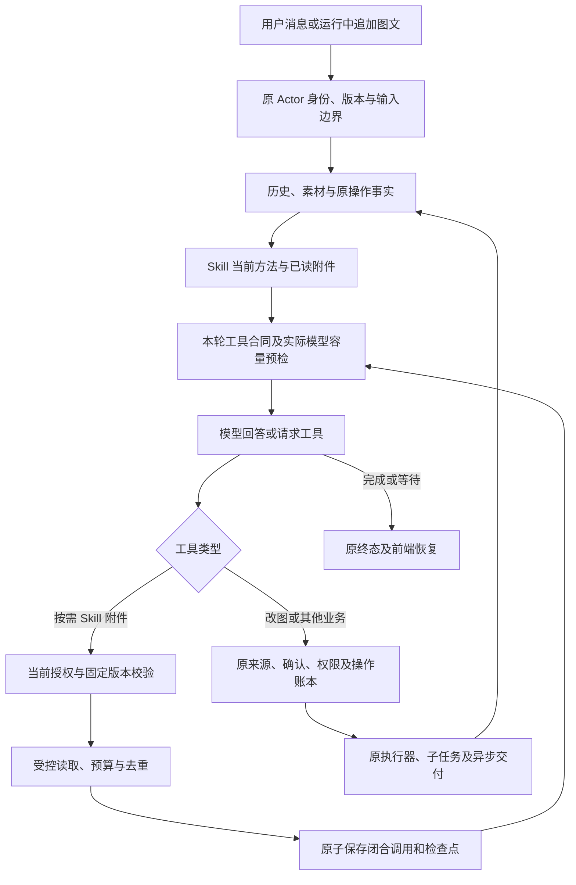

# Skill 与多轮聊天统一接入方案

日期：2026-11-22。任务沿用 `codex/task/20261121005427-skill-runtime-performance`。当前基座 `78cbce12c9e566bbf51f5e932bc68d327483d78f`；由原基座 `d15de2383` 快进接入最新 main 后保留全部 Skill 改动。本地审核和回归已完成，现按用户授权进入受控提交部署；发布结果以 release.sh 的最终记录为准。本方案是当前实施口径；原性能和附件文档保留历史依据。

## 目标与验收边界

减少手动 Skill 准备等待及不必要的长附件输入，使 Skill 契合现有聊天、连续改图和恢复链路。用户要求的聊天与多轮改图能力是硬约束：当前素材、选定成图、改图指令、未改要求、用户确认及原操作身份不能因优化丢失。

本次补齐的是最新主干接入、上下文冲突、测试类型契约、跨机制回归和隔离数据库验证缺口。既有指令包、权限模型、业务执行、操作账本、计费和供应商提交机制继续使用现有入口。不能把源码对照或单次模型样本当成托管 Grok 同任务速度保证。

## 最新代码与官方源码依据

最新主干比原 Skill 基座前进 20 个提交、147 个文件，包含运行中追加素材、单次流清理、独立媒体确认、即时创作/单图编辑、当前模型工具合同及持久纠错。主工作树保持原样；本任务先保存完整补丁、未跟踪文件及哈希清单，再在原任务分支快进并恢复改动，没有创建功能提交或推送。

再次查询确认，Grok Build 官方 HEAD 仍是 `2bdd1d6a6369de0e8c68132ea4539e9abd9e14a8`（公开 CLI/harness，不代表托管服务内部系统）。本轮重新读取 Skill 展开、压缩、目录预算、工具批次、用户追加与图片编辑源码。

| 机制与源码 | 我们采用的机制与适用边界 |
| --- | --- |
| [手选展开](https://github.com/xai-org/grok-build/blob/2bdd1d6a6369de0e8c68132ea4539e9abd9e14a8/crates/codegen/xai-grok-shell/src/session/slash_commands.rs#L1439)、[Skill 读取](https://github.com/xai-org/grok-build/blob/2bdd1d6a6369de0e8c68132ea4539e9abd9e14a8/crates/codegen/xai-grok-tools/src/implementations/skills/skill.rs#L449) | 手选由宿主定向解析固定包/版本，聊天不增加一次“决定是否激活”的模型回合。媒体提示词准备保留独立调用语义。 |
| [文件分段读取](https://github.com/xai-org/grok-build/blob/2bdd1d6a6369de0e8c68132ea4539e9abd9e14a8/crates/codegen/xai-grok-tools/src/implementations/grok_build/read_file/mod.rs)、[内联正文上限](https://github.com/xai-org/grok-build/blob/2bdd1d6a6369de0e8c68132ea4539e9abd9e14a8/crates/codegen/xai-grok-tools/src/implementations/skills/skill.rs#L65) | 使用显式 on_demand 附件，默认 eager 不改；本轮按完整附件读取，原正文不自动截断。分页是另一个版本化读取协议，需要定义切片去重、模板边界与恢复证明，本轮不把通用文件工具直接套到受控 Skill 包。 |
| [目录预算降级](https://github.com/xai-org/grok-build/blob/2bdd1d6a6369de0e8c68132ea4539e9abd9e14a8/crates/codegen/xai-grok-tools/src/types/skill_discovery_tracker/listing.rs) | 现有摘要目录、32 项及字节上限保持。手选优先保留、会话绑定保留；暂不增加授权 TTL 缓存或改变候选排序。大量目录的分层召回属于后续容量优化。 |
| [自动压缩与可选两阶段压缩](https://github.com/xai-org/grok-build/blob/2bdd1d6a6369de0e8c68132ea4539e9abd9e14a8/crates/codegen/xai-grok-agent/src/compaction.rs) | 沿用现有历史治理，按实际模型及重试模型增加最终输入估算和输出预留。超限明确拒绝，不静默删核心方法。Grok 的两阶段功能默认也未开启，不能无样本引入后台摘要费用。 |
| [工具批次、权限与中断](https://github.com/xai-org/grok-build/blob/2bdd1d6a6369de0e8c68132ea4539e9abd9e14a8/crates/codegen/xai-grok-shell/src/session/acp_session_impl/tool_calls.rs#L484) | 原 Registry/Policy、模型合同、审批与业务工具执行继续拥有权限；新增附件读取为内部只读控制动作，整批闭合后保存再进入下一模型轮。 |
| [图片编辑与图片引用](https://github.com/xai-org/grok-build/blob/2bdd1d6a6369de0e8c68132ea4539e9abd9e14a8/crates/codegen/xai-grok-tools/src/implementations/grok_build/image_edit/mod.rs) | 沿用现有 message/content 引用、ContentRecord、inline action、原生任务账本和子任务结果；新用户改图拥有自己的输入身份，恢复仍核对原操作，不用 Skill 执行状态替代业务回执。 |

## 统一职责与运行流程

Skill 原文件和用户运行中上传素材是不同来源。上传资料继续由工作区 fref/原图引用校验；不能用附件 ID 访问任意文件，不能用新上传图片替换已有“编辑底图”而不经过当前来源合同。当前 input/turn 下的工具纠错记录、独立用户确认与已发出操作不能被一次附件读取重置。

## 本次已实施的接入与约束

1. **更新基座并理解双方冲突。** `context.py` 同时保留按需附件已读/未读状态，以及主干对经固定身份审核的参考图 Skill 的尺寸覆盖；同名个人包不获得该覆盖。`CURRENT_ISSUES` 保留双方任务记录。Gateway 单轮流取消时保留会话、真正取消时关闭的修复没有回退。
2. **准备与权限优化。** 手选按 key 解析、发送时捕获精确 package/revision、手选/固定方法旁路可选推荐；同批权限复用一次新鲜任职事实，同步只读查询离开事件循环。仍在激活、附件读取和业务分派边界复查，不做跨请求授权缓存，不把数据库入队写线程化。
3. **按需资源。** 作者显式选 on_demand，沿原 `[[asset:id]]` 使用；正文、核心规则和缺省附件保持完整。只允许当前活跃、未完成退出的固定版本声明附件，校验当前身份、组织、权限、启用分配、正文与清单，再沿原存储核验实际文件。重复读取仍鉴权，不重复追加。媒体与计划任务完整加载回退，旧 Skill 序列化与旧检查点缺省值保持。
4. **恢复与失败。** deprecated 不阻断已有任务读取，新激活仍拒绝；disabled/retired/撤权拒绝。模板参数不因恢复重新改写；已读集合保持，未读不在恢复时突然读取。失败、取消、预算超限和检查点未确认不扩权、不派发同批业务，不自动升级版本。
5. **上下文与最终工具合同。** 在最终模型输入上估算正文、附件、历史、工具和输出预留，实际重试模型重新检查，未知窗口只记录不编造上限。普通聊天、媒体、计划任务及预算总结均接通；private flag 不发给 Provider。模型工具投影不替换 Policy 的规范 ToolSpec，新的错误修复次数与来源证明继续持久化。
6. **正式回归与类型。** 尺寸测试使用真实 ActiveSkill 缺省模型，覆盖旧数据可读及新附件状态。原真实 Gateway 运行中追加图文测试、视频确认测试均增加已加载 Skill 场景。额外覆盖模型主导循环的同批业务屏障、检查点失败保留当前纠错状态、平台尺寸规则与按需状态共存，以及加载 Skill 后连续两次选择不同成图进行编辑的原稿编译：每次引用当前成图，保留未改要求，原方案与原素材不被改写。该编辑测试验证实际 ContentRecord/规范输入编译，不冒充供应商生成验收。
7. **验证环境。** 共享图片/任务数据库测试在未显式设置专用 DSN 时，用已有 fixture 创建独有 Unix socket、关闭 TCP、initdb/start/stop 自己的集群，不咨询 DATABASE_URL、不连接不明固定 socket。显式 DSN 保留原固定 socket 门禁；安全回归验证错误配置在任何 SQL 前拒绝。这里只应用合成测试 schema 与迁移，不连接生产。

产品代码相对最新主干的改动包含 Skill 优化、调用前容量标识及本轮复现的 legacy 历史去重修复；图片编辑、素材绑定、独立确认、原生账本/计费和业务恢复逻辑保留主干实现。不能用旧样本或文字“已启用”证明新图已经派发、完成或交付。

## 验证漏斗与验收矩阵

先检查三方合并、实际 diff、上下文与类型；再执行定向跨机制和隔离数据库测试；随后扩大到 Skill、聊天主循环、模型路由/重试、原生来源、改图/重生成、确认、输入追加、恢复、权限与前端状态。新增变更或失败才重跑相关组，不把无关全量运行作为正确性的替代。

| 组合 | 预期保持的事实 |
| --- | --- |
| 普通聊天与只写提示词 | 不因 Skill 开始就启动图片/视频操作，正文按原交付逻辑显示 |
| 运行中追加图文 + 已读附件 | 同一任务/原 Gateway 会话继续；新素材按当前身份及文件版本投影；方法正文不重复 |
| 指定生成图再次编辑 | 沿用户选定成图的 message/content 引用，保留未改要求；不重新解释为旧策划重生成 |
| 多轮改图/再生成 | 新用户输入与模型/网络恢复身份分开，真实回执与既有 effect fences 决定是否新派发 |
| Skill 读取 + 业务工具同批 | 受控读取后保存闭合消息；业务不能抢跑 |
| 用户逐项确认 | Skill 加载不授权未确认视频或其他条目，已确认兄弟项不替代当前项确认 |
| 参数错误 + 附件读取 + 恢复 | 原输入版本、纠错次数及已闭合回执保留，不因读取重置预算 |
| 弃用/禁用/撤权/篡改 | 原固定版本可继续的语义与安全拒绝边界分别验证 |
| 媒体完成/受理未知接续 | 沿原操作核对、等待或交付，不用新工具 call ID 重发 |

当前证据：定向正式跨机制/内容/隔离门禁组 **157 passed**；第一组真实数据库及 Skill 运行时 **110 passed / 18 skipped**，跳过为缺失私有样本，已不因缺省 DSN 跳过。最终主批次 **2,261 passed / 38 skipped / 0 failed（84.22 秒）**。之后补充连续两次改图的编译检查及当版文件 IO 输出，定向 **5 passed**（其中 1 项新用例，其余与主批次重叠，不累加）。前端六组 **224 passed / 4 skipped**；TypeScript 构建、改动前端文件 lint、git diff --check 均通过。38 条后端跳过分别为 7 条显式付费模型项、6 条另需显式隔离 Actor 数据库的计费/检查点项、22 条私有原稿/原图/历史样本项、3 条已替换的旧编排项。跳过不视为通过。

实际运行的 PostgreSQL 覆盖了 Skill 分配/版本/撤权、339 组合与任务状态检查点、用户追加事件、连续任务接续及内容对象。本轮测试自行创建和销毁集群，既有固定 socket 未连接、未停止。主工作树未修改，全部改动在原 Skill 任务工作树。

原始结果：`/tmp/skill-current-main-regression.txt`、`/tmp/skill-current-main-frontend.txt`、`/tmp/skill-current-main-final-probes.txt`、`/tmp/skill-current-main-file-benchmark.json`。真实图片供应商、生产端到端和新主干付费模型速度尚未验证，不能宣称线上验收完成。

## 2026-11-22 再次全调用链审核

本轮从 HTTP 接收/幂等、Actor claim、上下文投影、模型会话、工具分派、异步媒体任务、检查点和前端恢复回查，并扩大运行整个后端和前端离线测试集。源码比对仍以本方案记录的最新 main 为基准；未恢复旧主干已经移除的自动方法绑定和旧内容选择协议。

发现并修复的产品问题：

- **保存后的中断不能回滚已提交事实。** 普通聊天没有 TaskState/bootstrap 时，附件读取检查点成功后收到 pause/cancel，或交付回调抛错，旧异常处理仍回滚内存中的 Skill 与消息。现在以原 Runtime 的 `replay_save_sequence` 区分是否确认保存：保存前失败恢复原投影，确认保存后保留闭合调用、已读附件与检查点，恢复读取同一事实。正式回归覆盖暂停、取消、交付失败、保存失败与同批业务不派发。
- **普通聊天控制批次也必须闭合保存。** activate/deactivate/read 均进入现有原子控制批次；先消费 BEFORE_TOOL 的待处理取消但不持久化未配对 assistant，再保存完整调用/回执。保存失败不会留下可被恢复模型误读的悬空工具调用，排队取消不读文件。
- **历史去重必须在来源注解之前。** legacy 历史的当前输入附上正文来源定位后，与当前用户原文不再相等，导致重复输入。现从最新持久化消息原文判断，只移除本次一条，再追加来源定位；相同的旧“继续”仍保留。固定 revision 历史不按当前文本去重。正式回归含带 ID 的真实投影和 HTTP/隔离数据库调用链。

回归基础设施与旧测试契约同时修正：详情页测试显式启用自身模拟 Gemini 环境，生产禁用开关保持；策划测试使用最新 resolver owner/尺寸接口；电商入口测试显式会话绑定方法并验证当前 Skill 组合检查点，不再要求业务路由替用户暗选方法；任务检查点测试采用当前 observed_history/stop_message，不恢复废弃选择函数。企微真实并发测试改为专属临时数据库加载原 116 RPC，50 路创建只产生一个用户和一笔赠送，合并测试继续检查积分和引用。子进程测试使用明确 backend 导入路径；前端使用任务工作树独立依赖解决 PDF worker 的 Vite 文件边界，不改应用依赖清单。

| 调用链边界 | 本轮核对与证据 |
| --- | --- |
| 接收、权限、幂等与排队 | conversation 鉴权先于 Skill 解析；捕获精确包/版本；拒绝选择保留 409 与槽位释放；取消准备不写消息 |
| 普通聊天与历史 | 原文及来源定位保持；最新输入仅去重一次；固定 revision 保留同文历史；原工具调用协议闭合 |
| 运行中追加素材 | 当前 Gateway 会话保留，新增图文沿原身份与资源校验；已加载 Skill 场景继续运行既有 steer 测试 |
| 连续多轮改图 | 原成图引用、ContentRecord、原稿/未改要求、输入版本、独立确认及原生账本保持；实际供应商交付仍需上线验收 |
| Skill/业务混合批次 | Skill 控制构成屏障，完整保存后下一轮再请求业务；取消或未确认保存不派发业务 |
| 权限与其他工具 | 同批读取共享新鲜任职，不缓存到下批；业务工具仍经原 Policy/身份/资源合同；真实 RLS 与撤权测试 |
| 恢复、错误与媒体 | 原 token/lease/操作回执与计费入口保持；已提交投影不错误回退；未提交投影不能进入恢复 |
| 其他业务与前端 | 全后端离线回归、全前端测试、TypeScript/Vite 构建与 PDF worker 检查；跳过和外部服务不冒充通过 |

首轮全后端发现的问题已分别完成复现和分类，不把旧夹具/导入环境失败当成产品错误，也不降低产品权限、确认或检查点约束来通过测试。

额外发现**测试进程退出崩溃**：全量断言输出 `15,599 passed / 259 skipped / 4 xfailed` 后，进程返回 -11，不能记为整条命令通过。macOS 崩溃栈指向 `_time_machine_time` 在生成器最终回收时调用已退出的模块；独立最小复现同样 -11，提前正常 `gc.collect()` 返回 0。已在测试 `pytest_unconfigure` 阶段正常回收不可达循环引用；但单靠 GC 不能关闭仍被模块持有的连接池。进一步用“聊天历史 + 时间测试”独立复现，定位 `test_chat_context.py` 的 handler 夹具在完成回答时运行真实指标回调、意外创建全局知识库异步池；现只在该组上下文单元测试中隔离这个非测试目标的指标回调，应用指标实现、独立指标测试和生产配置均保持。测试公共夹具进一步在当前测试事件循环仍可运行时关闭该循环拥有的真实知识库池，并释放对应缓存；通过 worker 任务的 loop 身份确定归属，不关闭其他循环/作用域或模拟注入池，不依靠解释器退出清理。新增正式 `test_test_process_shutdown.py` 三个子进程回归，分别验证原生时间钩子的循环引用清理、实际聊天历史/时间测试正常退出，以及真实知识库池在当前测试结束后关闭、不泄漏到下一测试。修复前红，单组聊天/知识库/时间扩查 **739 passed / 46 skipped / exit 0**；最终资源归属和相关服务组 **176 passed / 3 skipped / exit 0**。不改应用时钟、不升级共享依赖、不强制退出、不忽略测试码；最终使用标准 `python -m pytest` 完整复跑：**15,602 passed / 259 skipped / 4 xfailed / 0 failed / exit 0（508.84 秒）**，原生退出崩溃已消失。本轮未通过强制退出、禁用时间测试或忽略错误码放行。

真实 Redis 补充：专用固定 socket 确认未占用后，由本次进程启动 `--port 0` 的独有 Redis，用真实临时 PostgreSQL 补跑图片/详情页并发、出站故障、终态槽位修复及重启恢复等 **156 passed / 3 skipped / exit 0（最终按新夹具复跑 21.96 秒）**。其中 56 项是主批次因未提供 Redis 而跳过的项，其余与全量重叠，不相加；3 项仍要求另一个显式 PostgreSQL 检查点 fixture。只停止本次持有的 Redis 子进程，socket 已清理；未复用应用 Redis 或已有 PostgreSQL。

前端全量 **244 文件、2,774 passed / 4 skipped（52.48 秒）**；TypeScript/Vite 生产构建与 PDF worker 检查通过。4 项 xfail 是原附件路由基线中的工具描述和 system prompt 待办，不能当成已修复；条件跳过也不视为通过。私有原始素材、独立服务配置、真实付费模型/图片供应商及线上完整验收仍有明确验证边界。原始结果存于 `/tmp/skill-whole-backend-final.txt`（断言结束但退出异常）、`/tmp/skill-extra-redis-review.txt`、`/tmp/skill-all-functions-frontend-private.txt`、`/tmp/skill-all-functions-build.txt`、`/tmp/skill-shutdown-red.txt`、`/tmp/skill-shutdown-green.txt`、`/tmp/skill-pool-owner-cleanup.txt`、`/tmp/skill-whole-backend-verified.txt`（最终全量及正常退出）。

## 性能取舍与观测

继续复用有界私有生命周期记录：接收/claim、上下文、Skill 解析/权限/正文/附件、模型槽位、首字、工具、持久交付分别看，不相加嵌套阶段，也不记录正文、资源路径或密钥。正确性先于单个首字指标。

旧基座合成实测只作为机制依据：不用附件的输入 9,011→996 token，回答约 998→707ms；必需附件的回答约 1,360→1,922ms，因为多一次模型往返。新主干不冒用这些数值为现版本速度报告。本轮在最新基座重测真实不可变文件 IO，每场景 12 次：立即全读 17 次/4,670,253 字节，中位准备 16.591ms；按需初始 1 次/3,221 字节，2.932ms；按需激活并读取一个附件 4 次/589,842 字节，7.552ms。该值仅包含合成文件的准备和校验，不是 HTTP/排队/模型/图片供应商端到端时延。未来线上验收要用同模型、同资料的短 Skill/长 Skill、初次和热请求，以及多轮改图 p50/p95，并保留成功率与费用。

## 兼容、发布与回滚

无产品数据库迁移、无新依赖、无权限缓存、无自动改写已发布 Skill。on_demand 必须由作者发布新 revision 才生效，默认 eager。新字段缺省值省略，旧内容和旧检查点维持原形。

新的 on_demand manifest/deferred checkpoint 不能交给不认识协议的旧二进制；回滚需先完成或取消新任务，或采用兼容读取版本，不能删字段伪造兼容。新增测试隔离机制仅作用于 pytest，不进入应用配置。本轮修正 pytest 的连接池归属和进程收尾，不改变生产消息反馈、采样等后台任务的调度。

部署仍走项目受控 release 入口，须用户明确授权。本地审核期间未部署、未执行生产迁移或新增付费模型/图片调用；本次提交部署沿受控入口执行，业务验收待用户线上测试。
