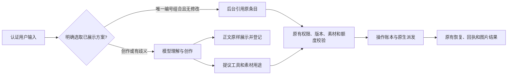

# 真实失败链路修复、职责边界与 Grok Build 对照

日期：2026-11-22。本轮只在任务工作树开发和验证，不回退或部署生产。

## 源码基准与比较边界

本项目基线为 `e084259011dbcbfec739dbc476510696bc0ba265` 加本轮 diff；修改前/后诊断见 [版本对照记录](TEST_Skill回归版本对照_20261122.md)。

通过 agent-reach 的 GitHub/gh 后端重新查询官方 main，仍为 `2bdd1d6a6369de0e8c68132ea4539e9abd9e14a8`。完整递归树共 5102 项、未截断；按实际调用链核验 33 个源码文件的 Git blob SHA，清单在本地 `/private/tmp/grok-chain-audit-20261122/manifest.json`。以下链接全部固定到该提交，不把后续版本混入结论。

Grok 的通用 Agent、Skill、工具和恢复循环可供对照，但没有把其计划文件/会话持久化视为本项目“商品方案整组编号＋原图绑定＋异步扣费任务”的同等业务实现。尤其其 image_edit 的附件 token 解析明确限制当前消息附件，不能照搬后撤掉我们的跨轮素材与成图引用。

## 逐项对照与职责

| 环节 | Grok Build 可核对实现 | 本系统职责和处理 |
| --- | --- | --- |
| Skill 调用 | [skill.rs](https://github.com/xai-org/grok-build/blob/2bdd1d6a6369de0e8c68132ea4539e9abd9e14a8/crates/codegen/xai-grok-tools/src/implementations/skills/skill.rs) 的 build_skill_message 统一注入正文 | 模型选择方法；后台加载、版本校验、工具过滤；Skill 不授予业务权限。保留现有目录、激活和恢复实现。 |
| 工具目录 | [tool_list.rs](https://github.com/xai-org/grok-build/blob/2bdd1d6a6369de0e8c68132ea4539e9abd9e14a8/crates/codegen/xai-grok-agent/src/tool_list.rs)、[tool_calls.rs](https://github.com/xai-org/grok-build/blob/2bdd1d6a6369de0e8c68132ea4539e9abd9e14a8/crates/codegen/xai-grok-shell/src/session/acp_session_impl/tool_calls.rs) | 仍由 catalog/policy 决定权限。明确的单图编辑只保留已能原子保存稿件的 inline 图片入口，不再暴露竞争的保存协议；复合交付、已有稿件修订、批量方案保留保存工具。 |
| 普通聊天和正文 | [streaming_capture.rs](https://github.com/xai-org/grok-build/blob/2bdd1d6a6369de0e8c68132ea4539e9abd9e14a8/crates/codegen/xai-grok-shell/src/session/streaming_capture.rs)、[turn_end.rs](https://github.com/xai-org/grok-build/blob/2bdd1d6a6369de0e8c68132ea4539e9abd9e14a8/crates/codegen/xai-grok-shell/src/session/acp_session_impl/turn_end.rs) | 模型创作并输出原文；后台负责页面投影、存储与编号。保留普通聊天流，不把写“生图正文/生图提示词”误判为实际生图。 |
| 方案编号 | 已核对的通用会话/计划机制不是本项目的编号业务契约 | 明确创作请求的编号标题＋普通段落由后台登记；普通解释/问答不因有编号就变为执行成果，代码围栏内的示例编号也不推断为独立条目。正文与展示间隔分别保存，已识别的比较表留在展示层，不截断执行限制。修订/导入继续使用原有校验入口。 |
| 图片引用 | [image_edit/mod.rs](https://github.com/xai-org/grok-build/blob/2bdd1d6a6369de0e8c68132ea4539e9abd9e14a8/crates/codegen/xai-grok-tools/src/implementations/grok_build/image_edit/mod.rs) 的 resolve_attachment_reference | 模型表达编辑要求、选择素材；后台验证用户/组织/会话、固定历史、真实文件、版本和哈希。新增画布绑定从已认证用户消息的明确目标取得，不能由模型 prose 或引用顺序替代。 |
| 画布与默认值 | 同一 image_edit 源码单图沿用底图，多图默认为 auto | 本项目继续遵守既有约定：默认 1K、无参考图 1:1、有底图匹配最近支持比例；没有把 Grok 的多图 auto 照搬进来。用户明确指定“图二”时按真实引用定位，即使执行素材换序也不改变画布；不会为了消除比例冲突而把图一从 input 强制改为 analysis；素材用途仍按经校验的模型选择保存。明确像素、用户比例、不可用尺寸等原有校验不放宽。 |
| 工具错误 | [tool_dispatch.rs](https://github.com/xai-org/grok-build/blob/2bdd1d6a6369de0e8c68132ea4539e9abd9e14a8/crates/codegen/xai-grok-shell/src/session/acp_session_impl/tool_dispatch.rs)、tool_calls.rs | 保留可信 ImageSizeError 的具体原因；补充到现有持久纠错预算，与 Schema 错误共享上限。纠正 SIZE_GUIDANCE 将 inherit_reference 写到 aspect_ratio 的矛盾。 |
| 保存失败循环 | [run_loop.rs](https://github.com/xai-org/grok-build/blob/2bdd1d6a6369de0e8c68132ea4539e9abd9e14a8/crates/codegen/xai-grok-shell/src/session/acp_session_impl/run_loop.rs)、[stop_gate.rs](https://github.com/xai-org/grok-build/blob/2bdd1d6a6369de0e8c68132ea4539e9abd9e14a8/crates/codegen/xai-grok-shell/src/session/acp_session_impl/stop_gate.rs) | 采用本系统自己的明确规则：同一输入的保存失败跨错误类型、跨读取工具计数，三个失败即结束纠错；草稿冲突保留更紧的两次限制。读取、换调用 ID 和恢复不能重置，新用户输入或保存成功才重置。 |
| 运行中追加 | [interjection.rs](https://github.com/xai-org/grok-build/blob/2bdd1d6a6369de0e8c68132ea4539e9abd9e14a8/crates/codegen/xai-grok-shell/src/session/acp_session_impl/interjection.rs) 在工具后、循环顶部、结束前排空追加，并有取消恢复保护 | 保留 Actor 控制事件、附件绑定和安全点。持久化已成功的回执先于尽力唤醒；回执只表示已入队，不等于已应用。任务完成竞态返回有作用域且无原事件的 window_closed，前端转正常新消息；未知回执保留原 request_id 核对重试，禁止另建业务消息。 |
| 权限/审批 | [hub_gate.rs](https://github.com/xai-org/grok-build/blob/2bdd1d6a6369de0e8c68132ea4539e9abd9e14a8/crates/codegen/xai-grok-workspace/src/permission/hub_gate.rs)、[source_identity.rs](https://github.com/xai-org/grok-build/blob/2bdd1d6a6369de0e8c68132ea4539e9abd9e14a8/crates/codegen/xai-grok-permission-rules/src/source_identity.rs) | 没有新增授权来源。编号目录不转移所有权；真实后续 Turn 必须沿原 adopt RPC 转移，原生派发仍执行 ToolPolicy、资源/要求版本栅栏、额度和操作账本。 |
| 恢复/追加后的重放 | context_snapshot.rs、turn_end.rs、cancel.rs 与 interjection 的 Guard | 新的普通正文登记也先把完整输出写入原有有界私有 journal，再原子提交成果、展示和 committed 状态。仅恢复同一输入的纯文本；不会经纯文本 journal 重放生图/业务调用。编号选择的恢复使用真实捕获的用户变更和原调用 ID 的 continued 派生，不能再让模型重写方案。 |
| 思考关闭 | [reasoning_effort.rs](https://github.com/xai-org/grok-build/blob/2bdd1d6a6369de0e8c68132ea4539e9abd9e14a8/crates/codegen/xai-grok-shell/src/agent/mvp_agent/reasoning_effort.rs) | 各家协议的开关仍按本系统现有 provider 合同处理；本轮没有恢复隐藏 low 思考。真实 Qwen Responses 关闭模式继续发送 effort=none。 |

## 两个真实失败场景的完整链路

1. 写作：真实用户创作请求 → 模型自然语言完整输出 → index_document 的受限 plain 路径 → 原始正文 proposal checkpoint → 原 save/commit_projection → Actor 事件 → 前端重复回放去重/渲染/刷新 → 下一轮只引用 artifact_id、item_index。
2. 编辑：真实用户“给图二加波点” → 模型 inline draft/真实素材引用 → 原生解析和权限核验 → 用户目标绑定到素材的 message_id/content_index 或已验证 occurrences → 图二真实尺寸 → 最近支持比例 3:4、默认 1K → 冻结请求和原生派发边界。模型排序、尺寸猜测、风格图的比例都不能覆盖明确底图。
3. 原稿/后续执行：新的 PostgreSQL 回归使用真实五条原文，保存并结束原回合，再创建真实新回合、执行 adopt/capture、恢复 user_changes；断言不发生新的模型采样，直接恢复第 1、3 条，且执行正文逐字等于已展示原文。既有手工范围导入用真正无编号的历史标题继续测试，没有移除该兼容入口。

## 编号明确时由后台负责的确定性入口

真实模型串联中额外发现：后台目录已具备完整方案，但模型仍可能只说“已提交”而不调用工具（`fixed-chain-off-6`），原有保护会拒绝这一说法，但用户仍无法执行。这不是保存 schema 能解决的缺口。

现在只有以下条件全部成立时，后台直接提议普通 `generate_image(content_source)` 调用：用户本轮是纯文本，全文仅明确选取至少两个不同编号并要求生成图片；没有追加要求、附件、改写、尺寸、再次生成或复合交付；只有一个有效目录组；最后展示的正文绑定同一个 artifact；所有条目均能沿原编译入口解析；当前已授权工具中存在 generate_image，且不是服务器主图策划模式。顺序保持用户列出的顺序，不由模型重排。

这不是新业务执行器：提议仍进入原 `_execute_tools`、adopt/capture、ToolPolicy、要求版本、素材核验、额度及原生操作账本。已有调用历史或图片完成事件时不再次自动提议；中断恢复优先使用原来的待执行调用，失败不自动重派。只要存在歧义或修改要求，就回到原模型路径。多轮改图没有套用该入口。

模型负责理解、创作、修改内容和有歧义的来源选择；后台负责编号登记、明确选择的原文读取、真实文件/尺寸、权限、操作状态、页面投影与恢复。没有把 Grok 的工具实现替换进本系统，也没有用模型自由操作替代后端登记。

## 追加要求竞态的证据和修复边界

此前 QA 会话的原任务于 11:15:11.448 完成，追加于 11:15:11.816 在 append_conversation_steer 被 ACTOR_STEER_SCOPE_MISMATCH 拒绝，控制事件为零。旧代码把无附件的这类已知拒绝上抛并断开连接，前端只能报告未知。

新处理不改写 SQL、不接受已经结束窗口的旧授权：后台重新核对任务别名、用户、组织、会话、Actor 标记、终态及相同 request_id 无原事件后才能返回 window_closed。客户端只在此明确未入队的回执下走正常新消息 API，重新获得输入锚点和权限；若已有原事件或状态不明则只核对原回执，不另建消息。附件在切换路径前还原到同一提交快照，避免丢附件或重复送达。

## 验证原则与限制

正式回归包含脱敏的真实失败原文和真实 Actor 事件 fixture，非人为要求模型使用 document 的理想输入。无新附件的“把第2张图片改成蓝色”继续沿历史成图定位，不强制要求当前附件；本轮确有新附件却指定不存在序号时仍拒绝。权限/恢复用现有临时 PostgreSQL/Redis 隔离测试；不连接生产库写入。本地真实模型验证使用原对照输入、原图字节和自然语言请求，另外串联新生成的方案与下一轮编号选择；图片供应商派发被截停，因此只证明请求准备、引用和派发前逻辑，不声称验证了供应商最终图片的视觉质量。

原始证据、无效的测试程序实验及其修正均保留在私有临时目录，不把测试替身错误计为产品失败。结果与最终检查见本轮测试记录及 CURRENT_ISSUES；未部署，不以旧 SHA 的检查放行本地新差异。
