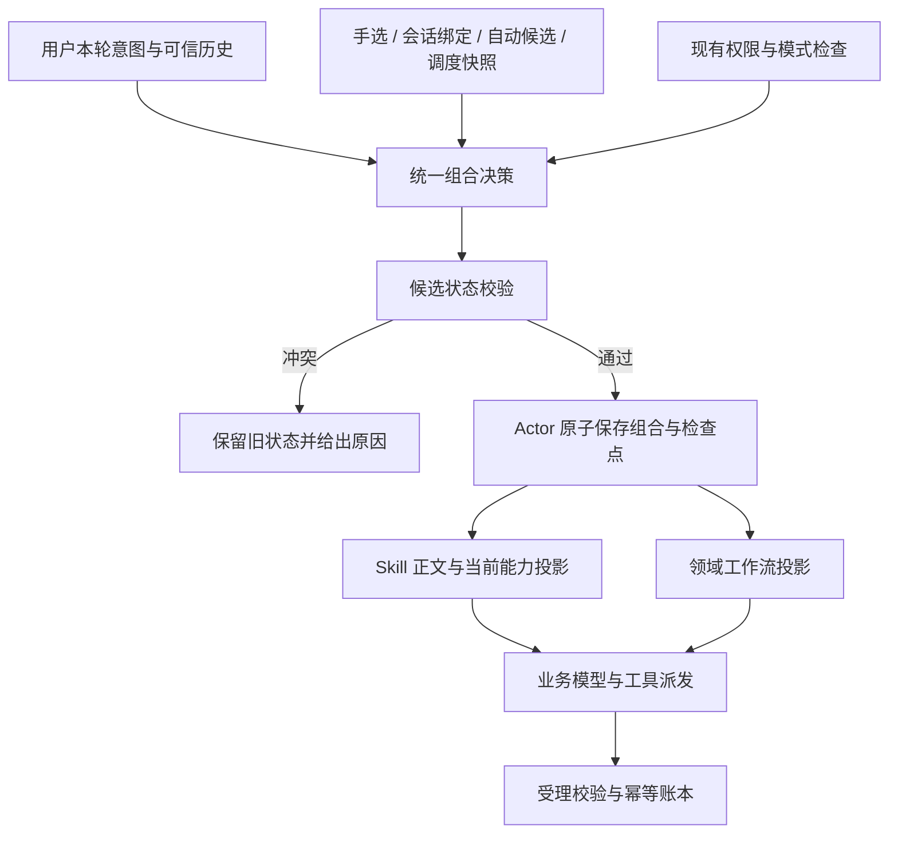

# Skill 统一协调与兼容修复方案

- 日期：2026-10-29。
- 状态：修订版 v2，已回应[工程与用户体验评审](EVAL_Skill协调机制工程与用户体验评审.md) 的 D1–D3、U1–U4；可作为后续实施输入。存量库存、功能回归和用户验证仍为实施/发布前置证据，本文件不代表代码已实现、测试已通过或生产已发布。
- 代码基座：`9511ac63e92ec08011f45146ddb51bed1237f889`，从最新 `origin/main` 创建的独立任务工作树。
- 目标：治理用户手选、系统推荐/自动激活、会话绑定、计划任务和恢复入口之间的流程冲突；保留已有功能、权限和业务受理约束。
- 范围：协调机制、触发本次事故的图片角色与 DashScope 协议缺陷、配套兼容及回归。不是全系统重写，也不引入新的模型、外部服务或 Agent 框架。

### 修订记录

| 评审项 | 本版落实位置 | 修订结果 |
| --- | --- | --- |
| D1 当前动作与控制权 | 3.1、3.2、3.5、4.4 | 加载、适用、控制三个状态分离；控制权按本轮动作及阶段生效。 |
| D2 可选候选隔离 | 3.3、4.1 | 必须集合整体成立；可选冲突仅拒绝相关候选及真实依赖项，最终状态仍一次原子提交。 |
| D3 旧版本处置 | 6.1 | 明确存量决策表与上线覆盖门槛；未核清的既有自动组合不被静默禁用或当成兼容。 |
| U1 冲突恢复 | 4.3、7.1、7.2 | 区分确定拒绝与结果不确定；提供对应调整动作，不一律刷新重试。 |
| U2 保留输入 | 7.3 | 恢复绑定原始任务输入、方法与受理账本，不重传、不以追问截图替代原图。 |
| U3 作者易用性 | 6.1、7.4 | 使用已有执行协议不必改后端；保留个人发布权限，内部契约不要求用户手写。 |
| U4 固定方法适用性 | 3.5、7.1 | 固定身份和权限仍有效，不要求每个新话题执行完整业务流程。 |

## 1. 结论与约束

在现有 `SkillRuntime` 内统一管理 Skill 组合，在现有 Actor 内统一提交执行状态；领域工作流只执行统一决定，不再独立建立相互矛盾的控制身份。

保留多个 Skill 的组合能力。需要互斥的是同一任务阶段的执行控制权，不是 Skill 数量，也不是所有不同的提示词。知识、格式、风格等辅助方法可组合；控制同一阶段的两种不同执行方法须经过受控交接。

协调器采用声明式契约和确定性校验，不增设一个模型裁判来审批每次激活。模型可建议适用方法，但不能通过自己的文字改变权限或已保存执行身份。

本方案保证可定义的系统不变量，并以真实案例及兼容矩阵验证；不声称能自动证明任意未来 Skill 自然语言正文之间完全无矛盾。契约准确性、发布校验和新增 Skill 评测属于长期有效机制。

### 1.1 需求编号

| 编号 | 必须满足的结果 |
| --- | --- |
| R1 | 用户明确选择的方法适用且有权限时执行该方法；自动匹配不能静默替换它。 |
| R2 | 无手选时，保留自动推荐、发现、模型激活及退出；手选后仍可补充兼容的辅助方法。 |
| R3 | 同一执行作用域最多有一个控制者；不同作用域可组合，切换须校验且留下状态。 |
| R4 | 提示词、工具范围、工作流身份和业务受理看到同一份组合决定。 |
| R5 | 不扩大组织、用户、工具、模式权限；不绕过审批、素材核验、付费受理与去重。 |
| R6 | 会话固定、计划任务、媒体入口、暂停恢复、重试和重新生成行为保留。 |
| R7 | 旧 Skill 内容、版本、哈希和旧任务检查点可读；恢复不自动升级或重新分类。 |
| R8 | 本次商品角色误判、工具 ID 超长被修复；错误不再错误归因给用户。 |
| R9 | 拒绝冲突或提交失败时状态不发生部分变更；对话可以解释原因并接受下一次用户操作。 |
| R10 | 发布前以功能矩阵验证，不用单个案例成功替代全链路兼容证据。 |

## 2. 已确认故障与现有调用链

### 2.1 生产事实

2026-10-29 15:11 的请求手选 `ecommerce-image-prompts`（完整融合版），传入两张商品图，要求五张拼多多详情图：

1. 五次 `generate_image` 被 `ECOM_WORKFLOW_ENTRY_REQUIRED` 拦截；没有进入实际生图受理。
2. 接着自动激活 `ecommerce-main-images`，两套正文同时在活动集。
3. `plan_ecommerce_images` 传入的角色均为 `product/商品图`，被当成没有商品参考图，237ms 返回失败。
4. 15:16 用户追问，当前轮激活不适用 Skill 被拒绝；随后的 DashScope 请求含 88 字符 `call_id`，超过接口返回的 64 字符限制。
5. 该会话查询到的任务均为聊天任务，策划表无该会话记录；没有可以续接的图片子任务。

原始用户附件、完整会话及服务器日志不复制到版本库。上述事实来自本对话前序只读调查；实施前要确认候选代码和部署版本的相关差异。

### 2.2 根因位置

| 位置 | 当前行为 | 失效的约束 |
| --- | --- | --- |
| `services/agent/image/ecommerce_planner/workflow.py::initialize/barrier` | 非服务器策划 Skill 的手选跳过初始化识别，直到生图时补做识别并强制另一套方法 | 执行方法应在业务模型/工具派发前协调 |
| `services/skills/runtime.py::_activate` | 校验身份、内容、预算与工具上限，但没有跨 Skill 的流程控制权契约 | 可加载不等于执行方法兼容 |
| `services/handlers/chat/execution_engine.py` | 分别应用 Skill 上下文、工作流身份、批次屏障 | 提示词和执行拦截可能来自不同决定 |
| `services/handlers/image_handler.py` | 根据活动 Skill、已尝试方案及 `_ecom_workflow` 再次要求 `plan_source` | 只改前面的路由仍会在受理层失败 |
| `services/tools/definitions/ecommerce_planner.py` | 描述使用 `product/商品图`，角色为宽松字符串 | 工具示例和程序约定不一致 |
| `services/agent/image/ecommerce_planner/service.py` 与 `inputs.py` | 两份商品角色判断不同，`detail` 也不一致 | 同一语义应共用解析器 |
| `services/adapters/dashscope/responses.py` | 原样转发内部调用 ID | 内部身份与供应商传输约束未隔离 |
| `services/handlers/chat/stream_setup.py` | 随 `web_search` 当前授权选择 Responses 或 Chat Completions | 协议切换必须兼容同一工具历史 |

### 2.3 现有机制必须复用

- `SkillSelection` 仅传身份和版本；`SkillIntent` 保存用户选择，不能承载客户端授权。
- `activate_manual/activate_session/activate` 已共享底层激活路径。
- 工具范围为宿主权限和各方法约束的交集；`required_capabilities` 已支持能力要求。
- 推荐是可选提示，推荐服务失败不阻止普通聊天；推荐不是激活事实。
- 手选、会话固定和计划任务方法不能由模型随意退出。
- 同批 Skill 控制调用与业务工具之间已有屏障。
- `RuntimeCheckpoint` 目前只接受 v1；恢复核对版本、正文/附件哈希和原权限。
- 计划任务快照仅接受 v1，禁用运行时动态发现；媒体入口 `explicit_only=True` 且不提供业务工具。
- Actor 安全点、执行 token、租约和数据库锁负责所有权；复用它们，不能另设一套并发锁。

## 3. 推荐系统模型



统一的是决策事实和提交边界，不要求所有功能经过一个巨型业务类。协调模块不派发业务工具、不接管图片队列、不替代 `ToolPolicy`。

### 3.1 发布契约：描述执行控制权

在不可变版本的 `catalog_metadata` 增加可选 `coordination` 契约。字段建议如下，实施可调整命名但不能改变语义：

```yaml
coordination:
  version: 1
  kind: workflow                 # guidance 或 workflow
  claims:
    - scope: image.planning
      method: ecommerce.inline
      actions: [plan]
    - scope: image.submission
      method: image.direct
      actions: [execute_prompt]
```

- `guidance` 没有控制权声明，用于知识、风格、格式辅助；仍遵守原工具上限。
- `workflow` 声明其**可能**控制的阶段与动作。scope 是有命名空间的语义范围；method 是执行协议，不是特定 Skill 名字。`actions` 来自宿主支持的动作，不接受可执行条件表达式。
- 只有与当前 `ActionContext` 匹配、且被协调结果选作控制者的声明才占用 scope；加载一个 Skill 不等于永久占用其全部声明。同一动作/阶段、同 scope 的两个不同 Skill 不能同时成为控制者；同一身份重复激活为幂等。不同 scope 可以组合，但须检查跨阶段输入输出与依赖。
- 参与提供知识、文案或风格意见不等于控制流程。提供建议的参与者不能决定是否派发、改变受理方式或替换控制者；不能仅因两个专业方法都参与设计就判互斥。
- 支持不同专业阶段顺序协作，不允许通过换个 scope 名绕过已有业务约束。业务执行 method 必须被宿主注册的流程实现识别。
- 声明不授予工具、网络、付费、计划任务或图片提交权限。普通/个人 Skill 的自声明不能取消宿主要求的审批或 `ready` 校验。
- 不提供任意正则、可执行表达式或不断增长的 Skill 两两黑名单。已知替代关系写为 method/scope 契约及宿主允许的转移关系。
- 非工作流辅助文本不需要被强制改造成流程；新增会控制派发顺序、提交协议的 Skill 必须显式声明，经过发布校验。

首批登记 `ecommerce.inline`（完整融合版的聊天策划）、`ecommerce.server_plan`（服务器三阶段策划）及相应提交方法。二者争用 `image.planning`；服务器策划必须使用已验证 `plan_source`。其他领域不凭本次案例猜测登记，先以库存核对结果补齐。

宿主可以提供默认普通工具执行路径，不要求无 Skill 的任务虚构一个 Skill 控制者。默认路径也受现有 ToolPolicy 与业务受理约束，不能借“无控制者”绕过已绑定方案。

### 3.2 运行事实：SkillComposition

建议在 `SkillRuntime` 保存版本化、不可变的 `SkillComposition`：

| 字段 | 含义 |
| --- | --- |
| `version` | 组合快照格式版本，初版 1 |
| `revision` | 本任务单调递增的组合修订号 |
| `participants` | package ID、Skill key、revision、body/contract hash、来源集合及本轮参与状态 |
| `action_context` | 本轮真实动作、当前阶段、原任务/方案引用和判定依据的稳定标识；不含私有推理 |
| `owners` | 当前动作/阶段中每个 scope 的控制身份及 method；不是所有已加载方法的 claims 并集 |
| `effective_allowed_tool_names` | 复用现有计算得到的上限，不另算一套授权 |
| `workflow_links` | 已有 plan/run/业务任务引用，不复制输出或凭据 |
| `policy_version` | 协调算法及宿主协议注册版本 |
| `transition` | 初始建立/辅助加入/退出/交接及原因，不含模型私有推理 |

同一 Skill 可以同时是会话绑定和本轮手选，来源应为集合，不能只保存一个优先级标签；不能以解除一种来源解除另一种锁定。

任务意图、Skill 内容和执行权限继续分离：`_skill_intent` 不被组合快照覆盖，组合快照也不能替代组织鉴权。

### 3.3 决策规则

1. 先检查真实用户意图、任务模式、身份、开关、目录和版本；不凭附件中的指令建立选择。
2. 所有会话固定方法及本轮手选构成必须保留的集合。在业务模型前一次预检身份、权限及**当前动作实际适用的控制权**；不适用某流程不等于解除方法绑定。冲突不能靠加载顺序解决。
3. 手选适用时选为其当前控制范围的方法。自动候选可以补充兼容范围或辅助能力，不能覆盖已确定控制者。
4. 会话固定与手选对当前动作确实互斥时，不采用“手选永远覆盖固定”，不偷偷解除绑定。说明相冲突的方法并让用户修改相应选择；保留配置。固定方法当前没有相关控制声明时，不能仅因名称不同阻止本轮请求。
5. 无明确选择时，继续现有自动推荐与模型激活。服务器领域路由提出方法候选，也必须经过同一协调入口。
6. 不相关或只执行已有提示词时，不因商品图片、历史电商失败或选中过某 Skill 自动重启整套策划。
7. 计算候选完整组合的权限交集，然后检查**所有**参与者声明的必需能力，包括旧参与者，不能仅检查新方法。
8. 空工具集本身合法，纯文本方法可执行；不能因为没有工具就判冲突。旧 `allowed_tool_names` 是允许上限，不能推断全部为必需能力。
9. 已加载辅助正文后是否产生语言歧义需通过正文评测；静态契约不冒充语义证明。禁止用新的模型裁判任意移除用户明确选择的方法。

当前阶段宿主执行协议确实需要的能力也属于必需条件，例如图片提交所需的受理能力；即使旧 Skill 未声明 `required_capabilities`，也不能因新增辅助方法把该能力收缩掉后仍声称组合可执行。只核验已知协议的真实依赖，不把旧允许工具列表整体升级为必需列表。

可选自动候选使用独立处置结果：`accepted`、`skipped_conflict`、`skipped_dependency`、`unavailable`。不因为一个候选被拒绝就撤销必须集合或无依赖的兼容候选。已接受集合的控制者优先于后续自动候选；同批候选采用持久化顺序和宿主确定性优先级，拒绝结果缓存于当前 action/composition revision，不能循环尝试同一冲突。

依赖来自经验证的版本契约与宿主方法注册，不由模型在工具参数中临时声明。没有明确依赖的两个自动调用，不因它们在同一批次就被当成一个必须共同成功的业务事务。若候选真正是用户目标不可缺少的能力，应作为当前任务的必需条件处理；不能简单标为可选后声称任务已完成。

### 3.4 允许切换，不允许执行中静默抢占

- 尚无业务副作用时，自动方法可依现有退出机制退出，再受控激活其他兼容方法；失败保持原状态。
- 不同阶段的合法交接由宿主登记的转移关系约束，校验所需业务回执及方法输入，不仅检查一个字符串允许关系。
- 用户手选、会话绑定的退出仍需要用户真实意图；模型自己调用不能解锁。
- 已受理图片、已发出的付费请求、结果不确定的工具调用不能被新方法作废。先保持原账本并解释状态，只有明确新请求才建立后续任务。
- 有 `plan_id` 的方案续接沿用原有效方法；不能把直接生图方法绑定到旧 plan 来绕过 `ready`。
- 当前操作是新的用户任务还是原任务恢复，沿用现有受认证入口判断，模型不能用“继续”文字伪造恢复授权。

### 3.5 当前动作与方法生命周期（D1）

分别保存三个事实：`loaded` 表示身份正文已验证并保留，`applicable` 表示本轮动作需要采用其方法，`controlling` 表示当前某个 scope 的唯一控制者。状态不相互替代。保持会话绑定或已加载方法，不要求运行它的全部步骤。

初版采用宿主可识别的有限动作：`plan`（策划/修改方案）、`execute_ready`（执行已保存且验证通过的方案）、`execute_prompt`（执行用户已有最终提示词）、`edit`（局部编辑）、`explain`（询问与解释）、`other`（其他请求）。它们不是全行业流程 DSL；混合任务按当前执行阶段逐步落定，不能把一个已鉴权动作推导为整组未来动作授权。

| 本轮输入与可信状态 | 动作及控制权 | 必须保持的行为 |
| --- | --- | --- |
| 明确新策划或修改商品事实/风格 | `plan`，按明确选择或合法自动匹配建立策划控制权 | 保留原文、图序、用户数量；不能静默采用另一套方法。 |
| “开始生成”，存在该任务 ready 回执 | `execute_ready`，沿用方案绑定方法与受理协议 | 不重新策划、不重复问资料；仍核验 plan/revision/item。 |
| “开始生成”，前文只有已完成的最终提示词、没有服务器方案 | `execute_prompt`，核对真实提示词与用户当前授权 | 不伪造 ready/plan_id，也不强制重做服务器策划。 |
| “按这些提示词直接生成”，有真实最终提示词 | `execute_prompt`，采用已支持直接执行协议 | 不强制重跑商品分析；旧方案待处理受理不能被隐藏。 |
| “为什么失败”“标记是什么意思” | `explain`，不申请策划/提交控制权 | 解释关联任务，不把追问附件当商品图，不启动图片任务。 |
| 固定了电商方法后询问其他话题 | `other`，相关电商声明不生效 | 绑定与工具安全上限保留；无关方法不接管当前回答。 |
| 前文多个方案，“继续”无法确定对象 | 暂不提交付费动作 | 先利用可信任务状态辨识，仍有影响执行的歧义才问最少必要问题。 |

动作判定复用现有任务模式、用户原文、已保存任务/方案证据和既有领域分类结果；不做简单关键词命中，也不另加每次激活必调的语义裁判。模型可提出动作候选，但控制权与业务回执必须由宿主核验。无法确定且会影响付费/方法切换时通过既有控制屏障处理；不假装自然语言总能确定性理解。

实际动作/阶段变化时创建新组合 revision 并原子保存；同一动作下的模型 chunk 不重判、不查库。v2 恢复使用保存的动作，不重新分类；新的用户重试仍按现有认证入口核验。

不适用的流程段由当前上下文明确说明不执行，完整绑定/正文证据仍保留。不得只隐藏标签、删正文或把原权限放宽来伪装流程退出。

## 4. 状态提交、并发和失败

### 4.1 两阶段本地准备，单次持久化提交

`prepare_transition()` 先在副本上使用已验证元数据检查当前动作、控制声明、依赖和基本权限；已知冲突尽早返回，不先读取全部模板/附件。待保留候选再完成内容哈希、模板/附件/预算和全量能力核验。任一必须条件失败不写 `active`、不注入正文、不改工具范围、不创建领域绑定。

通过后，由持有执行 token 的 Actor 保存新 SkillRuntime v2 和组合快照，成功后才替换活动状态和模型投影。提交前后均尊重取消与所有权变化。不能出现新正文配旧权限、旧工作流配新活动集。

控制调用同批混入业务工具时维持现有屏障；本批不执行业务副作用。提交分清以下集合：

1. 必须集合（手选/固定/调度及其真实必需依赖）：先整体预检；无法成立则保留原状态，不能部分执行。
2. 独立可选候选：在候选状态逐个求值，冲突/加载失败仅排除该候选及真实依赖它的候选；不撤销主任务和其他兼容候选。不能把现有已提交参与者作为排除对象来为新候选腾位置。
3. 最终集合：重新核验所有参与者的必需能力、控制权和预算，再一次原子提交。准备阶段的中间状态从未生效，因此排除可选候选不属于“部分事务成功”。

例如 A 为手选主方法，B 为兼容辅助，C 为互斥自动候选：提交 A+B，向 C 对应调用返回明确拒绝；模型读取真实结果，不能收到“全部成功”。若 B 真实依赖 C，则同时排除 B+C；若 C 实为任务必需能力，则任务明确不能完成而非宣称成功。保存失败仍是整份最终状态不生效。

### 4.2 数据库事务边界

现有 `save_generation_checkpoint` 及 `bind_ecom_workflow` 分别更新检查点与任务参数。仅在内存统一不能解决崩溃后分裂，必须补齐持久化一致性。

推荐增量扩展 `save_generation_checkpoint` 的 v2 状态分支，保留现有签名与 v1 分支：

1. 复用任务行锁、token、租约、任务状态检查，并补齐组织/用户作用域验证。
2. 校验状态中的组合所属 task/turn、expected composition revision；同 revision 同组合摘要为幂等（后续普通模型检查点可更新消息而不增加组合 revision），旧 expected revision 返回明确冲突，不覆盖较新状态。
3. 同事务写检查点、任务 `request_params._skill_composition` 的最小受理投影及已校验领域工作流投影。
4. 投影只写身份、方法、修订号和已有业务链接；不写正文、签名 URL、Token。全量组合与渲染正文沿用私有检查点的既有存储边界。
5. 保存失败或租约丢失时事务回滚，执行停止；不在未保存组合下继续派发。

新任务采用组合修订号检查。v2 领域适配器不再单独调用 `bind_ecom_workflow` 建立另一份身份；旧 RPC 保留给 v1 任务。后续 plan_id/阶段更新也走同一 Actor 保存边界，不能从领域侧偷偷改组合所有者。

业务受理通过已有受信任 executor 上下文传递组合修订号，数据库受理函数在同事务中核对父任务投影；模型参数不能带入或覆盖它。检查失败时未受理，不自动换方法重发。

数据库已经提交但响应超时属于结果不确定，不得当成“必然回滚”或立即按旧状态继续。使用原任务、transition identity 和组合摘要读取已保存事实：确认提交则恢复该快照，确认未提交且仍持有租约才可幂等重试控制提交；无法确认则停止派发。不能因此重发业务工具。读权限/租约已丢失时由新的合法 Actor 接续。

新增迁移以实施时下一个空闲序号命名；不修改旧迁移文件。尽量复用现有 JSONB 字段，不新建会话体系或业务输出表。新增函数/约束需同步回滚脚本、权限和真实 PostgreSQL 测试。

公共检查点 SQL 只验证任务身份、版本、租约、revision 和投影一致性，不包含各行业策略或读取 Skill 自然语言。领域方案合法性由现有领域受理函数验证；增加一个行业方法不应要求重写公共保存函数。

### 4.3 错误语义

| 内部错误 | 行为与对外反馈 |
| --- | --- |
| `SKILL_WORKFLOW_CONFLICT` | 不改变旧状态；说明两个方法对当前步骤要求不同，给出保留当前/调整选择的可执行方向 |
| `SKILL_REQUIRED_CAPABILITY_UNAVAILABLE` | 指明方法缺少必要能力；不扩大权限、不卸载固定方法 |
| `SKILL_TRANSITION_NOT_ALLOWED` | 保留当前业务记录；说明该步骤需要先结束或作为新请求执行 |
| `SKILL_COMPOSITION_STALE` | 停止本批，核对已保存状态；不能用随机新 ID 重发业务请求 |
| `SKILL_COMPOSITION_INCONSISTENT` | 恢复时受控停止并保留证据；不能回退到普通聊天执行旧付费操作 |
| `SKILL_LOAD_UNAVAILABLE` | 保留原有选中/固定方法错误语义，不能静默跳过必需方法 |

普通自动候选被拒绝时可尝试其他不冲突方法或普通可用工具；不得反复请求同一冲突组合。只有任务必须集合不能成立且需要真实用户决定时才要求调整方法；实际业务资料缺失仍可提出必要问题，不把一般辅助冲突都升级为弹窗。

控制结果增加结构化的拒绝类型、相关可见方法身份、`state_unchanged`/`state_uncertain`、允许恢复动作和原任务关联；这些字段是反馈，不能成为模型/前端授权。`feedback.py` 和前端必须同步支持，不能落入未知错误码的“稍后重试”。确定性业务拒绝与网络结果不确定采用不同恢复状态，详见 7.2。

### 4.4 模型上下文投影

每轮按已提交组合生成唯一的当前动作、适用范围、控制者与活动正文投影，清除上一组合的当前控制指令，避免 `ensure_messages()` 仅追加导致已退出流程仍控制当前动作。固定/手选方法身份和必须保留的正文不因“不适用”被模型解除；当前动作事实明确限制其流程段何时执行。历史用户消息、真实工具调用/结果及审计事实仍保留，不能通过删除它们伪造未发生的执行。

压缩后从同一快照恢复当前方法，不能重新路由；历史“已启用”文本不能授予活动身份。Skill 内容明确作为受平台权限约束的方法输入；多个辅助正文的组合行为通过评测，不以调整注入顺序声称消除了所有语义冲突。

## 5. 电商与供应商适配

### 5.1 电商只执行统一决定

- `EcommerceWorkflow` 保留意图识别、方案续接、阶段预算等领域职责，但识别结果仅为协调候选；不在 `barrier()` 内自行确立流程所有者。
- 首次业务模型前完成明确选择及当前电商动作的协调。若后续模型提出新方法，先执行控制变更屏障，再重新提供工具；不能先发五次业务调用再让用户看到五次同因失败。
- 手选完整融合版且适用：使用聊天策划/直接提交方法；保留用户张数、参考图集合、顺序、比例和原文，不强制改成服务器三阶段方案。
- 服务器策划方法：仍必须 `ready`、正确 plan/revision/item 与 `plan_source`，保留预算、租约、幂等受理和恢复回执。
- `image_handler` 不以“任何曾经激活某 Skill”代替当前方法决定。读取统一投影，同时核验现有方案及受理记录；历史存在 plan 不能被新身份隐藏。
- 未登记 method 不允许通过添加元数据获得特殊业务通道。既有普通生图能力继续受原权限及素材校验约束。

### 5.2 图片角色

新增领域内共享角色解析器，策划尺寸、商品事实、设计引用校验共用。输入保留原 `role`，冻结快照额外存规范角色及解析版本；不能改动旧快照的摘要或来源 ID。

明确兼容 `product`、`商品图`、`product_image`、`product_detail`、`detail` 及本次工具说明诱导的 `product/商品图` 等经核实别名；风格角色单独映射。只对明确等价的有限写法归一化，不按任意包含“产品”字样就认作商品。

新工具说明逐个列出合法规范值和完整 JSON 示例；未知/歧义角色返回内部字段错误或真实用途补问，不声称用户没有上传图片。风格图不能提供商品结构证据。

### 5.3 DashScope 调用身份

在供应商适配出口增加确定性 wire ID 转换，两种协议共用；内部 ID、审计、去重、检查点和 UI 身份不变。

- 建议所有应用 function call ID 使用固定前缀加完整 SHA-256 的 base64url 表示，长度 48 左右，满足 64 上限；输入完整 ID，不截前 64 位。
- 同一内部 ID 的调用与结果使用同一 wire ID；同一输入跨轮、重试、协议切换及恢复保持一致。构造映射时检查异常碰撞，发现即拒绝而不是串接结果。
- 仅转换应用函数身份；供应商 reasoning、内置搜索等 replay item 的 ID 不任意改写。
- 不原地改消息，不把旧检查点内容重写成 wire ID。Skill 激活成功或失败都要有完整配对。
- 协议仍按实际能力和授权选择，不以关闭内置搜索来躲避超长 ID；转换失败返回平台协议错误并关联任务，不让用户改图片。

## 6. 老版本、媒体及计划任务兼容

### 6.1 Skill 发布与存量内容

新增 `coordination` 默认缺省且旧序列化不输出空字段，保持旧 metadata 的哈希与比对结果。旧发布文件、正文、附件及 review hash 不原地变更。

首批做只读库存：平台/组织/个人版本、来源、model_selectable、task_modes、工具策略、绑定/计划任务引用及现有控制方法。产物只含身份、契约状态与迁移决定，不包含用户正文或生产凭据。

对已核实的老工作流使用**版本化的兼容契约注册表**，键至少为 package ID、revision、body SHA；注册表版本写入组合快照。它只补齐旧版本契约，不定义两两例外、不按 display name 匹配；任意正文变化不会自动继承。

旧版本按以下决策表处理，不把“尚未核实”当成新的安全默认值：

| 分类 | 新任务的激活/组合 | 原任务恢复 | 上线要求 |
| --- | --- | --- | --- |
| 已声明、已验证的工作流 | 按当前动作/控制权/依赖协调 | 使用保存版本、动作和回执 | 契约与组合回归通过。 |
| 已核实的旧工作流 | 通过精确版本兼容契约接入同一协调器 | 不改原 revision/正文/权限 | 注册表身份和摘要匹配，不能按名字套用。 |
| 已核实的辅助方法 | 保留自动与手选，按原工具上限组合 | 原语义及版本保留 | 确认无流程接管行为，不仅检查字段缺失。 |
| 未分类旧版本，仅存在单方法使用 | 保留原单方法功能及权限，不凭缺省声明获取新增控制权或默认为辅助；进入新组合前完成分类 | v1 仍按原可信快照处理 | 若原使用方式会受新规则限制，保留该范围原执行模式，不能暗中丢功能。 |
| 未分类旧版本，存在既有自动/固定组合 | 不擅自禁用、自动拆散或默认兼容 | 不热改既有任务 | 先核清真实组合及回归，未完成则该范围暂不切新协调模式，不得宣称完整治理已完成。 |
| 明确已知互斥的旧组合 | 阻止再次建立同阶段双控制者，提供无损调整入口 | 先核对原受理/付费状态；不可安全续跑则受控停止 | 列出原功能意图、替代操作与证据，不以“新规则不支持”代替修复。 |

执行模式在任务建立时固定，不能运行时根据异常退回旧路径。分批覆盖是兼容发布手段，不是永久保留两套决策者：本次完整交付要求上线覆盖范围内的现用控制方法及组合完成分类；仍未核清的范围列为未完成，而不是以默认放行掩盖缺口。库存不要求用户逐个手工标注，由实施根据真实版本、调用和测试完成；确需改变已有产品能力时再提出具体实例供用户决定。

分类只证明已核对的控制协议，不能证明所有自然语言无矛盾。新版本引用同一 Skill key 也不能自动继承旧正文的审核结论。兼容注册表只承担历史桥接，不成为每个新 Skill 的长期代码白名单。

新建/编辑发布入口支持可理解的“提供建议/格式知识”和“组织执行步骤”等声明，并选择宿主已支持的执行协议。使用已有协议的新版本走原有保存/发布链路，无需改后端代码；只有新增真正业务执行协议才需新增宿主适配器。字段校验、正文与声明的检查和组合评测纳入既有发布渠道，保留个人私有发布权限，不额外强制所有个人 Skill 申请管理员审核。

发布校验不使用一次模型判断作为唯一放行证据；自动生成的声明是可查看和修改的草稿，不得静默改变作者的执行方法。错误标为辅助不能取消已有宿主业务约束；缺少新增流程必需的契约时提示作者补齐，不擅自补成最宽权限。

### 6.2 检查点与回退

- 新 runtime 读取 v1/v2，v2 保存组合快照；不能只放宽数字上限后按 v1 逻辑处理。
- v1 原任务恢复不注入新目录、不改原版本、渲染文本或权限。可在纯内存校验其已有组合；安全且无冲突则按原语义恢复，已知矛盾则保留现场受控停止。
- v1 转 v2 只能在明确的安全边界提交；不能在业务派发不确定时升级、重新分类或重置预算。
- 重试是新尝试：沿用原始认证意图、素材和必要版本，重新做当前权限及组合检查；原图片受理/方案预算账本继续有效。
- 重新生成按既有明确用户操作建立新 generation run，不把它混同为崩溃重放。

### 6.3 媒体入口和计划任务

- `media.py` 继续 explicit-only、无业务工具、不能由模型选供应商或改 UI 数量/尺寸/时长。共享纯组合预检和契约，不强行套聊天 Actor 数据库存储。
- 媒体已有 `_media_skills` 及任务参数增加版本化组合摘要，重试继续验证原身份。
- 会话绑定新增/修改时提前校验已知冲突，执行时仍复核当前权限、绑定版本；不能仅前端禁选。
- 计划任务在配置/预检阶段核验完整锁定集合，新增版本化组合快照；旧 ScheduledSkillSnapshot v1 保持可读。
- 执行计划任务依旧不动态发现、不读取最新版本、不接受模型激活其他方法。快照无效应明确失败，不能静默降级普通聊天。
- 不同入口只共享纯策略与结果语义，各自沿用既有持久化和权限边界。

## 7. 功能保留与界面

| 功能 | 保留方式 | 可以接受的行为变化 |
| --- | --- | --- |
| 普通聊天、无 Skill 生图/视频 | 原工具及模式权限不变，推荐失败不阻塞 | 已知冲突不再变成接口异常 |
| 自动推荐/注入 | 保留目录、metadata 推荐、模型激活路径 | 不推荐/不激活已知互斥控制方法 |
| 用户手选 | 保留身份版本与方法正文，辅助自动组合继续可用 | 适用性/权限真实不满足时明确说明 |
| 会话绑定 | 配置与模型不可退出保护保留 | 冲突提前暴露，不再加载后才失败 |
| 多 Skill | 兼容知识/格式/分阶段方法继续组合 | 不允许同阶段两个互斥控制者 |
| 工具权限 | 交集、ToolPolicy、审批和组织隔离保留 | 无新增权限，不能用辅助方法取并集 |
| 电商服务器策划 | 阶段分析、ready、续接和 plan_source 保留 | 不再吞并其他已选执行方法 |
| 完整融合版 | 专业正文、张数、原图分工和直接生图能力保留 | 仅在真实矛盾时要求调整 |
| 图片受理与去重 | 原账本、lease、任务 ID 继续权威 | 增加组合一致性检查 |
| 暂停、取消、恢复、重试 | 原 token、安全点、检查点和意图校验保留 | 矛盾快照受控停止，不能错误重发 |
| 计划任务、非聊天媒体 | 保持版本锁定和各模式能力 | 配置时提前提示组合不可执行 |
| Skill 编辑、导入、发布、附件模板 | 现有能力保留，原 revision 不变 | 新增控制声明与相应发布校验 |

前端继续使用 `SkillSelection {skill_id, revision}`，不让客户端传控制权或权限决定。选择器/绑定/计划任务配置可显示兼容提示，但最终校验在服务器。

冲突反馈使用真实可见方法名及原因；已接受的图片仍保留对应结果消息。正常成功流程不额外展示协调器、scope、wire ID 等内部细节。无冲突不增加确认步骤。

### 7.1 用户正常流程与固定方法

- 无手选：上传/输入→发送；系统继续自动匹配，不要求用户选择架构或流程。
- 有手选：选择器关闭后回到输入框，保留“仅本条消息”与发送后清除的既有行为；兼容辅助方法后台加入。
- 可选自动候选被拒绝：系统跳过并在内部记录，主任务继续；不展示五个重复失败步骤，不弹窗让用户处理内部候选。
- 会话固定：相关动作沿用固定方法；询问原因、修改文案或无关话题不重启不需要的流程，绑定本身与工具安全上限仍保留。
- 只有会影响真实用户意图、必需方法选择或付费执行的歧义才询问；正常成功路径新增确认次数为零。

### 7.2 冲突反馈与恢复动作（U1）

| 状态 | 用户反馈 | 可执行动作与限制 |
| --- | --- | --- |
| 已明确拒绝，服务器确认没有改变状态 | “当前会话固定了 A，你本次选择的 B 使用另一套制作流程，请保留其中一种。” | “调整本次选择”回到当前选择器；“管理会话固定方法”定位对应标签。不自动解绑，不强迫刷新。 |
| 系统自己的可选候选不适用/互斥 | 通常不打断主任务；需要解释时说明继续采用用户当前方法 | 自动跳过候选，不产生用户审批门或反复尝试同一候选。 |
| 选择版本变化 | 指明该方法版本变化，保留原输入 | 允许查看并重新选择新版本；不在后台替换原版本。 |
| 权限/模式不足 | 说明当前能力不可用及适用范围 | 仅展示该用户真正可用的调整路径；无管理权限时不提供可点击但无效的“解除限制”。 |
| 配置写入响应丢失，状态未确认 | “正在核对方法设置，输入已保留。” | 保留现有 `needsRefresh`/阻塞发送语义，先核对服务器；自动核对失败才提供“刷新设置”。不当成已明确拒绝。 |
| 已有图片受理或业务结果不确定 | 显示原任务已受理/未受理/正在核实范围 | 查看原结果、核实后按允许范围继续；不得用“再试一次”重发整组。 |

前端依据稳定错误码与服务器返回的安全恢复描述渲染，不解析供应商原始字符串；`feedback.py` 增加对应公开反馈分支。恢复描述只包含可见方法身份、原任务关联、已确认状态及操作类型，不返回内部 policy、scope 或授权 token。

界面预检仅用于提前提示，不发业务请求、不保证运行时一定可执行；发送时仍做当前权限、版本和组合复核。未完成的可选预检不能让普通编辑区永久禁用。明确业务拒绝不沿用网络不确定状态的全局“刷新后才能发送”。

### 7.3 输入保留、失败续接与范围变更（U2）

发送前发现问题时，保留草稿文字、附件身份和顺序、本条方法选择；只对用户实际调整的设置做变更。复用现有弹层、标签、键盘焦点和移动端布局，不另建方法管理向导。

发送后发生冲突时，失败消息提供原方法摘要及恢复入口，不能因为“仅本条”标签已清除就要求用户凭记忆重新选择。原请求引用原消息/素材定位、数量、模式、尺寸及受理账本，不将追问、错误截图或模型复述替换原需求。

区分三种操作：

1. **按原方法重试**：沿现有认证重试入口恢复原 SkillIntent 和原素材；核验权限及原受理状态，不替换固定版本。
2. **调整方法后作为新请求执行**：先保留并回填原输入供用户核对，用户明确发送后建立新请求意图；不能把新方法塞进旧任务的冻结身份，也不能重置旧任务账本绕过重复受理保护。存在已受理部分时，先标明范围，再按明确的新请求语义处理。
3. **重新生成**：保留现有明确操作与 generation run 语义；不把它作为普通错误恢复的默认按钮。

用户管理会话固定方法属于真实配置变更，仍需现有权限及服务器确认；不会因为点击解释信息就删除绑定。若设置保存超时，先核对结果再恢复发送，已输入内容始终保留。

### 7.4 作者、计划任务与可访问性（U3、U4）

普通作者继续编辑正文、上传附件、保存和发布。契约编辑使用可理解的阶段和执行方式名称，内部 scope/method/hash 由系统生成，不要求手写 YAML、交接图或提交代码。新协议无法通过普通作者声明自行获得业务权限。

计划任务在配置时展示真实组合问题，保留已填调度与任务描述；旧固定版本不会自动替换。发布仍按原有个人/组织渠道，不能为了统一治理丢掉私有创建或既有发布能力。

错误有文本原因，不只用红色表示；恢复按钮可键盘操作，选择后焦点返回输入。选择器保留必要的状态反馈，不因加载可选推荐阻塞基础目录。无变化的正常流程不增加点击次数。

## 8. 文件职责与实施批次

### 8.1 主要变更位置（均相对 backend，frontend 单列）

| 文件/模块 | 职责 |
| --- | --- |
| `services/skills/contracts.py`、`authoring_contracts.py`、`storage.py` | 可选版本化协作契约、序列化兼容、发布校验 |
| 新 `services/skills/coordination.py` | 无 IO 的组合、冲突、必需能力与转移校验；输出候选决定 |
| 新 `services/skills/workflow_contracts.py` | 宿主可执行方法、scope、已审核 legacy 契约及允许交接注册 |
| `services/skills/runtime.py` | 全集合预检、候选状态、活动来源集合、v1/v2 快照、原有激活接口接入 |
| `services/skills/context.py`、`recommendations.py`、`recommendation_service.py` | 候选兼容过滤、当前方法事实、正文去重投影；推荐仍不授权 |
| `services/handlers/chat/execution_engine.py`、`conversation_turn_runtime.py`、`replay_checkpoint_store.py` | 动作/阶段预检、必须集合与可选候选分离、控制屏障与持久化提交；失败不部分生效 |
| 新增 migration/rollback | 原子保存组合投影、受理修订核验，v1 逻辑保持兼容 |
| `services/agent/image/ecommerce_planner/workflow.py` | 从独立决策者变为领域适配器，保留 plan/run 恢复与预算 |
| `services/handlers/image_handler.py` | 按统一投影核验方法及现有业务证据 |
| 新领域角色解析器及 planner `service.py/inputs.py/contracts.py/designs.py` | 同一角色语义，旧输入保留，规范角色冻结 |
| `services/tools/definitions/ecommerce_planner.py` | 明确角色枚举语义与 JSON 示例 |
| `services/adapters/dashscope/responses.py/chat_adapter.py` | 两种协议共同 wire ID 转换与配对校验 |
| `services/skills/bindings.py/scheduled.py/media.py/retry.py`、`feedback.py` | 各入口预检、版本化快照兼容、原有锁定规则及分类公开错误 |
| `frontend/src/services/skills.ts`、`useSkillBindings.ts`、选择器/绑定组件、`ScheduledSkillPicker.tsx`、Skill 编辑组件 | 分类确定拒绝/结果不确定，保留输入与原任务恢复、可读声明编辑；不增加客户端授权字段 |

实施顺序：

1. **B0 基线与契约库存**：锁定代码、复现夹具、现有功能/测试清单和存量方法/组合映射；按 6.1 决策表核清上线覆盖范围，对比生产版本。不写生产数据，不擅自禁用未知组合。
2. **B1 兼容读取与纯协调规则**：v1/v2 双读、旧 metadata 原样往返、动作适用性、必须集合与可选依赖隔离、权限不扩大和确定性策略测试；暂不让新任务写 v2。
3. **B2 Actor 与领域一体化**：原子保存、统一投影、所有激活入口、同批屏障和电商受理一致性；完成数据库故障注入。
4. **B3 独立协议缺陷**：共享角色解析、工具说明、两种 DashScope 协议；可独立验证，不用它们代替 B2。
5. **B4 配置入口与发布治理**：会话绑定、计划任务、媒体、Skill 编辑/导入/发布、库存旧契约；完成 7.1–7.4 的分类反馈和无损恢复；旧 revision 不变。
6. **B5 全矩阵与受控发布**：差分、重放、灰度与回滚演练完成后，才提出生产发布候选。

各批次构成一项完整修复，不把 B3 单独完成称为根治。方案不预先承诺所有模块都必须改动，实施中以调用链与验证缺口确定最小充分 diff；不顺手重写无关模块。

## 9. 验证与发布门槛

以下为计划执行的验收，不是当前已通过的结果。所有线上原始输入先脱敏成私有测试夹具；付费 E2E 在明确测试预算与授权内执行，不自动重放真实用户订单。

| 编号 | 场景与断言 |
| --- | --- |
| T01 | 无选择自动发现、推荐、激活、正文注入与退出正常；推荐服务不可用仍可普通聊天。 |
| T02 | 手选完整融合版 + 两张商品图 + 五张详情：首个模型已知正确方法，无中途强制服务器策划，数量/图序/风格/比例沿用。 |
| T03 | 无手选/明确选服务器策划：必须 ready 后 plan_source，不能直接编 prompt 绕过。 |
| T04 | 手选 + 兼容辅助成功；同 scope 控制者冲突不改变旧状态；不同 scope 合法组合成功。 |
| T05 | 会话绑定与手选冲突、多个固定方法冲突、同 Skill 多来源：不按加载顺序选赢家、不解除锁定。 |
| T06 | 权限为交集；加入新方法导致任一旧方法 required capability 丢失则拒绝；空工具纯文本方法仍成功。 |
| T07 | 自动退出后仅在原宿主上限内恢复权限；不能恢复旧快照没保存的能力。 |
| T08 | 并发/重复控制批次、取消、租约失效、保存失败：无部分活动集、正文、权限或领域身份生效；提交响应丢失按保存事实恢复，不假定回滚。 |
| T09 | 组合旧 revision、错误 task/user/org、伪造客户端字段：派发/受理前拒绝，无副作用。 |
| T10 | v1 旧快照/旧 metadata 原样可读，v2 续跑保留组合；目录/最新版本改变不影响恢复身份；压缩/退出后不重新注入旧活动指令。 |
| T11 | 图片已提交/未确定后请求换方法：既有任务继续，账本不重置，不重发图片。 |
| T12 | 计划任务 v1/v2 锁定版本、配置冲突、预检权限、禁用动态发现；媒体五种模式无越权及 UI 参数变化。 |
| T13 | 商品角色规范/已知别名/detail；仅风格图/未知/歧义角色不能提供商品证据；三处角色校验一致。 |
| T14 | 真实 UUID 的 63/88 字符及更长内部 ID、同前缀不同 ID、多轮多索引、激活成功/失败，wire ID <=64 且准确配对。 |
| T15 | Responses ↔ Chat Completions、跨模型、内置工具 replay、重试恢复，消息不被原地改变，ID 转换确定。 |
| T16 | 配置/导入/编辑/发布新契约，旧内容哈希和审查状态不变；错误声明不能获得宿主特殊方法权限。 |
| T17 | 原截图故障的脱敏组合回归：不再五次同因红色失败，不误报用户缺商品图，追问可回答，不暴露供应商原始参数错误。 |
| T18 | 真实 PostgreSQL 在检查点写后/投影写前故障、提交后响应丢失：事务一致、幂等可查；不能只用 mock 验证原子性。 |
| T19 | 策划→确认→生成；分别验证服务器 ready 和仅最终提示词两条路径；解释失败、新话题和局部修改不重启无关流程，固定身份与权限仍保留。 |
| T20 | A 主方法、B 兼容候选、C 冲突候选：A+B 可提交，C 明确拒绝；B 依赖 C 时排除 B+C；C 属任务必需条件时不得声称完成；同批保存失败无中间状态生效。 |
| T21 | 按 6.1 每类旧版本验证手选、自动、固定、恢复；未分类既有组合不被静默禁用或默认判安全；上线范围未核清则不得通过完整交付验收。 |
| T22 | 前后端区分确定拒绝、版本变化、权限不足、写入不确定；确定冲突有调整入口，不陷入刷新循环；不确定写入先核对才允许再次发送。 |
| T23 | 冲突前后文字、附件定位/顺序、数量和尺寸保留；仅本条标签清除后仍能查看原方法；调整方法新请求与原方法重试不混用身份；报错截图不替代商品原图。 |
| T24 | 普通作者用可读字段声明已支持方法，无需修改代码或额外管理员审批；保留私有发布渠道，旧版本摘要不变；新业务协议不能由自声明获得特权。 |
| T25 | 对比同一基线：正常路径新增用户确认次数为零，纯协调检查不额外调用模型；记录延迟/数据库次数，不在 MODEL_CHUNK 查询或重判；可选推荐不可用不阻塞基础目录。 |
| T26 | 实际走查自动生图、手选、固定冲突恢复、开始生成、失败重试；记录用户是否需指导、重传素材、重复选择；验证手机/键盘焦点、文本错误和恢复按钮。 |

复用并按影响范围扩展现有测试：`test_skill_runtime.py`、`test_skill_runtime_actor.py`、`test_skill_image_routing.py`、`test_skill_manual_selection.py`、`test_skill_session_bindings.py`、`test_skill_retry_intent.py`、`test_skill_multimode.py`、`test_scheduled_skill_snapshots.py`、`test_scheduled_skill_postgres.py`、`test_skill_assets_runtime.py`、`test_skill_storage_publish.py`、`test_skill_recommendations.py`、`test_ecommerce_workflow.py`、`test_ecommerce_recovery.py`、`test_chat_execution_engine.py`、`test_dashscope_responses.py` 及受影响前端测试。

不固定覆盖率指标；上述关键不变量须有可重复证据。发布前核对自动激活成功、手选完成、固定/调度成功、重复提交、未配对 ID 和组合不一致，不能只看聊天任务 status=completed。

T25 的延迟和数据库开销先在相同输入、模型和环境下测量，按基线及现有超时预算确定门槛，不凭空承诺毫秒数。动作判定复用既有路由，额外控制轮次与澄清在异常/歧义用例中单独记录，不能将它们藏入“纯协调零模型调用”的口径。

### 9.1 观测

记录 composition revision、policy version、匿名/受控访问的参与身份、来源、scope/method、决定/拒绝码、任务关联、checkpoint 版本、协议类型、ID 长度与 wire 映射摘要；不记录密钥、完整提示词、附件 URL 或用户私有正文到公开日志。

区分“正常拒绝不兼容候选”和“执行机制失败”，避免把拒绝次数当作系统崩溃率。关键指标为组合一致性错误、越权尝试、原任务重复受理、未配对工具结果及必需方法未执行。

## 10. 发布与回滚

1. 先部署能读旧/新格式、但尚不创建新契约/新快照的兼容版本；包含角色与 wire ID 修复也需验证。
2. 验证所有 worker 已具备新格式读取能力后，再开放新协作声明与新任务写入。不能旧 worker 继续消费新检查点。
3. 激活策略只在新任务固定版本；老在途任务不热改流程。可以先影子计算差异，但只对无副作用决策做观察，不额外调用付费模型、不重放业务工具。
4. 完成库存与 T01–T26 对应证据后受控放量；影子计算不算完成修复，也不能长期留下两套互相争抢执行权的逻辑。需要缩小上线覆盖范围时列出未完成项及原功能处理，不以灰度名义宣称全项目已经治理完毕。
5. 回滚到已验证的双读兼容版本，停止为新任务创建新快照；已创建 v2 的任务仍按其固定机制完成或受控停止。不能简单关开关后让它按旧逻辑继续。
6. 数据库新增兼容字段/函数优先保留；有 v2 在途任务时不删除其可读数据或撤回必要函数。破坏性回退必须先清点这些任务。
7. 发布仍走本地 `deploy/release.sh`，由用户明确授权；不直接部署、不修改生产绑定、不创建 GitHub 生产请求标签。

这比前面对两个独立字段 Bug 的局部修复范围更大：完整协调设计需要版本化契约、快照及事务迁移，不能继续声称“无需数据库迁移”。不新增外部基础设施或持续模型调用费用。

## 11. 决策、完成标准与剩余边界

本设计推荐：保留自动能力与手选能力；对同阶段控制权实施统一校验；固定集合冲突不静默选边；权限不改为并集；旧版本不原地重写；一次完整交付 B0–B5。

实施前需落到事实的清单：存量 Skill 的控制范围、可运行 method 注册、生产/最新 main 差异、各入口实际版本读写及测试数据可用性。它们是调查与实施工作，不要求用户逐条手工分类。

若库存发现尚未确认的产品取舍（例如组织固定流程明确要求覆盖用户手选），记录具体实例及影响后再确认该取舍；不能以通用优先级擅自改变已有组织政策。

完成标准：本次真实故障夹具通过；所有功能保留项均有验证；同动作/阶段、同 scope 不会提交双控制者；可选冲突不拖垮主任务；固定方法不锁死无关动作；上线覆盖存量分类完成；恢复输入不丢失；失败无部分状态；权限不扩大；恢复不换版本；付费请求不重复；生产候选经过现有发布门禁并供用户测试。

无法由代码静态证明的自然语言矛盾，通过声明审核与组合评测发现。对未来未登记或错误声明的 Skill，不做“永远无冲突”的承诺；它们也不能借此取得额外权限或绕过已定义业务协议。

## 12. 官方资料与适用范围

- [Anthropic Skills：调用控制与多 Skill 组合](https://code.claude.com/docs/en/skills)：证明手动、自动与组合可以共存，不代表其产品具备本方案同样的语义互斥检测。
- [Microsoft Handoff Orchestration](https://devblogs.microsoft.com/agent-framework/a-tour-of-handoff-orchestration-pattern/)：开发者约束可转移图，模型在合法路径内选择；本方案借鉴受控交接，不引入该框架。
- [Google ADK LlmAgent](https://github.com/google/adk-python/blob/main/src/google/adk/agents/llm_agent.py)：显式 parent/peer 转交控制；不把 Agent 交接与文本 Skill 视为同一实现。
- [Anthropic 工具设计实践](https://www.anthropic.com/research/writing-tools-for-agents)：清晰契约、减少歧义、以真实任务评测工具行为。
- [Microsoft 适配层模式](https://learn.microsoft.com/en-us/azure/architecture/patterns/anti-corruption-layer)：外部协议转换置于边界，支持本方案 wire ID 处理。

以上为官方公开机制与工程原则；统一协调契约、事务模型与优先级是依据本项目代码提出的具体设计，不冒称行业强制标准或任何公司的完整内部架构。


## 12. 本地实施记录（2026-10-29）

实现与当前证据见[实施记录](IMPL_Skill统一协调与兼容修复.md)。新组合保存在执行检查点 v2；计划任务的不可变配置继续沿用 v1 格式，避免与现有数据库守卫冲突。T12 的 v1/v2 指执行检查点兼容，不要求无必要地升级计划任务配置格式。生产发布和真实用户/供应商验收未执行，不将自动化通过等同于全矩阵业务验收。
