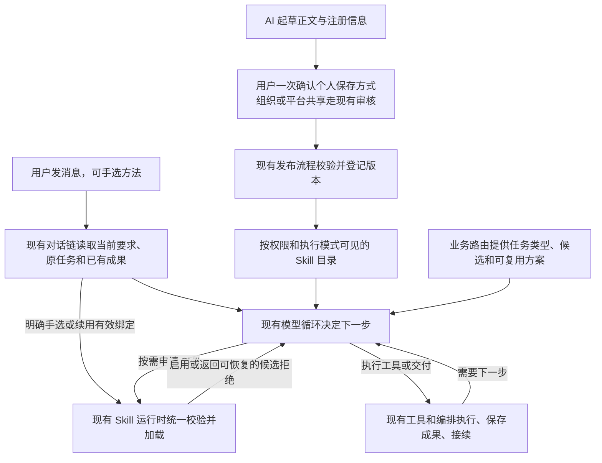

# Skill 选择、注册与成果交接

状态为本地实施和回放完成，真实模型与线上验收仍待验证。2026-11-12 开发前核对本工作树 HEAD、本地 origin/main 和远端 main，三者均为 `21a6c5c08f952605e64743913a4ed2e4e0fcdbd2`。同一任务的后续对话在本隔离工作树接续。

## 目标与现状

用户手选适用的方法就优先用它。没有手选时，模型可以直接回答、用普通工具，或从可用目录按需选择 Skill。系统推荐是候选。只有确实互补且能承接成果的方法才协作。同一阶段只有一个实际执行者。续做优先找回原任务和成果。AI 新写的 Skill 经现有流程发布后，也用同样的规则。

通用目录已支持仅推荐元数据、按需激活、激活前校验和检查点恢复。但电商入口识别到 `main_images` 时，还能主动激活 `ecommerce-main-images`，失败可结束本轮。旧截图中手选的「参考图多方案提示词」登记为 `image.prompting`，服务器主图入口登记为 `image.planning`。当前运行时主要按动作与职责组合识别重复负责人，两种声明不足以说明是否重做同一批提示词。原回报还出现过「电商套图策划 · 完整融合版」直接开始生图，页面未呈现完整规划。仅凭截图不能断言后端从未规划，验收必须检查实际方案和工具调用顺序。

原案例用原商品参考图（蓝色荔枝和粉色蜜桃风琴包），请求五张拼多多详情图，要求放桌上、背景配合产品、突出商品。手选提示词方法也曾出现 `SKILL_REQUIRED_CAPABILITY_UNAVAILABLE`。应区分三个历史对象，实际生效的生产版本、分配和正文仍须核实：

- 「参考图多方案提示词」：`reference-image-prompts`，历史截图版本 `vf540a7eb0eff4862b924d9af0f7032bd`。
- 「电商套图策划 · 完整融合版」：`ecommerce-image-prompts`，历史截图版本 `v5d3a01973e41404981324860769e3750`。与上一项组成原两个用户侧业务样本。
- `ecommerce-main-images`：服务器主图专用入口，历史截图版本 `vf147c0c57e1b4bbdb780e4f8bd2ff8fe`。单独验证其兼容与回归，别和完整融合版混用。

上述版本和已审查的正文摘要可从 `backend/config/skill_workflow_compatibility.json` 及 `backend/services/task_execution/methods.py` 交叉核对。优先复用仓库现有回放、素材和成果。查不到生产快照或原素材时，明确哪些验证使用替身、哪些仍待原数据核验。

## 架构

## 开发事项

- [x] **D1 · 回放原案例并收口选择入口。** 核对 `backend/services/handlers/chat/execution_engine.py` 的首轮激活、`_execute_skill_batch_impl` 与电商 `workflow.py` 的 `identify`、`coordinate`、`allows_planning`。新请求让业务路由提供语义和候选，把 `main_images` 下直接激活及失败终止的路径接回统一运行时。继续旧服务器方案读取原绑定和已有方案，保留显式要求使用服务器策划时的正常路径。复用现有模型循环，检查首轮和多轮工具暴露；不为每条消息固定加分类模型调用。
- [x] **D2 · 统一手选、会话固定、推荐和模型激活。** 在 `backend/services/skills/runtime.py`、`coordination.py`、`workflow_contracts.py` 的现有机制内落实。推荐不能覆盖手选。以当前动作及实际交付物判定重复，而非按名称、关键词或 Skill 数量。固定绑定、显式选择及历史任务冲突时验证版本与权限，涉及覆盖已有工作或改变交付时只澄清必要事实。可选激活失败不得改变当前绑定、成果和工具范围，也不得进入重复激活循环。保留激活与业务派发之间的检查点边界。检查聊天、直接图片/视频入口及定时快照的兼容性；定时任务继续按已锁定的配置运行。
- [x] **D3 · 接好两个原 Skill 和服务器入口的成果关系。** 分清提示词交付、逐图完整方案、按已有方案生成/编辑。只要提示词就交付文字。要求按这些提示词出图时，在派发前保存、校验完整逐图成果并传递实际引用。各阶段按动作收敛工具可用范围；同一批提示词只规划一次。检查 `backend/services/task_execution/methods.py`、现有模型主导循环、图片策划和提交工具的产物及消费者。复用版本化成果和引用；输入不匹配时保留已有成果并指出所缺条件，不伪造 plan_source。新消息或失败后接续沿用原任务 ID，保留已完成结果，只更新受影响阶段。使用既有幂等、权限、确认、计费和恢复机制。
- [x] **D4 · 接好 AI 写 Skill、注册和发布。** 从 `chat_creation.py` 的聊天提案、个人更新路径，到 `authoring_contracts.py`、`authoring.py`、`catalog.py`、`runtime_source.py`、`resolver.py` 核对真实字段流。现有聊天候选和部分个人更新会写 `model_selectable=False`，不能只改目录。AI 可起草描述、适用范围、需要的能力、职责和交付说明；用户在原确认流程中明确允许自动使用后才登记为模型候选，校验发布范围和权限。个人创建或更新复用原一次确认，组织和平台共享沿用既有审核。普通指导类有清楚用途即可使用。工作流只有声明了平台支持且可校验的输入输出及依赖，才参与自动交接。现有结构化协议仅有 `reference-prompts-v1` 与 `ecommerce-image-plan-v1`，优先复用这两个，不要求为每个新 Skill 开发新协议。能独立使用但缺少交接协议的版本保留手选能力。既有版本、快照及回滚语义须兼容，避免要求所有旧 Skill 重新发布。
- [x] **D5 · 完成本地验证并记录待验项。** 用已有测试和回放覆盖选择、发布、接续、权限和工具派发。若需新增测试，针对旧测试未覆盖的端到端回归。保存每条用例的实际 Skill、版本、交付物、工具次数、成果引用和恢复前后任务 ID；避免输出私有正文、素材或凭据。

范围：沿现有后端执行链开发，复用原确认入口与任务编排；保留原 ERP Agent，新增 ERP 写适配继续关闭。前端改动仅限现有确认入口确实需要承载“允许 AI 按需使用”且无法用现有字段表达时的最小接线，不重新设计界面。业务路由、目录选择和权限检查可独立回归，兼容修订或回退时保留已发布版本和在途快照。

## 验收标准

| 编号 | 操作 | 通过标准 |
|---|---|---|
| A1 | 手选原提示词 Skill，说“给我五张主图的提示词” | 完整五份提示词，服务器策划和生图调用均为零，其他候选不覆盖手选。 |
| A2 | 同样手选，说“写完再按这五份提示词出图” | 先保存完整提示词，再由生成步骤引用实际成果；不存在二次规划、越权、提前派发或重复计费。本地使用受控替身或复用原结果。 |
| A3 | 未手选，上传原参考素材，说“帮我做五张拼多多详情图” | 模型按需选择适用方法，能完成完整逐图规划，再提交生成。验证执行顺序、图数和引用；普通聊天与无关请求照常运行。 |
| A4 | 注入同职责的自动候选、可接续的候选及缺能力候选 | 同职责自动候选让位，互补候选消费前一步成果，失败的可选候选不终止可独立完成的任务。手选或固定方法不可用时真实说明影响。 |
| A5 | 沿用已有方案或成图说“只补第二张”，或在失败/暂停后继续 | 保留同一个逻辑任务 ID、可用的原绑定和已有成果；只补做一次第二张。刷新或恢复后仍能找回正确成果，核对权限失效时无法继续派发。 |
| A6 | 让 AI 写一个个人 Skill，分别以手选和明确允许自动使用两种方式发布 | 用户各确认一次即可使用；未允许自动时模型目录不暴露，允许后相关任务可按需找到、无关任务不受影响。覆盖编辑已发布个人 Skill、发布范围、无权共享及组织/平台原审核。 |
| A7 | 新版本声明受支持的成果交接，以及无效能力、未支持协议的候选 | 合法版本能手选、按允许范围自动选择并复用实际产物；无效声明不能启用自动交接。独立可用的指导类 Skill 不承担结构化工作流要求。 |
| A8 | 回归会话固定、定时快照、暂停、取消、刷新、确认和并发重复派发 | 原有权限、上下文、成果、计费与防重复规则有效。旧任务和旧 Skill 仍按兼容路径使用。 |

优先查看 `test_skill_coordination.py`、`test_skill_image_routing.py`、`test_saved_original_skill_failures.py`、`test_task_execution_original_skills.py`、`test_model_directed_image_reuse.py`、`test_skill_chat_creation.py`、`test_skill_authoring_postgres.py` 和定时快照测试（位于 `backend/tests/`）。付费模型和图片调用先给出预计费用、次数与上限，等新批次确认。此前的单次或批次授权不延用。禁止为验收重复生成已有图片。核对当前项目发布规则，开发交接不包含提交部署、生产写入或清理工作树的授权；本地通过后报告证据与仍待线上验证的事项。

## 2026-11-12 实施与回放记录

- 执行入口实际位于 `backend/services/handlers/chat/execution_engine.py`。旧首轮强制激活仅保留给有原绑定或方案的接续和旧检查点。新请求的电商路由提供候选。模型主导任务在申请服务器方法时才初始化该入口。手选、固定版本、动态激活和拒绝都继续走 Skill Runtime 及其检查点。
- 两份原 Skill 本地导出中的版本与上文一致，且都登记为手选使用。原参考图和原请求从既有本地记录读取，历史响应通过离线传输回放。两条历史失败均保持未完成状态并保留修复证据，业务派发为零。服务器专用 Skill 的生产正文、分配及实际生效版本仍待核验。
- 基线模型主导循环会跳过旧的逐图成果门禁。该循环现在通过 `save_task_image_plan` 保存结构化文本、原 Skill 版本和哈希。同批图片请求等待保存完成。后续原生图片请求引用保存成果并精确匹配提示词、负面提示词、比例与序号。历史服务器原稿及旧提示词引用继续由原生入口验证。
- 新迁移 `376_agent_task_image_method_handoff.sql` 允许逐图文本和完成回执进入现有模型主导任务的原子检查点。已保存成果和原调用记录保持不可变。已产生这类记录时，数据库回滚脚本会拒绝撤下兼容校验。
- 现有确认卡片新增一次确认内的自动使用勾选。模型可提供任务模式、用途、触发场景、必需能力及两个已支持的逐图协议之一。个人创建和更新沿用一次确认。组织与平台共享经原审核流程进入目录。历史发布版本和定时快照仍使用各自的原配置。

| 编号 | 本地实测 | 仍待验证 |
|---|---|---|
| A1 | 手选原 `reference-image-prompts` 版本，回放已有五份逐图提示词。保存阶段服务器策划和生图均为 0，原手选仍有效。 | 原问句由实际模型重新理解并完整呈现五份提示词。 |
| A2 | 先持久化五项，再按实际成果引用匹配原文和比例。混合保存与生成批次不会派发。两个方法分别得到五条受控受理回执。原参考 Skill 使用保存的真实五图方案，完整融合版使用受控五图文档。 | 真实图片产物及供应商结算。 |
| A3 | 无手选的受控测试中，服务器方法作为候选进入模型循环，模型请求激活后绑定版本。普通聊天与无关请求回归通过。 | 原拼多多请求下实际模型的选法、服务器完整五图策划和提交顺序。 |
| A4 | 同阶段候选冲突、依赖排序、缺能力拒绝、候选拒绝后的工具范围和手选或固定失败均有本地验证。 | 实际模型收到拒绝后的继续执行表现。 |
| A5 | 保存后恢复原任务与版本，使用原方案只补序号 2。重复项与权限失效均受拦截。既有成图复用与受控回执回归通过。 | 生产权限变更、页面刷新与实图交付一起联测。 |
| A6 | 临时 PostgreSQL 验证默认手选、明确自动使用、个人更新、确认重试和组织、平台审核。确认卡片测试通过。 | 已部署目录和页面联测。 |
| A7 | 支持协议的版本可保存实际结构化成果并交接。未知能力校验失败。普通指导类可经确认登记为候选。 | 自然语言场景对新版本的选择表现。 |
| A8 | 本地回归覆盖会话固定、定时快照、暂停取消、恢复、并发提交和原生权限防护。新增 ERP 写适配保持关闭。 | 部署后页面刷新、线上授权及实际计费。 |

本地证据保存在用户私有目录 `~/.codex/task-evidence/skill-selection-registration-20261112/`。后端综合回归 996 项通过，扩展后的逐图交接模块 19 项通过，确认卡片 4 项通过。逐图交接报告记录实际 Skill、版本、数量、任务 ID、成果引用和受控受理次数。两条历史回放记录只保存在本机。此次新增付费调用为 0，实际新增图片为 0。工作树待另行授权提交部署。
