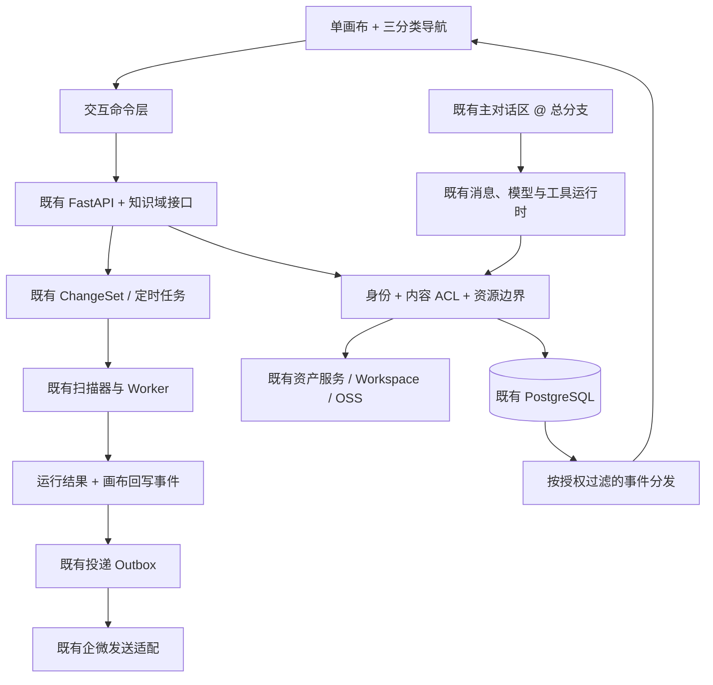
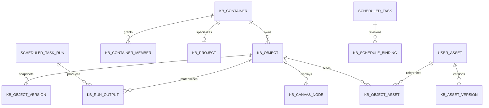

# 统一知识画布实施方案

日期：2026-10-19（Asia/Shanghai）
状态：B0 设计/原型已完成；V1 已实现开发环境真实闭环，尚未生产发布；全周期能力仍分批实施。
任务分支：`codex/task/20261019033948-knowledge-canvas-design`
设计基线：`d597ac35cb7e7d85f09ce681c8e99571ed83f7ae`。
审计证据基线：`f7c3be32b6cb23293de170b39a0392d239cc43bf`。

## 1. 本次修订与适用范围

本方案将对话中已确认的产品行为转为当前项目的实施设计。最新范围：知识画布不规划聊天或分支对话，只在既有主对话区通过 @ 总分支引用；分支右键打开定时面板，设置执行内容、时间和推送对象。首次代码审计后的 main 已前进；本任务从最新 main 创建，核对差异后，文件、预览、知识、权限、聊天资源边界和调度核心的审计证据仍适用。main 中的启动、日志、公开模型、订阅和商品图片制作变化不在本任务改造范围。

本任务从 B0 设计推进到 V1 开发：已新增真实画布、底座接口、权限与持久化迁移，并在任务私有开发克隆库验证；没有生产迁移、提交推送或部署，没有新增应用依赖。实际范围、验证和发布条件见 [V1 开发交付](./TECH_统一知识画布_V1交付.md)。下文未在 V1 交付记录中列明的表、接口及能力仍为后续设计目标，不能当作现有功能。

B0 细化见[协议、数据约束与交互验证](./TECH_统一知识画布_B0契约.md)，包含消息引用、智能体读取、逐表约束和可操作原型；B0 明确的具体契约优先于本文早期概念表述。V1 实际接口和局部细化以 V1 交付记录为准，其余后端及数据库能力仍属于后续批次。

主要修订：

1. 保留 React/TypeScript、FastAPI/Python、PostgreSQL、Redis、现有 Worker、Workspace/OSS 和企业微信链路；撤回另建 NestJS/BullMQ 后端的初始建议。
2. 右侧采用顶部三个选项卡；删除导航创建按钮；默认当前项目搜索，不默认检索对话。
3. 将用户知识与 Agent 经验库隔离，将通用协作项目与商品图片制作项目隔离。
4. 文件身份复用 `user_assets`；新增内容绑定、版本和授权，不另建一套上传存储。
5. 定时功能复用 ChangeSet、扫描器、执行记录和投递 Outbox，新增可信内容范围与结果回写。
6. 一张可视画布采用按内容授权的加载和事件分发，不能向客户端同步整个组织的隐藏数据。
7. 内容保存后天然可供智能体读取和 @ 引用，无需封装、发布、注册或逐个绑定智能体。下文“发布”仅指扩大共享范围或原有受控自动化配置生效，不是知识调用前置条件。

相关既有设计：

- [工作区资源选择与授权衔接](./TECH_工作区资源选择与授权衔接.md)
- [AI 规划与定时任务 ChangeSet](./TECH_AI规划框架与定时任务ChangeSet适配器.md)
- [定时任务可靠投递](./TECH_定时任务可靠投递.md)
- [组织架构与权限模型](./TECH_组织架构与权限模型.md)

## 2. 已确认需求与交互验收表

以下 R 编号为产品约束；技术建议不自动升级为已获实施授权的决定。

| 编号 | 已确认行为 | 主要验收场景 |
|---|---|---|
| KB-R01 | 同一无限画布承载个人知识、项目和团队知识 | 切换右侧选项卡不换画布、不改变视野；刷新后恢复位置 |
| KB-R02 | 右侧顶部三个选项卡：个人知识库、项目、团队知识库 | 下方完整高度显示目录；各自记住展开、滚动和查询状态；支持调整宽度和收起 |
| KB-R03 | 创建仅从画布交互发起 | 右侧没有创建按钮；双击空白打开轻量创建菜单；空标题取消不留幽灵对象 |
| KB-R04 | 拉线创建与思维导图快捷键 | 拉到空白创建、拉到既有节点连线；Tab 子节点、Enter 同级、F2 标题、Shift+Enter 换行、Space 平移、Ctrl/Cmd+Z 撤销 |
| KB-R05 | 创建时决定输入内容、绑定文件、引用知识或任务 | 子节点默认继承归属；独立节点显示归属；Tab/Enter 默认直接输入主题标题 |
| KB-R06 | 自动归类并支持目录与画布双向定位 | 点击条目加载、展开、缩放、高亮；“在目录中显示”反向定位；可返回上次位置 |
| KB-R07 | 绑定视频、文档、图片等多个文件 | 同一文件多处引用；上传状态可见；绑定失败不会显示成功；移动内容不重新上传 |
| KB-R08 | 文件可展开、查看，适用类型可编辑 | 懒加载预览；原生文档保存并有版本；Office 预览与正文编辑明确区分 |
| KB-R09 | 搜索当前知识分类，优先当前项目 | 项目列表搜名称和简介；选定项目搜其节点、正文、附件及已解析文本；结果定位内容 |
| KB-R10 | 默认不跨项目、不跨对话搜索 | 多项目展开时仍明确当前搜索项目；对话默认排除；可选“包含当前项目对话”留待后续 |
| KB-R11 | 画布不提供聊天；既有主对话区引用知识 | 不创建画布/分支会话；主对话区 @ 总分支后自主读取对应内容；返回可定位来源 |
| KB-R12 | 右键节点、附件或区域设任务和定时推送 | 展示作用范围、时间、时区、收件目标、内容版本、启停和历史 |
| KB-R13 | 选择企业微信个人或群作为目标 | 只提供已接入且允许使用的目标；清楚区分个人通知、机器人群和其他通道支持范围 |
| KB-R14 | 团队协作与个人整理共存 | 私人内容不进入他人的目录、画布、事件、搜索或 AI 上下文；共享需明确处理 |
| KB-R15 | 后台执行与结果回写 | 关闭浏览器仍执行；失败可追踪；结果生成节点可定位；重试不重复创建报告 |
| KB-R16 | 自动布局、自由拖动和关系表达并存 | 分支可折叠；局部布局只影响选区；知识连线不改变自动化执行顺序 |
| KB-R17 | 创建保存后天然可调用，用户只需 @ 总分支 | @ 总分支后由智能体理解框架、定位子分支并读取资料；不要求选择单个节点或内容范围；重命名不失联；编辑下次调用生效；无需封装或发布 |
| KB-R18 | 智能体理解框架并按其中明确的规则回答或工作 | 自动读取结构和适用规则，按需读取相关资料；整框架任务覆盖所选范围并说明缺失；规则不能扩张文件、工具和外发权限 |

### 2.1 页面结构

```text
┌─────────────────────────────────────┬──────────────────────────────┐
│                                     │ 个人知识库 │ 项目 │ 团队知识库 │
│                                     ├──────────────────────────────┤
│             统一无限画布             │ 搜索当前项目…                │
│                                     ├──────────────────────────────┤
│   主题 ── 文档 ── 待办               │ ▾ A 客户项目                 │
│     ├── 图片                        │   ├─ 需求资料                │
│     ├── 视频                        │   ├─ 规则与待办              │
│     └── 任务 ── 定时推送             │   ├─ 任务                    │
│                                     │   └─ 自动化                  │
│                                     │ ▸ 产品开发项目               │
└─────────────────────────────────────┴──────────────────────────────┘
```

目录中的“资料/讨论/任务/自动化”为可采用的分组展示，不强迫用户使用固定业务目录。导航分类是服务端内容归属的投影，不维护第二份可独立写入的目录数据。

双击或拖线后的菜单：输入内容、上传或绑定文件、引用已有知识、创建任务、设置自动化；菜单内显示归属。新项目也由画布创建菜单发起。项目内容先选择既有项目，或在同一创建流程中创建项目，不能在右侧再加创建入口。

### 2.2 必须定义的状态

| 触发 | 正常与边界行为 |
|---|---|
| 创建/保存 | 客户端生成 command_id；服务端幂等；临时节点显示保存中；失败可重试或撤销；取消未保存节点不创建业务事实 |
| 中文输入 | IME 组词期间不响应 Enter/Tab 创建；编辑器聚焦时快捷键归编辑器；拖拽不能误触双击 |
| 新增层级 | contains 关系不允许环；同一导航树中只允许一个父节点；其他关联用 reference/related，不形成第二个层级父节点 |
| 跨归属连线 | 建立引用不改变原内容权限；双方均有权限才可展示关系；跨归属移动或发布是独立操作 |
| 删除 | “移除当前展示引用”和“删除源内容”分开；后者进入回收机制，并标记失效任务；普通撤销不能复活已无权访问的内容 |
| 定位 | 先授权再加载；展开祖先后计算 fit bounds；目标失效展示可恢复提示；连续点击只完成最后一次导航 |
| 展开附件 | 未处理、处理中、失败、可预览、不可预览分别展示；关闭详情释放播放器和大编辑器 |
| 搜索 | 明示 scope 与当前 project_id；取消旧请求；结果不覆盖新查询；缓存按身份、范围、权限版本隔离 |
| 多人操作 | 不覆盖他人的内容或布局版本；冲突返回当前版本；断线重连重新鉴权并补取当前授权状态 |
| @ 引用 | 输入 @ 只展示有权访问的总分支入口，优先当前项目；按名称及归属消歧；不让用户再选子节点或读取范围；回车确认候选时不误发消息 |
| 推送 | 未配置、无发送权限、目标不可用、排队、重试、部分成功、失败分开；不能把排队显示为送达 |

## 3. 现有能力与开发对照表

代码路径相对仓库根；证据针对上述基线。Reuse 表示复用能力，仍需为新入口验证。

| 编号 | 需求与能力 | 当前证据 | 处理方式与边界 |
|---|---|---|---|
| KB-M01 | 身份、组织 | [api/deps.py](../../backend/api/deps.py)、[org_scoped_db.py](../../backend/core/org_scoped_db.py) | Reuse；新增内容 ACL，不把 org_id 过滤当作完整授权 |
| KB-M02 | 上传和存储 | [file_upload.py](../../backend/api/routes/file_upload.py)、[core/workspace.py](../../backend/core/workspace.py) | Extend；保持原上传，新增可靠绑定和跨成员受控读取 |
| KB-M03 | 文件资产 | [asset_registry.py](../../backend/services/assets/asset_registry.py)、[145_user_assets.sql](../../backend/migrations/145_user_assets.sql) | Extend；复用资产 ID，补版本和生命周期；不得另建平行上传系统 |
| KB-M04 | 多类型预览 | [preview/registry.ts](../../frontend/src/preview/registry.ts)、[useWorkspaceItemActions.ts](../../frontend/src/components/workspace/useWorkspaceItemActions.ts) | Reuse 适配器；新增画布承载方式与授权取件适配，不复制一套预览分支 |
| KB-M05 | 用户知识正文 | [knowledge_service.py](../../backend/services/knowledge_service.py)、[knowledge_dedup.py](../../backend/services/knowledge_dedup.py) | New 用户内容域；旧库为模型/工具/经验，含淘汰，不承载用户文档 |
| KB-M06 | 通用协作项目 | [118_detail_projects.sql](../../backend/migrations/118_detail_projects.sql) | New；detail_projects 保持图片制作业务，只可作为关联对象接入 |
| KB-M07 | 无限画布 | [App.tsx](../../frontend/src/App.tsx)、[package.json](../../frontend/package.json) | New；新增路由、画布适配与命令层，不重建整站布局和认证 |
| KB-M08 | 聊天与 AI | [conversation_service.py](../../backend/services/conversation_service.py)、[ToolContext](../../backend/services/tools/context.py)、[ResourceManifest](../../backend/services/handlers/resource_manifest.py) | Extend；复用消息、模型、工具框架；主对话区引用及授权项目资源读取需显式接入；不增加会话 scope |
| KB-M09 | 范围搜索 | [file_browse.py](../../backend/api/routes/file_browse.py)、[file_query_extensions.py](../../backend/services/file_query_extensions.py) | New 范围 API；复用解析/数据库/向量基础。工作区文件名搜索不能替代项目正文搜索 |
| KB-M10 | 定时任务 | [scheduled_tasks.py](../../backend/api/routes/scheduled_tasks.py)、[scheduled_task_change_adapter.py](../../backend/services/scheduler/scheduled_task_change_adapter.py)、[scanner.py](../../backend/services/scheduler/scanner.py) | Extend；走新 ChangeSet 路径，不再增加第二套任务草稿、调度器或工作流平台 |
| KB-M11 | 结果与企微投递 | [task_executor.py](../../backend/services/scheduler/task_executor.py)、[delivery_worker.py](../../backend/services/scheduler/delivery_worker.py)、[delivery_sender.py](../../backend/services/wecom/delivery_sender.py) | Extend；复用持久化 Outbox；新增画布结果投影与目标能力信息 |
| KB-M12 | 多人正文编辑 | 现有预览为只读；现有 WS 主要服务消息/任务 | New 协作能力；不能宣称 WebSocket 已等价支持并发编辑 |
| KB-M13 | 普通待办 | 现有 tasks 服务 AI 执行，scheduled_tasks 服务调度 | New work item；关联原执行任务，不能改变原表业务含义 |
| KB-M14 | 天然知识调用与 @ | 现有聊天有附件与资源选择机制，但未实现总分支知识引用与框架导航 | Extend 现有输入和资源适配；用户只选总分支，智能体内部解析子节点；无需另建“知识包注册表”或复制全文 |

### 3.1 审计缺陷与接入前置修复

| 编号 | 已复现问题、影响 | 最小修复方向与验证 |
|---|---|---|
| KB-F01 / P2 | TaskForm 按 task.push_to_others 显示群选择，但调用仅 owner/admin 可用的 groups；普通组织成员担任主管时返回 403，错误被转为空列表 | 选择目标与管理目标分开；新选择器用可发送目标查询；不能放宽修改群名权限。覆盖 manager/deputy 的业务权限与 org role 不同组合，403 明示且不伪装为空 |
| KB-F02 / P2 | 执行器保存 files，同时生成非空 content；Worker 的 content 分支未合并 files，可能只有正文却被标记投递完成 | 统一构建正文、附件、结构化内容；去重后逐项发送并记录。覆盖 files-only、正文加文件、重复文件、多目标、部分发送后重试 |

F01 证据：[TaskForm](../../frontend/src/components/scheduled-tasks/TaskForm.tsx)、[群管理权限](../../backend/api/routes/wecom_chat_targets.py)。F02 证据：[载荷构建](../../backend/services/scheduler/task_executor.py)、[发送分支](../../backend/services/scheduler/delivery_worker.py)。此前隔离复现不连接真实数据库、不真实发送消息；缺陷未在本任务修复。

## 4. 系统职责与核心数据关系

### 4.1 运行结构



第一版不新增微服务集群、图数据库、向量数据库或新的调度平台。PostgreSQL 为归属、权限、业务状态和布局的真相源；Redis 提供现有通知与缓存能力。

### 4.2 拟新增实体

以下为领域与约束设计，不是迁移 SQL；迁移号在实施时按最新 main 分配。

| 实体 | 主要字段和约束 |
|---|---|
| kb_containers | id、org_id、kind(personal/project/team)、owner_id、title、revision、deleted_at；personal 按组织上下文+本人唯一，team 按组织唯一；project 对应一个项目空间 |
| kb_projects | container_id 唯一外键、负责人、状态、业务摘要；不复用 detail_projects |
| kb_container_members | container_id、user_id、role(viewer/editor/manager)、状态；同容器/用户唯一，统一承载项目与团队写入授权 |
| kb_objects | id、container_id、parent_id、kind、title、current_revision、created_by、deleted_at；parent_id 为层级真相源，同容器约束且防环 |
| kb_object_versions | object_id、revision、格式、正文快照、当时层级、作者；文档/规则等内容统一版本化；协作接入后快照由协作状态派生，不能与 CRDT 并行双写正文 |
| kb_work_items | object_id、负责人、到期时间、状态；普通待办，与 AI tasks 和 scheduled_tasks 分开 |
| kb_canvas_nodes | id、object_id、canvas_context、placement_container_id、布局版本、位置、尺寸；同一对象可多处展示 |
| kb_relations | source_object_id、target_object_id、relation_type(reference/related/dependency)；contains 从 parent_id 派生，引用允许跨分支 |
| kb_object_assets | id、object_id、asset_id、绑定版本、排序、状态；asset_id 引用原 user_assets；同对象重复绑定幂等 |
| kb_asset_versions | asset_id、version_id、内容摘要、不可变存储引用、大小、创建人；复用原 OSS/Workspace 存储服务，不另造一套文件资产 |
| kb_task_targets | work_item_id、目标对象/节点/附件 ID 或区域锚点；优先 ID，区域同时保存坐标 |
| kb_schedule_bindings | scheduled_task_id、任务修订、source_selector、version_policy、output_container、output_anchor；配置与原 ChangeSet 原子发布 |
| kb_run_outputs | run_id、output_key、object_id、状态；run_id+output_key 唯一，作为执行结果到内容的幂等投影 |
| kb_index_jobs / kb_search_chunks | 对象/附件版本、处理状态、正文片段、来源定位、索引版本；正文/资产为真相源，索引可重建 |
| kb_mutation_receipts / kb_events | actor、command_id、请求摘要、结果版本、事件 ID；保证新增内容命令的幂等与可靠通知，不复制原 ChangeSet 状态机 |

天然调用以总分支的稳定 root_object_id 或容器根身份为入口；结构化引用作为原消息/任务资源选择的一部分保存，包含 root_ref 和 revision_policy，不向用户暴露逐节点或 range 选择。智能体内部仍以稳定 ID 导航、读取子节点和附件，当次解析保存实际对象/附件版本与适用规则依据。不新建一份独立知识包、内容副本或逐对象的启用状态。用户明确创建的规则节点属于知识对象的一种类型，规则修订与正文一样版本化。

归属变更必须是事务操作：同步检查原对象、后代、引用、文件授权和绑定任务；不通过拖动坐标隐式改变归属。首版共享操作优先“发布明确内容到目标容器”，涉及原对象移动时显示影响；历史私人对话不随节点移动被整段发布。



### 4.3 数据一致性与引用生命周期

- 新增知识表使用带可信身份的事务和对象 ACL；需要使用 OrgScopedDB 的租户表同步登记。即使 org_id 为 NULL，个人数据仍必须按 owner 限定；不能把所有 NULL 组织记录当作共享空间。
- 同容器树以 parent_id 为唯一父关系；环检测、父节点存在与版本检查在事务内完成，contains 只做派生展示。跨容器引用同时验证目标权限，不通过连线获得权限。
- 业务变更、命令回执和事件在同一 PG 事务提交。Redis 只是唤醒；丢失通知后靠带范围的增量读取或快照恢复。
- 布局按节点/分组版本更新，避免整画布最后写入覆盖；短暂拖动预览可以丢弃，松手才持久化。个人折叠、视野和布局偏好与团队共享位置分开保存。
- 新节点绑定文件前，要求资产登记成功，服务端返回稳定 asset_id；旧上传的 best-effort 行为保持兼容。不得伪造 asset_id 或将绑定失败投影为成功。
- 新知识附件使用不可变版本引用。旧工作区路径可能改名/移动/覆盖，不能直接承诺为固定版本；首次绑定需要校验并建立可追溯版本，失败显示“待绑定/不可固定版本”。
- 改名、移动、删除、恢复统一经过资产生命周期服务，包括 API、AI 文件工具和后台入口；避免只修一个文件管理页面。知识引用改标题不必重命名底层文件。
- 移除展示或附件绑定不删除源文件；物理清理前检查全部活跃引用、运行快照和保留策略。未知引用状态时不执行清理。

## 5. 权限矩阵与单画布隔离

### 5.1 推荐授权规则

有效权限 = 有效身份/组织成员 ∩ 内容容器 ACL ∩ 当前动作权限 ∩ 文件/任务资源上界。发布或推送再检查目标与内容分发授权。旧业务权限中的 boss 快速放行不能替代个人知识 ACL。

以下为最小权限建议；组织管理员特殊读取、合规托管及离职数据归属尚未确定，不在首版默认增加这些例外。

| 动作 | 本人的个人内容 | 他人的个人内容 | 项目 viewer | 项目 editor | 项目 manager | 团队空间成员 |
|---|---|---|---|---|---|---|
| 查看、搜索、引用 | 允许 | 默认拒绝 | 允许 | 允许 | 允许 | 按团队读权限 |
| 修改正文、创建内容 | 允许 | 拒绝 | 拒绝 | 允许 | 允许 | 按团队写权限 |
| 修改共享布局 | 允许 | 拒绝 | 拒绝 | 允许 | 允许 | 按团队写权限 |
| 删除源内容 | 本人授权 | 拒绝 | 拒绝 | 首版限本人创建 | 允许项目内管理 | 按团队内容管理权限 |
| 管理项目成员 | 不适用 | 不适用 | 拒绝 | 拒绝 | 允许且不能超组织范围 | 不适用 |
| 发布或对外推送 | 本人授权且满足通道权限 | 拒绝 | 默认拒绝 | 需分发授权 | 需分发授权 | 需分发授权 |
| 设置自动化 | 当前任务功能权限+源内容授权 | 拒绝 | 拒绝 | 检查任务权限 | 检查任务权限 | 检查任务权限 |

团队知识可读写范围使用明确团队授权，不按“知道对象 ID”或“同一组织”自动放开。首版团队权限默认取组织团队范围，若增加子团队/部门私库，作为独立能力扩展。

### 5.2 一张画布的技术含义

当前登录组织上下文中，前端组合个人、项目、团队的授权节点，在同一坐标系展示；未选择企业时只展示本人个人内容。已有组织切换保持原隔离，不能跨组织合并对象。

一张可视画布不等于一个含全组织数据的共享 JSON 或 Y.Doc：

1. 目录、视口、搜索和事件均由服务端按 ACL 过滤；连线的两个端点都可访问才返回。
2. 普通实时事件通过当前授权订阅发送；不能先广播全组织节点再让前端隐藏。
3. 文档协作按文档/权限边界建房间，加入及续期鉴权，权限撤销后断开并清除订阅。删除后阻止旧房间或离线更新复活对象。
4. 画布结构先走服务端命令和版本校验；CRDT 只用于适合协作的正文，不能直接修改权限、归属、任务定义和引用。
5. 初次加载按视口、项目和折叠分支分页；授权变化令缓存失效并重新加载。已下载的副本无法承诺远程收回，界面如实说明分发含义。

### 5.3 文件共享与 AI 边界

知识文件访问入口先校验 object/asset binding，再通过既有存储服务提供流或短时受控 URL。旧 CDN 直链是否受鉴权保护尚未实测，新的私人/项目入口不能把静态 URL 当作 ACL。

同事读取共享资料时，不伪装成上传者，不开放上传者整个 Workspace。可信适配器按明确资产版本解析，必要时在获授权任务工作目录形成有限副本，并传入 ResourceManifest/ResourceAccessBoundary。原工具 runtime 保留 user/channel 身份；知识读取通过可信 knowledge_context 增加有限资源边界，不凭空塞入 project 会话类型。

## 6. 核心接口与调用链设计

以下接口为拟新增，统一放在 `/api/knowledge`。名称可在 OpenAPI 细化时调整，行为和安全边界不变。

| 接口 | 主要契约 |
|---|---|
| GET /navigation | 返回当前身份可见的三分类树，游标分页；项目列表不返回全量正文 |
| GET /canvas | scope/viewport/cursor；仅返回授权节点、关系、当前版本及续取信息 |
| POST /commands | command_id、operation、target、expected_revisions、payload；身份由认证获取，不信任 payload 中的 actor/org |
| GET /objects/{id} | 获取授权内容、类型能力和版本；无权与不存在采用一致的资源不可用响应 |
| POST /objects/{id}/assets | 注册/校验既有 asset_id、版本和绑定权限；重复请求幂等；旧路径由可信解析器转资产 |
| GET /objects/{id}/assets/{binding_id}/access | 获取允许的预览/下载访问；不返回凭证；不可越过绑定下载其他资产 |
| GET /search | scope_type、project_id 或个人/团队范围、q、cursor；默认排除对话；scope 不明时拒绝猜测 |
| GET /locate | object_id/node_id；返回授权锚点、必要祖先和 bounds；不能返回隐藏邻居 |
| GET /references | @ 候选只返回总分支入口；按当前项目优先、归属和名称消歧；不列所有子节点、不默认搜索对话 |
| POST /context/resolve | 解析结构化知识引用；返回授权目录、规则、资源清单与版本；由可信 AI 适配器调用，不能以调用接口本身获得新增权限 |

内容命令包括 create_object、create_project、create_child、connect、bind_asset、update_title、move_nodes、publish、unlink、trash、restore。简单内容操作复用现有事务模式；涉及已有 AI ChangeSet 的受控修改沿用原机制，不要求每次拖动都创建 ChangeSet。

请求重复键且摘要一致时回放原结果；同键不同参数返回冲突。版本冲突返回 409 与当前授权版本；校验失败 422；资源不可用统一 404；依赖处理未完成返回明确 processing 状态；数据库/权限服务未知时不降级放行。具体错误码随接口实现固化。

### 6.1 搜索

项目列表仅搜项目名称/简介。选中项目后，搜索框显示项目名称；多个项目可以展开，但只使用当前选中项目。切换选项卡不触发画布跳转。

先按容器与 ACL 限定候选，再做关键词和语义召回；不先向量搜索全库后由前端过滤。文档和附件索引按源版本异步生成，结果带 object_id、绑定 ID、版本、片段及页码/时间点等已有定位信息。未解析/索引中/失败状态可见。

缓存键包含 actor、组织、容器、权限版本、查询及索引版本；权限变化不能继续返回旧缓存。中文分词和排序用真实中文资料评测。外部搜索工具、对话全文和 Agent 经验库不作为默认数据源。

### 6.2 页面边界与正文编辑

知识画布不规划底部聊天框、聊天侧栏、创建对话节点或分支对话。讨论与智能体使用沿用既有主对话区；本轮只增加 @ 总分支引用及其资源读取协议，不新建项目群聊、共享知识会话或 conversation scope，不增加 kb_conversation_links。

主对话区的原会话所有权、消息历史、Actor/WS 和工具身份规则保持；知识引用必须贯穿消息持久化、任务恢复、摘要、来源展示和实时 ACL。保存共享知识不等于分享私人会话或个人文件目录。分支右键面板专门配置定时执行与推送，填写内容、时间、时区和已有权限的接收目标。

正文首批支持有版本的原生文档编辑；协作批次再启用文档级 CRDT。知识对象标题/归属继续由服务端控制，正文权威数据切换时有明确导入版本，不能把旧快照和协作状态互相覆盖。

Office 现有转换/预览继续复用；真正 Office 正文编辑、视频剪辑、PDF 原文修改单独评估，不用预览能力冒充编辑。视频首版支持播放与时间点批注，转写为异步可选处理。

### 6.3 保存即调用与 @ 交互

知识不是需要再次封装的导出产物。保存成功即具备结构化读取入口；用户不需要再选“封装为知识库”、发布版本、注册接口或逐个授权智能体。系统提供统一调用能力，智能体在当前用户/任务已有授权下使用。

- 用户只需引用一个总分支，例如 @售后处理。总分支指一套知识框架的根主题；项目或个人/团队知识库的根目录也可作为根入口。内部子节点和附件由智能体自行定位，不要求用户逐项引用。
- 输入 @ 时优先给出当前项目内的总分支；需要其他归属时切换已有授权的根入口，不自动跨项目、跨对话全文搜索。候选展示名称与归属，同名时消歧，不再弹出“自身内容/整个分支”等范围选择。
- 选中后只显示“@售后处理”等总分支标签；标签存稳定根 ID，不靠文本名称匹配。标签可移除或定位到画布，后端重新鉴权。
- 用户也可直接说“使用当前项目资料”，由当前可信页面上下文解析；涉及多个同名或不明确目标时再选择。不会因为省略 @ 就失去正常的上下文读取能力。
- 默认引用在每次调用时读取最新已保存内容，并记录当次版本。后续编辑无需重新启用；当前未保存修改不冒充已提交内容。定时任务仍支持已确认的 latest/pinned 策略。
- 目录和正文可在保存后直接读取；文件解析、OCR 或转写未完成时显示处理状态。智能体不能把“尚未解析”当作“没有内容”，也不能声称已读完整个框架。
- 删除或撤权后引用标签显示资源不可用；不得凭历史缓存恢复访问。重命名和布局移动不改变引用身份。

调用流程：解析总分支与权限 → 读取总纲、整体目录、关系和全局适用规则 → 根据任务自行选择子分支 → 读取对应内容、局部规则及必要关联资料 → 在既有工具边界内回答或执行 → 返回依据和实际覆盖范围。资料足够时不反复询问用户“应该看哪个节点”。外部引用按授权和相关性读取，不递归扩张成其他项目的全量访问。框架过大时分批读取；用户要求全框架总结或检查时记录遍历覆盖与未读取项，不能用局部检索冒充全部读取。

规则节点需要用户明确表达业务规则或流程，创建保存后即在对应范围适用，无需再次发布。父级约束沿 contains 层级继承，普通 related/reference 连线不会把另一分支的全部规则自动传播过来。明确的适用范围和例外优先，存在无法兼容的规则时说明冲突并请求业务判断；不自行选择更宽松的权限。

回答规则、工作步骤与系统执行权限分开。普通附件文本、网页指令和模型输出不自动提升为可信执行规则；业务规则也不能覆盖用户当前指令及系统安全/权限约束。资料要求“发送群消息/退款”时，仍调用既有授权和审批流程，不因 @ 或知识读取而新增操作权限。

## 7. 定时任务、结果回写与企微

### 7.1 三类任务

- 普通待办：kb_work_items，负责人/状态/截止时间；完成待办不等于执行 AI。
- 即时 AI 执行：复用原 tasks，只以绑定关系引用。
- 定时自动化：复用 scheduled_tasks/runs、ChangeSet、Scanner、Executor 和 DeliveryWorker。

纯提醒或转发固定资料宜采用确定性动作，不强制调用模型；需要在原调度框架增加执行类型并定义计费行为，不能绕开原限流、审计和权限。该扩展在自动化批次设计并验证。

### 7.2 配置与可信资源范围

右键创建时显示：节点/附件/分支/区域范围、时间、时区、内容版本、输出位置、收件目标和失败策略。

source_selector 区分 object_ids、asset_binding_ids、branch、project；区域仅用作选中时解析节点的入口，不单凭坐标持续授予新文件权限。动态分支/项目必须由用户明确选为动态范围，不能把“本次选中的几个节点”自动扩展为未来整个项目。

version_policy 区分：

- pinned：绑定已存在的不可变文档/文件版本；不能用可覆盖的 Workspace 路径假装固定版本。
- latest：每次运行解析当前授权的版本，并保存实际读取的版本清单。

通过既有 `POST /api/scheduled-tasks/changesets` 扩展 definition.source_binding，适配器 normalize/authorize/diff/hash/提交 RPC 与配置快照同时支持；原字段白名单不能静默丢弃绑定。绑定与任务修订同事务生效，不允许先启用任务后补资源授权。

预检、确认和执行都校验源范围、输出容器、收件目标。任务执行前和访问资源时刷新权限；授权撤销或源失效时停止并记录，不能退回读取 owner 全部文件。旧 template_file 任务保持原资源边界。

现有任务 API 要求 org_id。组织账号内的个人内容可在权限满足时接入；无组织散客的个人定时功能目前不支持，需独立定义权限与额度后才能开放，不把隐藏 403 包装为可用功能。

### 7.3 执行、幂等与回写

```text
已发布 ChangeSet + 内容绑定
→ 原扫描器原子领取 / 固定配置版本
→ 复核成员、源、输出和收件权限
→ 构建有限资源与实际版本清单
→ 既有执行框架完成动作
→ 持久化运行结果、kb_run_outputs 和待投递事实
→ 按授权事件更新画布 / 原投递 Worker 发送
```

报告 object_id 按 run_id+output_key 幂等创建。运行成功、结果可见和推送成功为独立状态；数据库完成事务扩展时保持原函数签名兼容或增加有版本的入口，不能旁路双写。文件先持久化再关联，未关联产物由保留策略回收，不能让未上传完成文件出现在成功报告中。

执行与投递继续至少一次语义，不承诺企业微信收件人恰好看到一次。部分发送后重试应有稳定分项键和持久进度；远端接收后本地确认前崩溃，仍可能重复，需要在运行记录如实标识。

范围内容在任务运行前改变时，pinned 读原版本、latest 记录当次版本。任务排队、停机漏执行、上次未结束和重启恢复策略必须在该批次固化测试；不把旧任务默认行为静默改成新的全量补跑。

### 7.4 企业微信

优先复用当前智能机器人目标、OrgConfigResolver 和发送适配器。定时投递当前走 smart_robot，不能因为通用 sender 支持 app 就宣称定时自建应用发送已经完成。

目标选择查询与管理员改群名分离。目标携带稳定 ID、企业、通道、目标类型、可用状态和消息能力；只选择已接入目标，不能输入任意 chatid 绕过校验。群名称可能需要手动标注，不能假设能枚举所有群。

企业微信成员/群、部门、自建应用、客户群和 Webhook 是不同能力；超出现有链路的通道逐项验证，不默认新增所有连接器。凭证仅由现有服务端配置解析；快照不保存密钥。

发送链接要检查接收方访问条件；需要外部分发时使用有明确范围与失效策略的分享能力，不能自动公开私人原文件。发送副本需要内容分发授权。F01/F02 是本批次上线前置。

## 8. 实施文件与职责

以下为计划，不代表文件已存在。实现时按模块边界合并，避免机械拆出空服务。

| 范围 | 拟新增/修改位置 | 职责及兼容约束 |
|---|---|---|
| 页面 | 新增 frontend/src/pages/KnowledgeCanvas.tsx、components/knowledge/、stores/useKnowledgeCanvasStore.ts、services/knowledge.ts | 命令、节点适配、三选项卡、范围搜索、定位、恢复；仅修改 App.tsx 接入路由 |
| 预览 | 修改 preview/ 的访问与承载适配，复用 registry | 新增绑定上下文，不把其他用户路径交给原个人代理 |
| 知识域 | 新增 backend/api/routes/knowledge.py、schemas/knowledge.py、services/knowledge_workspace/ | 内容、树、项目、授权、查询、定位；不混入旧 knowledge_service.py |
| 数据访问 | 新增知识域 repository/策略；修改 org_scoped_db.py、相应 scope 适配与迁移 | 同事务 ACL/版本/事件；不只在前端拦截 |
| 文件 | 扩展 services/assets/、file_upload.py、file_manage.py 及原文件工具公共生命周期入口 | 可靠注册、绑定、不可变版本、删除引用检查、受控读取 |
| 主对话区引用 | 扩展原输入区、message 服务、工具 context/runtime_context、附件解析、WS/Actor 适配 | knowledge_refs 端到端接入；旧 user/channel 行为不变；不增加画布聊天 |
| 自动化 | 扩展 scheduled_task_change_adapter.py、scheduled_task_agent.py、task_executor.py、相应 RPC | 资源绑定进入差异/指纹/快照，执行范围复核，结果原子回写 |
| 企微 | 扩展 scheduled_tasks 目标查询、TaskForm 选择数据、delivery_worker.py 和公共 sender | 修 F01/F02，保留管理员群管理权限和可靠投递路径 |
| 实时 | 扩展既有 WS 分发或新增知识事件适配 | 权限过滤、恢复游标、撤权断开；不直接开放全组织广播 |
| 灰度 | 在现有 config/featureFlags 增加 knowledge_workspace_enabled 等独立开关 | 命名区别于旧 kb_enabled；API 与 Worker 均检查，不只隐藏 UI |

### 8.1 依赖候选与准入

2026-10-19 查询 npm 注册表元数据，以下仅为精确版本候选，本任务未安装、未执行漏洞扫描或集成验证：

| 候选 | 用途、许可与核对结果 | 准入条件 |
|---|---|---|
| @xyflow/react 12.12.0 | 节点 UI，MIT；声明 React/ReactDOM >=17，最近发布 2026-09-24 | 在项目 React 19 下验证拖拽、键盘、虚拟加载和可访问性，再锁定 lockfile |
| @dagrejs/dagre 3.1.1 | 有向图自动布局，MIT；发布 2026-08-08 | 验证局部布局、左右分支、节点尺寸；层级约束仍由业务服务保证 |
| @tiptap/core 3.32.0 | 正文编辑，MIT；要求 @tiptap/pm 3.32.0，发布 2026-10-13 | 一并锁定 pm、React 绑定及实际扩展；验证序列化、清洗与版本回放 |
| yjs 13.6.33 | 文档 CRDT，MIT；发布 2026-09-23 | 只在协作批次引入，验证持久化、撤权与断线恢复 |
| @hocuspocus/server 4.7.1 | 候选协作服务，MIT；要求 Node >=22，发布 2026-10-12 | 将新增服务运行负担，未决定采用；先与 Python 侧协作接入方案比较，再确定部署与版本 |

新增依赖必须核对许可证、传递依赖、公开漏洞和项目打包结果，不能用 latest 标签代替锁定。原生编辑与协作的扩展包未锁定前，不宣称依赖设计完成。Office 编辑服务、OCR/媒体转写供应商仍为后续评估，不预设新增持续费用。

注册表来源：[React Flow](https://registry.npmjs.org/@xyflow%2Freact)、[Dagre](https://registry.npmjs.org/@dagrejs%2Fdagre)、[Tiptap](https://registry.npmjs.org/@tiptap%2Fcore)、[Yjs](https://registry.npmjs.org/yjs)、[Hocuspocus](https://registry.npmjs.org/@hocuspocus%2Fserver)。

## 9. 分批开发与质量门槛

各批次独立可验收；当前已获用户授权开发并完成 V1 开发环境闭环，其余按版本推进。

| 批次 | 交付 | 前置与验收 |
|---|---|---|
| KB-B0 契约与原型 | 从本文件导出 OpenAPI、实际迁移设计、交互原型与测试样例 | 走通 R01-R16 的主要及失败状态；确认第 11 节中会影响本批次的产品边界 |
| KB-B1 内容与权限底座 | 容器、通用项目、成员、知识对象、引用、命令与事件 | 数据库级权限测试、同键重放、环与并发冲突；不改变旧知识库/图片项目行为 |
| KB-B2 画布与资料闭环 | 三选项卡、双击/拉线/快捷键、绑定、预览、定位、范围搜索 | R01-R10/R16；新上传绑定可靠；项目内检索不越权、不默认搜对话 |
| KB-B3 编辑与协作 | 原生编辑、版本、按文档授权同步、画布多人修改 | R08/R14；无丢失更新、离线恢复与权限撤销；Office 高级编辑另立验收 |
| KB-B4 主对话区天然调用 | 既有主区总分支 @、框架导航与规则读取、有限资源适配与来源 | R11/R17/R18；只 @ 总分支即可自行读对应内容，无封装/注册或细粒度范围选择；不新增画布聊天/分支会话；重放/历史摘要/附件权限全链路通过 |
| KB-B5 自动化与企微 | 修 F01/F02、任务绑定、动态/固定版本、结果回写与目标选择 | R12/R13/R15；重启、部分失败、撤权、完整附件及受控企微实测 |

B2 可以形成单人可用的资料工作台，但不是团队协作完整上线。B3/B4/B5 可按独立开关交付；完整产品验收必须涵盖全部 R 项。

### 9.3 可持续开发与生产预览计划

本节将技术批次映射为用户可体验的版本。B 编号表示技术领域，不要求按编号依次发布：先打通画布，再接资料、主对话引用和自动化，最后补齐复杂实时协作。项目共享与权限隔离从第一版建设，不能延后到实时协作批次。当前 B0 已完成，V1 已完成开发环境验证但未生产发布；以下 V2—V5 尚未完成实现。

| 版本与顺序 | 可在生产预览中体验的效果 | 技术范围与发布门槛 |
|---|---|---|
| V1 真实画布最小闭环 | 打开知识画布；三分类目录；从画布创建项目、主题和文本内容；拉线创建层级；目录定位；刷新和重新登录后内容仍在 | B1 + B2 最小交互。先在开发库完成表、RLS、命令/版本与布局接口，再接真实前端。包含最小编辑保存及版本冲突提示，不含文件/@/定时入口；两账号验证私人隔离、项目角色和撤权，不允许静默覆盖 |
| V2 资料工作台 | 文档编辑与历史版本；绑定文件、预览；折叠、搜索定位、思维导图快捷键及失败恢复 | 完成 B2，交付 B3 的基础编辑/版本部分。上传登记、版本引用、跨成员受控访问和删除引用检查通过；逐格式标注能力；不承诺 Office 高级编辑或实时共同输入 |
| V3 主对话区引用 | 在既有主对话区 @ 总分支，让智能体自己查找相关资料并按规则回答；来源可定位回画布 | B4 依赖 V2，不依赖 CRDT。真实贯通消息引用、任务恢复、版本快照、有限文件读取和实时鉴权；用固定中文资料验证导航与规则；画布不新增聊天 |
| V4 分支定时与推送 | 右键分支打开面板，设置执行内容、时间/时区、企业微信接收人或群；查看运行状态，修改、暂停和取消 | B5。F01/F02 修复并回归；任务绑定、重新鉴权、幂等执行、完整附件和失败重试验证通过；只对明确用于验收的已授权个人/群试发，初始不创建或默认启动任何自动任务 |
| V5 多人实时协作与扩量 | 多成员实时看到内容/布局变化，支持并发编辑与断网恢复；逐步扩大预览范围 | 完成 B3 的实时协作部分，整体验收 R01—R18。授权房间、冲突恢复、撤权/删除、离线旧更新和实际规模性能通过；CRDT/协作服务依赖先完成准入，不为首轮预览提前引入 |

每个版本先做一条端到端可验证流程，再补足该版本异常边界。未接入的能力不放可点击的假按钮；生产页面不挂独立假数据原型，不以浏览器内存保存冒充正式保存。版本可以按以下统一流程交付：

1. **范围与开发**：同一版本在隔离任务工作树内完成；开始时核对最新代码与仍有效的审计证据，列明复用模块、精确改动范围、迁移和验收步骤。先交付 API/数据再接 UI，避免双方假设不一致。版本内持续修订同一方案和契约，不另建平行的文件、消息或调度系统。
2. **本地预览与证据**：独立开发库验证权限/事务和端到端流程，提供可操作预览、截图及简短验收清单。只有当前版本链路真实可用、必要测试通过、无未解决阻断问题，才形成生产候选；不得只交后端表让用户无法看效果。
3. **生产候选**：记录本次范围、完整 SHA、数据库兼容顺序、检查结果、预览账号/项目范围、功能开关及回滚方案。合入最新 main 后按最终全部差异执行仓库门禁；权限、共享契约、数据库、消息、调度等改动走现有完整档，不以普通页面改动规避检查。
4. **受控发布与定向启用**：按 [APPROVED_DELIVERY.md](../development/APPROVED_DELIVERY.md) 执行。当前“规划可部署预览”不触发部署；完成可审阅候选后，用户明确发出“提交部署”时使用既有受控入口。后续新能力默认关闭；本次 V1 按用户最新发布指令向所有登录账号开放，仍可显式关停或配置账号/组织名单。由服务端判定可用范围，并让前端入口保持一致；无权用户直接调用 API 同样被拒绝。功能开关及白名单是拟实现项，不声称现有系统已具备该灰度能力。
5. **线上验收与收尾**：部署成功后提供实际访问地址、版本、已启用范围、操作步骤和已知限制；先核验旧主对话/文件/调度健康，再由用户走新流程。生产测试只创建可识别的专用验收内容，不批量导入真实资料，不自动发外部消息。线上出现问题先禁用新能力并按已验证方案处理；用户线上验收通过并说“清理工作树”后，沿原受控入口验收整合 main、关闭任务；下一版本从最新稳定 main 建新任务。

每版固定保留四类交付记录：**本版能做什么/暂未开放什么、实际验证证据、生产候选与访问范围、异常恢复与遗留事项**。问题分为阻断本版与后续改进，不用已知越权、数据丢失或错误投递换取提前预览。应用关闭开关不能当作数据库回滚，已保存内容和任务审计保留。

首批执行范围锁定 V1，拆成三个连续工作包：①内容/权限接口与开发库验证；②真实画布最小闭环；③权限/持久化/并发回归、预览与发布候选整理。各包完成即记录证据，但以完整 V1 为首次生产体验单位。完成 V1 调查与开发库准备后，根据实际迁移、依赖和测试耗时估算工期，再逐版更新；不在尚无实施证据时承诺固定上线日期。

### 9.1 验证矩阵

| 层级 | 必测内容 | 证据与通过标准 |
|---|---|---|
| 单元/组件 | 创建/连线/键盘、IME、展开、取消、导航竞态、搜索作用域、预览能力 | 每个 R 项有对应场景；功能入口一致；错误可恢复 |
| 数据库集成 | 不同用户/组织/项目、个人 NULL org、伪造绑定、旧版写入、事务失败 | 用独立开发库与实际数据库身份验证；越权读写为零，失败不留半成品 |
| 文件生命周期 | 上传成功登记失败、移动/覆盖/删除、固定版本、预览读取权限 | 绑定稳定，不靠旧路径猜测；回收前保留有效引用 |
| 协作/恢复 | 两人同时编辑、布局冲突、断网重连、删除后旧更新、撤销 | 无静默覆盖；权限撤销后停止接收或提交；不复活已删内容 |
| 调度/投递 | 单次/周期、预检后修改、断线、重启、部分发送、重复完成 | 使用原版本/租约/幂等语义；报告不重复；完整正文与附件；状态真实 |
| AI | 中文真实资料、错引用、资源未知、恶意资料指令、共享输出 | 答案来源可追溯；模型不能扩权；记录模型、任务版本与实际资源范围 |
| 天然调用与规则 | 创建后立即 @ 总分支、自动找对应子分支、同名消歧、改名、编辑、删除、撤权、未解析文件、规则继承与冲突、大框架完整遍历 | 不要求封装/发布/注册或逐项选内容；资料足够时不让用户代为找节点；选择与读取正确、更新生效；不串项目/对话；未读内容如实标记；规则不能扩权 |
| 真实连接 | 已授权企业微信测试账号/群、接收文件与链接可访问性 | 核对最终收件内容，不以 mock 或入队成功替代；未经测试目标授权不发送 |
| 发布恢复 | 开关关闭、混合版本、索引重建、待投递回滚 | 旧功能可用，未完成运行不丢失，无重复外部副作用 |

### 9.2 性能与可观测性

性能数字先作为评测目标，不作为当前结果。B0 建立可重复夹具：1,000 个节点及混合文件的大画布，另设 10,000 节点分区加载场景；以 5 人编辑起步，按实际部署容量扩大。明确浏览器、设备、网络、服务规格和源数据规模。

初始目标建议：常见视口首次可操作 <=2 秒、缓存就绪的定位 <=500ms、常见项目搜索 p95 <=1 秒、拖动期间无持续主线程阻塞；以实测和业务规模调整后形成上线指标。禁止用小空画布证明大画布性能。

复用既有日志/监控，贯穿 request_id、command_id、object_id、project_id、task_id、run_id、delivery_id。记录保存冲突率、权限拒绝、资产登记/索引失败、定位失败、调度延迟、投递重试与 dead、回写积压；不在日志暴露正文、密钥或完整敏感链接。

## 10. 迁移、灰度与回滚

1. 新知识表采用增量迁移及索引；不把 knowledge_nodes/detail_projects 改名或批量转为新域。
2. 历史资产按需登记和关联；若做回填，单独设计可恢复作业，不读取或搬运无关生产资料。
3. 先兼容 schema，再部署入口和 Worker 支持，按每版授权范围启用；本次 V1 已获全登录账号开放授权，后续能力保持独立控制。旧客户端不理解新内容 scope 时不能接收其事件。
4. 消息 knowledge_refs、资产生命周期和任务绑定属于兼容敏感改动；实际迁移须列出约束、RPC、RLS、旧客户端和 Worker 版本矩阵。引用不能被旧服务静默忽略；本轮不新增 conversations scope。
5. 关闭开关先拒绝新创建/发布，停领新知识自动化，排空或明确暂停已运行任务；保留原 Outbox 消费和运行审计。关闭 UI 不意味着停止后台任务。
6. 回滚应用时保留新增数据与不可变文件；未完成知识绑定任务须暂停或由兼容版本处理，不能交给忽略 source_binding 的旧 Worker。
7. 不在已有真实数据后直接运行 DROP 回滚；协作状态须有快照可导出。只有确认无引用且另获授权时才清理新增表或对象。
8. 交付遵循当前 AGENTS.md 的受控入口。本任务尚未提交、推送或生产部署；有实际 V1 代码后须按相应完整档检查，不能再当纯文档候选处理。

## 11. 尚未确定的边界与设计就绪条件

以下不阻止整理设计和无关原型；影响相应实现时必须先补证据或确定规则，不能被开发者静默选成扩大权限或新增费用的方案。

| 编号 | 待定事项 | 当前建议与限制 |
|---|---|---|
| KB-Q01 | 组织内私人知识归属、管理员特殊访问、离职保留 | 默认个人 ACL；不新增管理员读取例外；离职策略确定后再做托管/转移 |
| KB-Q02 | 无组织账号的定时功能 | 现有 API 不支持；先保证组织账号内闭环，不承诺散客调度 |
| KB-Q03 | 企业微信实际可用通道和目标范围 | 以现有已接入机器人为先；自建应用定时/部门/客户群等按实际能力验证 |
| KB-Q04 | 原文件 CDN 保护、短时分享与撤权 | 发布前验证实际配置；新接口必须受控，不能默认长期静态 URL 已满足私密性 |
| KB-Q05 | 编辑和协作依赖、Office/转写服务 | 候选已列；需精确锁包、漏洞/许可检查、PoC；新增服务和持续费用另行确定 |
| KB-Q06 | 主对话区引用与工具资源适配 | 保留原会话 scope 和身份校验；B4 验证 knowledge_refs、任务恢复与有限资源读取全链路，不以删权限过滤代替 |
| KB-Q07 | 动态项目授权、内容分发和纯提醒计费 | 动态范围需明确选择；分发需独立动作授权；确定性提醒不能沿用不明的 AI 计费 |
| KB-Q08 | 规模、保留周期和团队管理权限 | 用真实团队规模确定容量与删除保留策略；性能目标须评测后固化 |

因此本文件已足够用于原型和开发拆解，但不是“全部批次可无条件直接上线”的结论。B0 结束时应形成最终 OpenAPI、逐表约束/索引/RLS 与迁移回滚、依赖 lockfile 评审、交互原型证据；B4 验收主对话区引用集成；B5 之前补齐通道和分发验收。

## 12. 证据与本任务验证记录

前一轮审计在 f7c3be32 执行的定向检查：

- 后端：knowledge_service、file_browse、file_executor、permissions_v1、scheduler_scanner、scheduled_task_executor_delivery、scheduled_task_delivery_worker、wecom_chat_targets_routes，共 201 项通过。
- 前端：预览 registry/toPreviewItem/usePreview、TaskForm、useScheduledTaskStore，共 103 项通过。
- 隔离复现：主管推送权限为 true，但管理员群列表授权为 403；载荷含一个 PDF 时实际发送只有正文且被标记完成。
- 限制：不是生产验证，也不是新画布功能测试。未核验生产迁移、真实企微收件、CDN 鉴权、协作编辑或大画布性能。

本轮已补充 B0 接口与数据契约及独立假数据原型：43 个 Schema 的结构检查、16 个正反例、9 个 API 路径和 4 个只读工具的引用检查、21 张表的约束描述检查，以及 13 个浏览器交互场景通过。逐项证据与复现命令见 [B0 验证记录](./knowledge-canvas-b0/validation.md)。本地文档引用、KB-R01 至 KB-R18、代码围栏、原型脚本语法和差异检查通过。

上述为 B0 验证记录，不把历史结果标成 V1 新基线实测。V1 已修改业务代码并在任务私有开发库验证权限和持久化，详见 V1 交付；真实模型读取、文件服务、多人协作和企微投递仍按后续批次验收。无提交、推送或生产部署。
