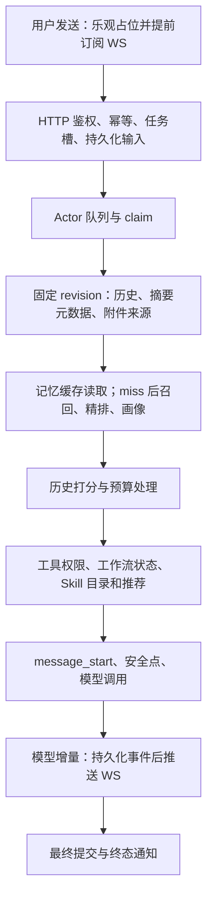
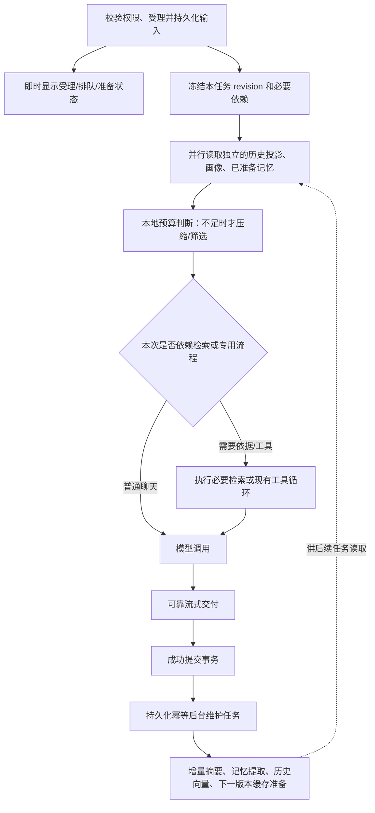

# 聊天响应延迟：公开架构调研与改造方案

日期：2026-10-14。状态：调研完成，方案待确认；本轮不实施、不部署。

发布范围补记：用户随后要求先提交部署现有前端流式显示修复。本文后端架构方案仍未实施，不包含在本次发布行为中；部署结果以受控入口的结构化结果为准。

## 结论与边界

保留现有 PostgreSQL/Redis/Actor/ModelGateway/WebSocket 架构，重整在线关键路径与提交后上下文维护的职责。没有证据需要更换框架、拆成多 Agent 或新增向量数据库。

本方案依据厂商公开文档、官方 Grok Build 源码、本地 Claude Code 参考树和项目 HEAD 57dcd263。公开客户端与参考架构不等于各厂商聊天网站的全部内部设计，也不是统一行业标准；源码版本及来源限制见第 7 节。

此前未经完整架构验证的两处后端修改（budget.py 提前判断、message_scorer.py 并发批处理）已恢复到 HEAD，不作为线上现状或已完成优化。前一轮流式显示修改仍独立保留、尚未部署；它不能解决服务端首段等待。

## 1. 官方证据及适用范围

| 来源 | 已核验的公开建议 | 对本项目的启示与限制 |
|---|---|---|
| [OpenAI：Latency optimization](https://developers.openai.com/api/docs/guides/latency-optimization) | 减少请求，独立工作才并行；无需模型的步骤用确定性方法；采用流式传输并减少用户无反馈等待。 | 先删除无效前置工作，再考虑并发。加载状态不是模型正文，也不能作为首正文延迟改善证据。 |
| [Microsoft：AI App Architecture](https://learn.microsoft.com/en-us/startups/build/ai/ai-app-architecture) | 分段测量排队、检索、模型、编排等；限制并发与扇出；可选增强离开关键路径；按步骤设延迟预算。 | 普通聊天不必等待所有可选增强；权限、必要依据和有效状态必须保留。不能照搬参考场景的秒数当本项目 SLA。 |
| [Google：RAG reference architecture](https://docs.cloud.google.com/architecture/rag-genai-gemini-enterprise-vertexai) | 明确区分数据加工子系统与在线服务子系统；历史资料提前生成向量和索引，查询时使用已有索引，并生成本次 query 向量。 | 历史加工适合异步，但当前问题依赖的检索仍可能必须同步。不能把所有记忆读取一律后台化。 |
| [Anthropic：Building effective agents](https://www.anthropic.com/engineering/building-effective-agents) | 从简单方案开始；复杂 Agent 常以延迟和成本换质量；路由按任务划分；独立子任务才能并行。 | 保留已有执行循环，普通请求尽可能直达所需模型/工具。不新增一次模型分类来决定每条消息走哪个 Agent。原文发表于 2024-12-19，部分工具已变化。 |
| [Anthropic：Context engineering](https://www.anthropic.com/engineering/effective-context-engineering-for-ai-agents) | 支持预取与按需取用结合；压缩需保留决策、约束与未完成事项，过度压缩可能损失信息。 | 采用有覆盖边界的摘要加未覆盖消息，保护当前输入、最新纠正和工具调用配对。 |
| [Google：Context caching](https://docs.cloud.google.com/gemini-enterprise-agent-platform/models/context-cache/context-cache-overview) | 模型上下文缓存可复用前缀，但可能过期/淘汰；缓存需遵守用户会话和权限边界。 | 应用侧上下文缓存与模型侧 KV 缓存是两层机制；缓存失效必须正确回源，不能依赖缓存保证权限或数据正确性。 |
| [Claude Code：工作机制](https://code.claude.com/docs/en/how-claude-code-works)及[Skills](https://code.claude.com/docs/en/skills) | Skill 先提供简介，使用时加载正文；接近上下文上限时先清旧工具输出，再按需总结。 | 官方文档可以独立佐证渐进加载和按容量触发整理；本地第三方代码中的实验预取路径仍不能视为官方全量行为。 |

以上为官方建议与公开参考设计；下面的具体流程是结合本项目提出的建议，并非厂商强制规范。

## 2. 我们现在的完整链路

### 可核查的代码事实

1. 前端提前订阅、乐观占位已经存在：`frontend/src/services/messageSender.ts:96`。不是 HTTP 完成后才开始订阅。
2. Actor 支持 Redis 唤醒，默认扫描 2 秒、并发 5：`backend/services/conversation_worker.py:151`。不能把所有延迟归结为固定轮询等待。
3. Actor 主 DB 使用异步客户端，但 ChatHandler 另用同步 DB；上下文快照、历史读取有同步 execute：`backend/services/handlers/context_snapshot.py:70`、`backend/services/handlers/chat/executor.py:385`。async 函数中调用同步 DB 仍会阻塞事件循环；其具体耗时需要测量。
4. Actor 先构造完整历史/摘要/附件快照，然后才进入 PromptBuilder 的 memory/history/summary gather：`backend/services/handlers/chat_context_mixin.py:135`、`backend/services/prompt_builder/builder.py:364`。所以这个 gather 没有让已读完的历史与记忆真正同时开始。
5. 预算处理先远程评分、后判断是否超预算：HEAD `backend/services/handlers/context_compressor/budget.py:288`。query 非空且历史超过 5 条即可触发 Embedding，尽管普通 Web 历史可能远未超预算。先判断需求是恢复正确流程的一部分，但不是整个架构方案。
6. 记忆缓存 TTL 30 分钟，命中时复用、读取不续期，到期后重新召回；注释虽称整会话固定，实际不能保证永久固定。miss 路径串联召回、可选 LLM 精排、persona：`backend/services/prompt_builder/session_memory_cache.py:28`、`backend/services/memory/memory_service_v2.py:197`。该完整路径没有统一总 deadline。不能改为每轮重召回，也不能生成中途悄悄替换本轮上下文。
7. message_start 在上下文、工作流与 Skill 初始化之后才发送：`backend/services/handlers/chat/execution_engine.py:255`。受理与准备状态应早于正文，但不能把状态当正文或提前发送生成完成。
8. 每个文本块先写 durable event，再推送；模型读取循环 await sink：`backend/services/handlers/chat/actor_sink.py:89`。存在串行数据库背压机制，其实际影响未测量，不能直接删除可靠落库。
9. 后处理分发只在 legacy `stream_lifecycle.py:110` 调用；正式 Actor 成功链为 executor→execute_chat→ConversationExecutionService._commit→终态 observer，没有接入同一摘要/记忆维护分发：`backend/services/conversation_execution.py:206`。
10. 旧摘要写入只更新内容与计数，不写 summary_revision；新快照只接受正 revision 且不超过任务基线的摘要：`backend/services/handlers/chat_context/summary_manager.py:177`、`backend/services/handlers/context_snapshot.py:185`。不能直接把旧更新函数接回去就认为兼容。
11. 历史查询限制了任务基线，但未与摘要覆盖区间联动。需要明确“摘要覆盖到哪里”才能安全读取剩余尾部，不能仅靠摘要存在就任意删减历史。
12. Skill 初始化没有独立 LLM 分类请求：`backend/services/skills/runtime.py:608` 读取目录、权限与绑定；`:613` 的 model_recommendations 是推荐给模型，实际由 `recommendations.py:37` 确定性排序。主模型随后调用 activate_skill 可能增加工具回合，但与初始化不同。HTTP 的额外控制路由也只在存在 running/paused 任务时触发（`api/routes/message.py:250`），不是所有普通聊天的前置步骤。

### 现有线上观测与限制

- 已取得上下文准备 5.7/11.7/14.1 秒的样本；14.137 秒样本有 Embedding 评分超时。该样本 source=wecom，不能当 Web 普通聊天的性能基准。
- 同一样本队列等待约 0.14 秒，Gateway 日志记录的首数据块间隔约 2.09 秒。Gateway 首数据块可能是思考或 metadata，不等于用户首个可见正文；采样日志异步写入且事件没有独立发生时间，该间隔也不能当精确 Provider 耗时。不能把这些值简单相加当完整浏览器 TTFT。
- 生产只读设置：Web history/total 预算均为 200000；企微 history=8000、total=32000。不能把企微的预算压力直接套给 Web。
- 过去 7 天有 chat 任务的会话：Web 50 个，message_count>20 的为 0；企微 2 个，超过 20 条的为 1，该会话存在版本化摘要。这不是延迟分布，也不能据“只有一个摘要”判定所有会话失去摘要功能。
- 没有完整的浏览器首正文与逐块延迟追踪，因此尚不能将“不顺滑”确定归因于数据库、Redis 或模型。

## 3. 推荐流程：在线消费准备结果，提交后增量维护

不新增“每条消息先调用一个路由模型”。依赖判定优先使用已有任务模式、显式 Skill/工具选择与工作流状态；普通自动模式仍保留现有按需调用工具的能力。复杂电商策划、ERP 查询、必须依据知识库的请求继续执行必要流程。

### A. 在线必须完成的步骤

- 身份、组织、会话访问、限额/幂等和输入持久化。
- 本轮用户输入、最近纠正、必要历史和附件的可信来源。
- 当前任务 anchor/revision 冻结、主动指定或固定 Skill 的校验。
- 安全的 token 上限处理、工具权限与必要检索。
- 计费、fencing、最终提交与可靠交付。

这些步骤不能为速度被省略，也不能拿旧缓存代替当前权限检查。

### B. 提前维护的稳定资料

- 已提交历史的文本投影、token 计数、消息向量；key 至少包含组织、会话/所有者、消息 ID、内容 hash 和处理模型/算法版本。
- 已完成轮次的增量摘要、长期记忆提取，及下一轮可复用的闭合历史投影。
- 发布版本不变的 Skill/工具描述等控制面资料可缓存；启用状态、个人绑定与权限仍需按当前身份校验。

新用户输入的 query 向量和当前问题确实需要的检索可能仍在线发生，不能全部提前计算。

### C. 记忆和可选增强的等待政策

第一批保留当前缓存复用与本轮上下文冻结，不改变跨轮生效政策。后续可在会话建立/打开后，在明确用户与组织边界内准备可复用的记忆与画像；预热操作幂等合并，避免每次页面渲染都触发付费处理。首轮 query 尚未知时只准备 query 无关的部分，不能用无关 query 预热后冒充首轮召回结果。

普通个性化召回与自动推荐可有独立等待预算；显式“根据以前记录/指定资料回答”的依赖属于必要依据，超时应如实说明或继续明确等待，不能静默跳过后装作有依据。不确定是否必要时保守处理，不默认丢弃记忆。

任何降级策略都是待确认产品行为。第一批不强制启用新的记忆降级；先测量、复用准备结果和修复无效打分。已有结果一旦进入本轮 prompt 就冻结，晚到结果仅供未来任务，不能动态改写正在生成的上下文。

源码对照进一步确认要区分常规路径与必要慢路径：首次必需记忆读取、接近容量上限的压缩、当前问题必需的资料检索仍可能阻塞。它们应有真实状态、耗时记录和取消机制。不能承诺所有请求都直接进入模型，也不能用零等待预取替代明确要求的依据。

### D. 成功提交后的可靠维护闭环

在 Actor 成功提交的同一事务记录待维护事件，至少按 conversation + committed revision + job kind + handler version 去重；只有真正 committed 的结果才能触发。不能仅在发送 message_done 后用 create_task 代替持久任务。

复用现有 PostgreSQL/Redis/worker 技术栈，不引入新的消息系统。后台消费者与在线生成采用独立并发额度；重启后可扫描恢复；重复投递、重试不重复提取记忆或覆盖新摘要。后台失败不回滚已经成功的回答，但保留可见状态和重试证据。

摘要必须记录明确覆盖区间（through message/commit revision）和生成版本，采用条件更新防止慢的旧任务覆盖更新的摘要。在线只使用不越过本任务基线的摘要，再读取未覆盖尾部；旧摘要没有可靠覆盖元数据时回到现有历史策略，不能直接给它补上“当前 revision”。消息修改、软删除和权限变化均需检查缓存有效性。

### E. 同步 I/O 与按需初始化

将在线异步函数中的同步数据库读取移到明确的异步 repository 或受控线程执行边界；不共享跨线程连接/事务。仅对独立读取并发，保持组织范围和同一冻结基线。取消线程等待并不等于终止 SQL，数据库需要对应查询预算与连接回收。

已有强约束初始化（手选 Skill、固定绑定、已保存专用工作流恢复）保留；普通聊天的可选推荐和重型控制面扫描不能无界阻塞模型启动。是否延后某一步要由其依赖和观测决定，不根据 Skill 名称随意跳过。

### F. 受理状态与流式交付

受理后及时展示真实 accepted/queued/preparing/generating/tool 状态，用户可在准备阶段取消；沿用现有占位符与任务 ID，避免另建一个假回答。状态反馈与首个模型正文分别计时，不以空 message_start 或打字动画替代性能改善。

首批不改逐块 durable 语义。若观测确认数据库 append 占主要逐块延迟，再单独设计短窗口聚合；必须保留 event ID、delivery_seq、fencing、暂停/取消刷盘、断线重放和恢复一致性。

## 4. 实施分批与验证

| 批次 | 范围 | 验证及放行条件 |
|---|---|---|
| 1：计时与已证实的无效工作 | 既有 observability 旁路分段计时；严格沿用现有历史集合和 token 算法，未超预算时不评分。暂不新增 WS 状态、不重整 DB 读取、不改变记忆政策 | 未超预算 prompt 不变且 scorer/Embedding 调用数为零；超预算结果与原策略相同；计时失败或变慢不影响执行；不改变冻结上下文、权限、Skill、暂停恢复与计费 |
| 1B：按分段证据选择 | 独立 I/O 边界、准备状态及取消反馈，各自完成接口与状态设计后实施 | 相同 anchor/revision；连接和事务不跨线程滥用；准备期间暂停/取消真实集成验证；新增状态不改变 durable 事件序号和终态语义 |
| 2：后台维护闭环 | Actor commit 后幂等维护、摘要覆盖区间、历史向量和缓存准备 | 提交失败不产生维护任务；成功后崩溃可恢复；重复任务不重复写；旧任务不覆盖新版本；冷缓存、缓存过期、软删除及跨组织均正确 |
| 3：按测量选择 | 必要/可选依赖等待预算、冷会话策略、可能的 durable 分块聚合 | 用户确认降级语义；证明质量无实质回退；逐块持久化确为瓶颈时才修改交付；故障注入验证暂停、重连、去重和计费 |

具体职责位置：

- 受理/准备反馈：api/routes/message.py、handlers/chat/actor_enqueue.py、handlers/chat/execution_engine.py、WebSocket 投影。
- 上下文读取与预算：handlers/context_snapshot.py、chat_context_mixin.py、prompt_builder/builder.py、context_compressor/budget.py。
- 会话记忆准备：memory/memory_service_v2.py、prompt_builder/session_memory_cache.py。
- 提交与维护：conversation_execution.py、现有记忆/摘要维护器，及最小持久维护任务结构。
- 实际上游首输出：model_gateway.py 与 observability/model_sampling.py；区分 metadata、思考、工具、正文。
- 交付测量：actor_sink.py、conversation_delivery_store.py、Redis/WebSocket、前端接收/首次绘制。

## 5. 验收指标与保留约束

同一 request/turn ID 记录：HTTP 受理、Actor 排队、snapshot/history、memory、budget/scoring、Skill/工具准备、模型槽位等待、provider 首数据块/首思考/首正文、durable append、浏览器接收/绘制、完成。

按 Web/企微、具体模型、思考模式、冷/热缓存、历史 token 数、普通聊天/工具任务分别统计 p50/p95。用相同输入、模型和基线比较；不把企微样本或缓存热身后的最佳结果当所有请求。

先建立基线，再确认数值 SLO；不承诺所有模型两秒内出字。首批的确定性目标是：未超预算时远程历史评分调用数为零；后台维护不进入本轮首正文等待；有真实进度；权限/冻结/记忆与回答质量不退化。

发布时分开控制新读取策略与后台维护；回退新读取仍可使用原历史路径，已完成回答和旧 checkpoint 保持可恢复。数据迁移必须覆盖旧记录、RLS、审计和软删除的生产结构，先隔离验证再受控发布。

## 6. 当前未解决与待确认事项

- 首段前各阶段的完整生产分布尚缺；已有日志不能解释每条 Web 请求为何慢。
- 记忆冷启动降级政策、摘要覆盖模型和后台任务结构属于本方案的架构决定，未实施。
- 同步 I/O、模型排队和逐块数据库背压的实际贡献待追踪；不能宣称唯一根因。
- 已有缓存和旧链路摘要/记忆实现，但 Actor 维护闭环尚缺，应接通和修正，不重复建设。
- 本轮只增加本调研/方案文档并撤回未确认后端优化，未部署任何修改。

## 7. Grok 与本地 Claude Code 的源码对照

### 来源和固定版本

- 官方 [xai-org/grok-build](https://github.com/xai-org/grok-build/tree/2bdd1d6a6369de0e8c68132ea4539e9abd9e14a8)：审查 commit `2bdd1d6a6369de0e8c68132ea4539e9abd9e14a8`，`SOURCE_REV=559751fdcec02d413e4c57c8832ab275e4f44980`。仓库公开的是 Rust CLI/TUI 和 agent runtime，按期从其 monorepo 同步；不包含可据此核验的 grok.com 完整线上服务架构。
- 官方 [grok-1](https://github.com/xai-org/grok-1) 是开放权重模型的 JAX 加载/推理示例，不能拿它解释聊天编排、Skill 或 WebSocket。
- 本地主要参考 `/Users/wucong/claude项目参考/claude-code-mirror`，HEAD `494f7612806a20dcc6aac677e0dda2976518e585`，package 版本 `0.0.0-leaked`。README 自称为 2026-03-31 快照的第三方镜像；不能独立证明来源完整性或等同当前官方版本。
- `/Users/wucong/claude项目参考/claude-code-source`，HEAD `430502e7bbe7e502d08619722ebc869b92bdd826`、版本 `999.0.0-local`，是第三方修复版；抽查核心 query/context/compact/API 文件与 mirror 仅末尾空行不同。`claude-leaked-files` 内容不全，`claw-code` 是重写，均不作为官方实现证据。

本轮仅静态阅读，没有执行这些源码、安装脚本或模型，也没有读取账号凭证/会话内容。以下 Claude 结论仅表示这份本地参考树的行为；官方文档核验与第三方源码观察分开使用。

### 可复用机制及必须保留的边界

| 机制 | 实际源码证据 | 对我们的建议 |
|---|---|---|
| 必需资料等待，稳定资料复用 | Claude [queryContext.ts:61](/Users/wucong/claude项目参考/claude-code-mirror/src/utils/queryContext.ts:61) 用 Promise.all 获取独立上下文；[context.ts:116](/Users/wucong/claude项目参考/claude-code-mirror/src/context.ts:116)、`:155` 会话内 memoize。Grok [turn.rs:2133](https://github.com/xai-org/grok-build/blob/2bdd1d6a6369de0e8c68132ea4539e9abd9e14a8/crates/codegen/xai-grok-shell/src/session/acp_session_impl/turn.rs#L2133) 首次准备记忆，后续复用已有块；旧记忆模式的 search 仍在 `:2303` await。 | 不每轮重扫稳定资料；缓存按组织/用户/会话/配置版本隔离，失效后正确回源。保留当前缓存读取与本轮冻结，跨轮生效政策单独确定。不要宣称两者从不等待记忆。 |
| 昂贵整理先检查必要性 | Claude [autoCompact.ts:225](/Users/wucong/claude项目参考/claude-code-mirror/src/services/compact/autoCompact.ts:225) 先估算容量，未达阈值 `:275` 返回；达到阈值时 [query.ts:454](/Users/wucong/claude项目参考/claude-code-mirror/src/query.ts:454) 仍等待压缩。Grok [turn.rs:2869](https://github.com/xai-org/grok-build/blob/2bdd1d6a6369de0e8c68132ea4539e9abd9e14a8/crates/codegen/xai-grok-shell/src/session/acp_session_impl/turn.rs#L2869) 也是检查后同步压缩。 | 先本地判断是否超预算，再做必要评分/压缩。我们未超预算仍远程评分是明确流程问题；不需要先引入更复杂的压缩引擎。 |
| 提前准备也必须验证版本 | Grok [compaction.rs:179](https://github.com/xai-org/grok-build/blob/2bdd1d6a6369de0e8c68132ea4539e9abd9e14a8/crates/codegen/xai-grok-shell/src/session/compaction.rs#L179) 的受控 two-pass 路径在容量阈值前启动预取，`:337` 应用前校验模型、前缀长度与内容 fingerprint；预取未结束时 `:325` 仍可能等待。 | 稳定历史可以提前处理，应用时必须校验覆盖边界和 revision；不能让旧后台结果覆盖新历史。我们目前短 Web 会话没有证据需要立即复制 two-pass。 |
| 可选预取和维护离开首字前串行链 | Claude [query.ts:297](/Users/wucong/claude项目参考/claude-code-mirror/src/query.ts:297) 启动一次相关记忆预取，`:1592` 只消费已完成结果；`:999` 不等待 post-sampling hooks。SessionMemory [sessionMemory.ts:272](/Users/wucong/claude项目参考/claude-code-mirror/src/services/SessionMemory/sessionMemory.ts:272) 串行维护，`:343` 推进覆盖消息 ID。 | 可选增强可以重叠执行；明确依赖历史的请求不能丢检索。CLI 的进程内后台任务不满足我们的可靠性要求：Actor 提交后维护仍需持久化、去重和崩溃恢复。 |
| Skill 目录和正文分开 | Grok [listing.rs:17](https://github.com/xai-org/grok-build/blob/2bdd1d6a6369de0e8c68132ea4539e9abd9e14a8/crates/codegen/xai-grok-tools/src/types/skill_discovery_tracker/listing.rs#L17) 原生格式单项描述与 when-to-use 合计限制 400 bytes（兼容模式有不同格式），正文调用时加载。Claude [SkillTool/prompt.ts:20](/Users/wucong/claude项目参考/claude-code-mirror/src/tools/SkillTool/prompt.ts:20) 限制简介与总目录预算，完整正文在 Skill 调用时展开。 | 沿用目录发现→按需激活；优化重复目录/权限 I/O。我们的初始化本身也没有每轮额外分类模型，不能据此提出“删除分类模型”这种不对应代码的修复。 |
| 流消费与本地保存可以分开，但可靠性契约不同 | Claude [QueryEngine.ts:716](/Users/wucong/claude项目参考/claude-code-mirror/src/QueryEngine.ts:716) 不等待 assistant transcript 保存，最终按场景 flush；Grok [updates.rs:425](https://github.com/xai-org/grok-build/blob/2bdd1d6a6369de0e8c68132ea4539e9abd9e14a8/crates/codegen/xai-grok-shell/src/session/acp_session_impl/updates.rs#L425) 将持久化入队与 live gateway 转发分开，无逐块磁盘确认等待。 | 测量我们的 durable append 是否导致背压；若需要再设计聚合。不能直接删掉落库，CLI 本地恢复不等同多进程服务端的 fencing/断线重放承诺。 |
| 输出显示策略与服务端等待分别评价 | Claude [REPL.tsx:1458](/Users/wucong/claude项目参考/claude-code-mirror/src/screens/REPL.tsx:1458) 接 delta 后由 Ink 合帧，并在 `:1473` 隐藏未完成行；并非逐字动画。API [claude.ts:1933](/Users/wucong/claude项目参考/claude-code-mirror/src/services/api/claude.ts:1933) 区分首块前等待与后续流停顿。 | 没有“大厂统一逐字输出”的标准。前端平滑不算后端提速；继续分别测量首协议块、首可见正文与逐块交付。 |

Grok [request_builder.rs:19](https://github.com/xai-org/grok-build/blob/2bdd1d6a6369de0e8c68132ea4539e9abd9e14a8/crates/codegen/xai-chat-state/src/actor/request_builder.rs#L19) 从已有 Actor 状态组装请求；其中工具历史裁剪在利用率达门槛后执行（`:107`），这一组装路径没有外部相关度评分请求。它同样采用 Actor，说明不需要因当前延迟推翻我们的 Actor 方案。

Grok [turn_phases.rs:8](https://github.com/xai-org/grok-build/blob/2bdd1d6a6369de0e8c68132ea4539e9abd9e14a8/crates/codegen/xai-grok-telemetry/src/spans/turn_phases.rs#L8) 记录模型前等待、sampling、工具阻塞、compaction 与首输出；[sampling_events.rs:14](https://github.com/xai-org/grok-build/blob/2bdd1d6a6369de0e8c68132ea4539e9abd9e14a8/crates/codegen/xai-grok-shell/src/session/acp_session_impl/sampling_events.rs#L14) 区分 reasoning 首 token 与有意义的文本输出。其客户端模型首输出仍不是我们浏览器首次绘制，前端测量必须另加。

源码研究支持的调整是：保留必要编排；稳定输入提前维护并复用，昂贵工作按需触发，普通请求减少无效前置步骤，必要慢路径显式反馈。它不支持“所有记忆/摘要全部异步”“完全取消 Skill 编排”或“CLI 快所以删服务端可靠落库”。

实施顺序按第 4 节收窄：先取得分段基线并修复确定性无效工作，再按证据选择 I/O 与状态优化、补 Actor 后台维护闭环；可选记忆降级、two-pass 压缩及 durable 聚合不进入首批。上述源码没有提供我们 Web 请求的性能分布，本轮仍不能宣称某一步是全部延迟的唯一根因。

## 8. 修改前的链路安全审计（2026-10-14）

用户要求先核查完整链路及可能回归，再修改。本节为只读审计和实施边界；本轮没有新增后端业务代码、数据库或生产变更。已有前端显示层改动仍未部署。

### 已补查的交付边界

- HTTP 发送前已经生成稳定 request/task/message ID、乐观占位并订阅（`frontend/src/services/messageSender.ts:96`），不能借提速重建占位或改变请求幂等键。
- 前端以 stream + execution attempt + delivery sequence 去重；缺序时请求重放而非继续追加（`frontend/src/contexts/messageStreamProjection.ts:112`）。`WebSocketContext.tsx:135` 重连携带游标，`:155` 组织切换清除旧映射。这些不是可跳过的性能开销。
- `stream_end` 仅表示模型流停止，不表示提交成功；最终完成依赖 message_done/error 或权威暂停快照（`frontend/src/contexts/wsMessageHandlers.ts:142`）。不能把 accepted/preparing、模型流结束与持久成功混成同一种状态。
- 原显示层 hook 仅消费已存内容，终态、恢复快照、非追加替换立即显示原文；Store、WS 投影和持久内容不使用动画后的截断文本。已有 134 项定向测试与 TypeScript 验证复用，本轮未因只读审计重复运行。

### 计时本身不能改变链路

- `backend/services/agent/observability/model_sampling.py:105` 已将采样日志放到后台线程；事件字段 `:40` 没有实际发生时间。未来计时需在执行节点用 monotonic 捕获阶段起止/时长，再旁路发布，不能用日志落盘时间推算精确阶段耗时。
- `handlers/chat/stream_setup.py:95` 中 memory=0ms 是固定文本，不是独立测量；`:136` 的 starting 日志仍在权限和 Skill 初始化之前。未来必须记录真实阶段，不能用这些字段证明 memory 无耗时或 Provider 已启动。
- 浏览器总耗时使用浏览器自己的时钟，服务端阶段使用服务端自己的时钟；跨端用 request/task/attempt ID 关联，不能直接相减不同机器的绝对时间。
- tracing 不新增逐块同步数据库写入，不承载输入/输出正文、Token 或密钥；采样失败必须保持 best-effort。只记录首思考/首正文等边界一次，避免按每个 chunk 生成无界后台任务。

### 第一批严格限制

预算提前判断必须使用与 core 完全相同的历史集合、归档判定，以及逐条 `_msg_tokens` 求和。不能改为整批 estimate_tokens（存在舍入差异），不能同时改变参与评分的消息集合、保护尾部、评分阈值或 Embedding 并发。目标是未超预算时 prompt 完全相同，只减少无效外部请求；超预算保留原算法。

受理状态、数据库异步化、记忆等待政策、摘要覆盖读取、后台维护、durable 聚合均不与这项修改捆绑。它们分别涉及协议、事务、上下文和恢复语义，应在对应证据和测试充分后单独实施。

### Actor 与恢复不变量

| 约束 | 已核验位置 | 修改边界及已有验证入口 |
|---|---|---|
| 重试/恢复沿用原历史基线 | `migrations/277_chat_image_sources.sql:19` 保留旧 revision/through；`:206` 首次 claim 冻结；`chat/stream_setup.py:56` 恢复直接使用 checkpoint messages | 不读最新历史替换原基线。`test_context_snapshot.py:65,104,127,141,220`、`test_conversation_cache.py:22,47,89`、`test_chat_generation_executor.py:319,368` 已有对应测试 |
| 只有当前 owner 可执行与提交 | `277_chat_image_sources.sql:148` 锁与 claim；`conversation_execution.py:173,226` 续租及 ownership loss；`122_conversation_actor_terminal.sql:64` commit fencing | 不改变 claim/token/attempt/租约。`test_conversation_actor_recovery_integration.py:118,187` 是实际 PostgreSQL 竞争测试入口；`test_conversation_execution.py:303,323,346` 覆盖取消旧执行与关闭 |
| 暂停/取消先保存安全点 | `conversation_turn_runtime.py:158,211` checkpoint 与刷盘；`chat/actor_sink.py:212,237` required flush；`239_conversation_actor_production_contract_compat.sql:479,561` pause/resume 约束 | 不跳 required flush、不把 paused 当 completed。`test_chat_actor_sink.py:152`、`test_conversation_actor_pause_snapshot_integration.py:166` 有对应验证。现有 engine 准备过程多为 mock，不能据此承诺真实记忆准备时即时暂停 |
| 自动模型重试不能拼接已输出正文 | `model_gateway.py:267` 有输出后禁止自动换模；`message_generation_helpers.py:327` 用户失败重试沿用助手消息；`message_turn_anchors.py:24` 保留原输入 | 保持自动重试与用户重试区别。`test_model_gateway_retry.py:158,191,225,305`、`test_message_idempotency_route.py:46` 是相关入口 |
| commit 才是完成及计费事实 | `122_conversation_actor_terminal.sql:51,81` 幂等提交、扣费、消息及 close revision 原子更新；`conversation_execution.py:206` 先提交后通知 | 通知失败不改写 failed；提交回包丢失不触发假失败重试。`test_conversation_execution.py:221,240,365,381`、`test_model_gateway_credits_integration.py:15` 有对应验证 |
| durable 事件序号与重放保持原义 | `248_conversation_delivery_event_idempotency.sql:39` 只允许现有五类事件，`:57,70` fencing 与 event ID 幂等；`241_conversation_delivery_session.sql:330` snapshot 后补增量 | tracing 走旁路，不能插入 preparing 新事件或提前借用 message_start。`test_chat_actor_sink.py:207,223`、`test_conversation_delivery_session_integration.py:108`、前端 `wsMessageHandlers.test.ts:365,777,841` 有相关覆盖 |

上述为测试源码覆盖审计，未在本轮重跑这些测试，也不等于真实环境全部通过。第一批不改变这些契约，验证围绕实际差异展开；以后改变其中任何机制时，再运行对应集成与故障测试。

### 预算局部等价证据与仍需补的验证

评分器只返回分数，没有修改 messages、摘要、业务数据库或会话缓存；其额外副作用是 Embedding 请求、HTTP 客户端初始化和日志。现有 core 在未超预算时不使用分数直接返回，因此可提前做同一判定。计数仍包含 reasoning、provider output 和 tool-call 参数；保护尾部仍是最后四条非归档 user/assistant 消息，不能描述成严格的两个完整对话轮。

只在 `/tmp/chat-budget-readonly-audit.py` 的内存 AST 候选中插入相同 guard，没有修改仓库业务文件。固定随机种子与确定性评分桩完成 6000 次同步/异步新旧差分：3866 次预算内/无历史跳过评分，2134 次超预算继续原评分，消息结果全部相同，外部调用为零。它支持控制流等价，不代表 PromptBuilder 集成、外部评分质量或线上耗时已经验证。

实施前/实施时需要将以下验证纳入仓库：

1. 异步预算内至少六条消息且 query 非空，scorer 零调用，完整 messages 和冻结 snapshot 均不变；同步入口也验证。
2. 恰等于预算、低一 token、逐条取整不同于整批取整；包含 reasoning/provider output/tool-call 参数。
3. 超预算使用固定分数，新旧排序、末尾四条、归档及历史交付事实不变；工具消息/调用 ID 保持。
4. Web/企微 PromptBuilder 保留真实预算函数、只替换 I/O 与外部 Embedding，比较送往模型的完整 messages。现有测试中 mock 预算的部分不足以证明这点。
5. tracing 关联阶段及 attempt；异常/取消时收口，不吞 CancelledError；慢或失败的指标发布不影响首输出。首块、思考和正文分别计时。

回滚第一批只需恢复原评分调用路径并关闭新增旁路观测，不需要回退数据库或重写任务/checkpoint。具体开关粒度应随实施范围确定，不能凭日志减少就宣布整体延迟已解决。

### 后台摘要/记忆暂未达到直接接线条件

1. `conversation_execution.py:382` 的 terminal observer 是事务后 best-effort，失败被捕获。维护任务若仅在这里创建，会有提交成功后崩溃漏任务及重复回调风险。需要在提交事务内记录幂等维护事实，外部模型处理在事务外执行。
2. `summary_manager.py:88,176` 使用计数和 created_at，摘要切片覆盖范围与 summary_message_count 含义并不一致；没有 closed revision/CAS。不能仅补写当前 summary_revision，必须先定义确切覆盖边界，再兼容 Actor reader 和旧记录。
3. 现有 `conversation_deliveries` outbox 是企微专用，channel/kind 和 worker 有专用协议（`migrations/124_conversation_delivery_outbox.sql:4`、`134_web_user_wecom_delivery.sql:8`），不能冒充通用维护队列。应复用其成熟机制，单独定义维护 job 的幂等、租约、重试和权限。
4. `memory/pipeline_scheduler.py:40,148,223,322` 的计数读改写、L1 模型等待、L2 进程内 timer、L3 进程内锁/pending 都不足以直接提供跨进程幂等恢复。旧 `chat_context_mixin.py:219` 的抽取来源也不是可靠真实 turn/message ID。后台接入前必须提供真实来源和可重放语义，不在第一批顺手修复。
5. 当前记忆缓存读不续期、miss 无 single-flight；`delete_session_memory` 未查到实际调用。后续需要明确记忆删除/关闭和跨轮缓存的优先级。读取前现有个人上下文门禁及 owner/org/group scope 必须保留；这些缺口不能直接推断成已发生跨用户泄漏。

第二批必须验证：提交回滚无 job；提交后崩溃可恢复；重复/回包丢失只入队一次；失效租约不发布；旧摘要晚完成不覆盖新版本；旧分支不读未来摘要；覆盖尾部无遗漏；失败/取消轮次不抽取；跨组织/群聊边界正确；记忆删除/关闭与缓存一致；worker 重启恢复。现有旧摘要与 memory 单元测试多依赖 mock 或算法复写，不能替代这些真实数据库和调度场景。

审计完成不代表所有优化均已达到实施条件：第一批已有局部等价依据，仍需仓库集成回归；普通 Web 精确分段基线、准备期间真实取消、后台维护契约和新状态协议仍是明确缺口。实施时只推进证据充分的一批，完成验证后再扩大范围。
