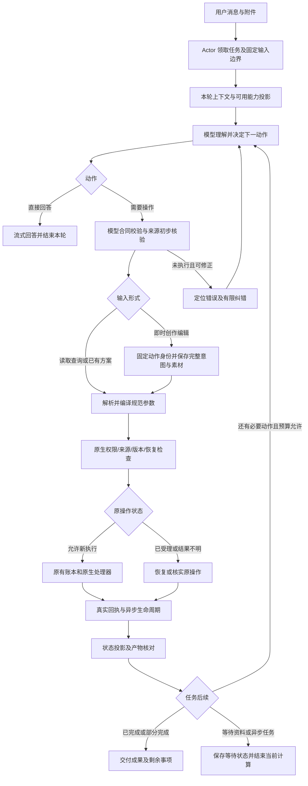

# 通用对话执行架构最终改进方案

2026-11-20。状态：完成代码风险复核及整体架构、用户任务、工程实现三视角复审的实施设计；尚未实施业务变更。

本文件是本任务后续实施的方案入口。此前[总体诊断](TECH_通用对话执行架构诊断与改进方案.md)和[Grok 源码深度对照](TECH_通用对话执行架构深度设计与迁移风险.md)保留为依据；涉及实施选择，以本文为准。代码基线 `4ca37b6703aef49147bec23a533ebb2acc769cc0`，Grok 对照基线保持不变。

## 1 采用的最终方向

保留 Conversation Actor 及模型主导循环，统一其上下文、工具合同、素材选择、错误恢复和交付投影。原生工具执行、审批、操作账本、图片 worker、积分结算继续由现有系统负责。新入口不拥有第二套执行/计费体系。

用户可以自然表达问答、分析、创作、修改和操作；模型按本轮实际能力决定回答、读取资料、调用工具或最小追问。问答不强制规划，上传图片不自动构成生成许可，简单编辑不强制用户先查看一份策划文档。已有“策划→保存→选择→执行”继续支持。

本轮将已识别风险全部纳入设计控制和验收条件。“设计上已处理”不等于“运行中已排除”：未实施的路径不能宣布验证通过。权限越界、重复副作用、状态不可读属于阻止对应新入口启用的问题；实测证据缺失时保留旧入口运行，不以绕过校验解决。

## 2 复核后补充和修正的事实

1. `tools/runtime.py::execute` 不是简单转发：可信身份刷新、文件解析、来源证明、已有调用 replay、新图片合同校验、确认及执行前复核有特定顺序。新合同层包住新输入，不重排这些步骤。
2. `tools/policy.py::_binding` 同时绑定规范工具定义、参数、身份、范围和资源版本。为模型简化 Schema 时，不能直接替换 policy 使用的 `ToolSpec.schema`。
3. `task_execution/image_operations.py` 遇到账本写入是否提交不明会停止，不返回模型任意重试；接受回执缺少真实 task/message ID 时保持 uncertain。此行为是约束，不是待“优化掉”的繁琐步骤。
4. `handlers/chat_image_lifecycle.py` 在持久化发送标记后仅单次提交供应商；连接建立失败、明确拒绝与读写超时区别处理。unknown 不自动重发；不确定超时有用户退款、平台承担可能费用的现有策略。本方案不更改这些财务语义。
5. 当前图片受理 RPC 的后续定义在 `339_skill_composition.sql`，worker claim 又有 `283_detail_page_generation.sql` 更新。只测 273/278 不能证明当前 Skill 组合受理行为；必须同时覆盖 339 的合同与回滚保护。
6. `TaskState` 是 frozen、extra forbid；恢复调用 `model_validate`。新增持久字段并不天然向后兼容，不能把 metadata 当成任意扩展口袋。
7. 前端已用 task、attempt、context revision 和 artifact ID 处理旧事件与去重。需要沿用这些身份，不能另造只按“最新一张图”的投影。

上述是现有机制及兼容约束，不是在声称它们已经覆盖所有未来新路径。实际生产库对象和权限未在本轮读取；发布时仍须走项目现有迁移/数据库身份验证。

## 3 最终通用流程

这张图是职责流，不覆盖 `runtime.execute` 内既有 replay/权限顺序。执行事实来自处理器和账本；文字、Skill、工具发现结果都不能赋予权限或宣布任务完成。

### 3.1 本轮上下文

复用当前快照和 image_sources，投影本轮文本、当前附件、相关历史、成果版本、原操作状态。短引用只在固定 turn/scope 内有效；服务端将其映射到已有 message/content index/file/asset/task 身份。不得接受模型传入的 actor、owner、scope 作为可信身份。

每项素材区分可定位、已视觉加载、用途及版本。正文与图片元数据不能假装视觉观察；读取历史图片受现有权限与视觉预算限制。历史摘要用于找线索，不作为完整提示词或图片字节的替代。

只有服务端引用解析或模型已检查可见上下文后仍无法唯一定位时，才返回有限候选并最小追问；不能把“目前还没查找”当成“用户没说清楚”。当前多图不能全部自动用于生成；analysis-only 不变成 input。保留未改要求，编辑生成新版本；原稿、选中成图和重试原任务分别处理。

### 3.1.1 任务身份与追加消息

“第二张再浅一点”“继续”首先关联可核实的活动任务、用户明确选中的成果或仍待回答的问题；“再做一张”“重新生成”是新的用户动作，不等于对原调用的网络重试。新动作必须由可信用户消息身份和选中目标建立新的 effect 版本/任务义务，不能只因参数相同就吞掉，也不能只因模型换了 call ID 就重复执行。

补充答案只填补当前待澄清问题；修改请求产生需求版本变更；新任务建立自己的目标关系。目标归属不明确才追问。跨 turn 不直接复用 image_1 这样的短引用；先从持久资源身份在新 turn 重新授权投影。

用户在执行中追加要求时，必须区分：尚未发送则用现有 revision gate 阻止旧派发；已经发送则说明旧任务仍可能完成，新要求作为新版本处理。对依赖旧成图的修改，成图未完成前保存等待依赖，不能悄悄改用原图。

### 3.2 工具合同与发现

建议新增 `tools/model_contracts.py`，从现有 ToolSpec 与控制类型派生合同，负责模型 Schema、确定性编译器、相关错误定位及合同指纹。不是第二份手工工具注册表。

同一份本轮最终模型合同供 Actor 和子 Agent 校验。控制动作仍由 host handler 实现；保存控制不因为不是业务处理器就省略校验、身份和恢复边界。未知字段/错类型/互斥条件明确报错，不静默删除可能改变语义的筛选条件。

发现先按现有权限限定候选，再做工具精确名、控制合同自省、动作/对象同义词与描述检索；相关候选带可调用合同和 ready/partial/unavailable 事实。检索只产生候选，不直接执行，不把没有召回等同没有能力。先不引入新向量服务或分类模型；后续算法由真实中文任务评测决定。

供应商适配必须保留约束语义。某供应商不支持某结构时，采用经验证的等价投影及服务端校验，或明确拒绝该能力组合；不能删字段/约束来伪造兼容。

### 3.3 保存与即时编辑：分两步交付，最终汇入同一链

**第一步修好现有协议。** 保留 `save_task_text` 和 `generate_image(content_source=...)` 的当前形式，明确 materials 路径、用途、continue_execution 含义和错误示例；去除决定素材丢失的措辞正则。模型按正确合同完成调用，先解决现有问题，不同时改变恢复协议。

**第二步提供即时语义入口。** 模型提交完整修改意图、明确素材引用和受支持规格；后台保存同样的 ContentRecord，再编译到同一个原生 generate_image。用户不需要看内部登记文档。已有方案选择走固定 artifact/item/revision，不再生成一份近似正文。

第四阶段实现复用 `generate_image`，增加互斥的 `draft` 用法。一次即时调用限一张图，且单独提交。明确选用已保存方案、使用既有图片方法或电商策划时继续走原选择入口。当前输入版本已有即时动作时，模型换调用 ID 依然指向该次动作。用户新消息具备新的输入身份，可以提出新的生成动作。

版本化记录 `_inline_media_action` 使用 `version=1`，和 ContentRecord、规范调用绑定及已解析原图的配方一起提交到现有 TaskCheckpointStore。记录绑定当前任务及会话执行轮，保存外部调用 ID、确定性内部保存 ID、用户输入版本摘要、原始参数和规范参数摘要、原稿身份和摘要。原生操作沿用外部调用 ID。操作与受理状态来自原账本。外部对话中的原始工具调用只对应一条工具结果。

| 中断窗口 | 恢复行为 |
|---|---|
| 参数或来源校验失败，或准备提交未完成 | 没有已确认的准备记录就停止派发。原稿及原生配方在一次本地事务中提交 |
| 准备记录已提交，原生账本中没有相应操作 | 核对调用、原稿、配方和用户输入版本，继续使用原身份进入派发前权限和版本检查 |
| 原生已登记，受理结果未知 | 复用原生核实逻辑。未找到受理证据时保留未决，不分配新提交 |
| 原生已受理，但回执或通知丢失 | 找回同一图片任务及消息，继续原生命周期 |
| 最终结果已落库，页面未收到 | 通过现有任务、消息和尝试身份恢复展示 |

存量动作的恢复读取与新入口开关独立。通过 `CHAT_INLINE_IMAGE_ENABLED=false` 可统一关闭新的即时调用，保留原方案入口与已经登记动作的恢复。切回不认识该记录的旧二进制前，需要先处理存量。后续用户轮次和异步续接保留原稿与原生账本，清掉属于上一执行轮的即时动作索引。

### 3.4 错误与有限恢复

统一模型可见错误包含 code、stage、精确 path、最小合法示例和 recovery.action；真实已知时携带 accepted/completed/operation_id，未知值不能默认 false。内部错误详细信息留在受控日志，避免重复输出全文、密钥或内部作用域数据。

| 状态 | 允许动作 |
|---|---|
| 明确未派发的形状错误 | 修正字段；不顺便改正文、素材用途、规格或业务条件 |
| 缺来源/候选不唯一 | resolve/最小追问 |
| 当前权限或确认不满足 | 走现有授权流程或停止 |
| 原操作 reserved/accepted/uncertain | 核实或等待原操作，禁止模型新造调用绕过 |
| 确认无外部副作用的暂时故障 | 适配器按其安全规则有限重试 |
| 不支持或不可恢复 | 真实说明限制，交付已有部分成果 |

传输重试、模型纠错、异步轮询分别计量。通用纠错按目标+固定输入版本+错误类别统计，无效换字段不重置；其他目标成功不刷新失败项预算。分页游标变化、实际读到资料、授权补齐和已受理才是各自真实进展。跨重启预算使用版本化 checkpoint，沿用已有图片纠错的持久 allowance 思路，模型不能设置余额。

### 3.5 用户可见体验与组合任务

内部合同错误由模型修正，用户只看到当前进展、实际需要补充的信息和结果；不要求用户理解 materials、checkpoint、content_source 或填写内部 Schema。来源唯一且指令清楚时直接执行，不为每次图片操作增加一次额外确认；现有政策要求的确认仍保留。

| 用户场景 | 必须呈现的行为 |
|---|---|
| 单图“把背景换成木桌” | 使用当前图，保留主体，直接进入任务；不先展示一份登记文档 |
| 只上传图，没有操作要求 | 理解/询问其用途，不擅自产生付费生成 |
| “第二张浅一点”，且刚才只有一组图 | 读取并定位第二张，保留其他要求；不让用户重传或提供文件 ID |
| 两组图都存在第二张 | 用可识别缩略图/所属消息或简短描述让用户选择，不暴露内部 ID |
| “再做一张” | 新增一个明确生成动作，保留旧结果；不误当重复请求直接复用旧图 |
| “先别做，只改提示词” | 只保存/交付文本新版本，不产生图片任务 |
| “剩下两张也做” | 仅处理未完成目标，已完成项不重做不重扣 |
| 任务未完又发“背景再浅一点” | 未发送则更新需求；已发送则解释当前状态，新版本不假装撤销原请求 |
| 读文件后导出报告 | 读取原文件、按要求形成可打开的文件，提供实际下载成果；不能只返回已导出文字 |
| 查询订单或销售 | 正确业务口径/时间/范围；缺关键口径再问，系统无权限时说明限制 |
| 设置或修改定时任务 | 回读并展示实际生效内容、时区和状态；没有回执不说已经设置 |
| “分析资料，做三张图，再导出文案” | 关联各项结果，允许独立项继续；依赖缺失项暂停，交付成功部分与明确剩余项 |
| 服务超时或额度不足 | 简短说明是否已受理、哪些完成、下一步可做什么；未知不诱导重复点击付费 |

这不是新增一套全局规划器。组合任务继续由现有模型循环及要求/操作账本表达依赖、目标和部分完成；没有跨工具事务时，不声称可以回滚已完成的真实写入。读取、普通问答和业务查询不强制保存 ContentRecord；统一的是合同与结果语义，不是所有任务都走图片登记流程。

### 3.6 结束、等待和预算

任务必须明确落在完成、部分完成、等待输入、等待授权、等待异步结果、不可恢复失败或用户取消等现有状态语义中。没有待办就结束；收到 submitted 后进入既有事件/续接机制，不让主模型持续轮询消耗预算。不依赖浏览器持续在线，刷新后可恢复真实状态。

错误修复预算与用户新要求的业务动作区分；新用户要求不会让历史 unknown 变成可重试。生成质量核对不是默认自动付费再生成：确定性失败按原生命周期处理，主观不满意可说明并等待用户修改；需要新的付费动作时必须有可追溯用户意图及原有额度约束。

## 4 风险逐项关闭表

“已有保障”指读到的代码/当前测试，不代表未来修改自动继承。下列 ID 是实施验收的稳定编号，任何未满足项应阻止对应入口启用。

| ID | 风险与代码复核 | 方案内的消除/约束方式 | 关闭证据 |
|---|---|---|---|
| R01 | 超时重提，重复付费/写入；image_operations、tool_lifecycle 已区分 uncertain | 新入口复用原 lifecycle；固定内部调用及 effect 身份；未知只 reconcile | 同一用户动作的接受响应丢失、账本完成失败、换 call ID 均只一个原任务；供应商调用计数受断言 |
| R02 | 修参/换素材继承旧确认；policy 绑定参数、定义、范围及版本 | 模型投影与 canonical spec 分离；编译后确认；执行前再核验 | 确认后改输入/文件/版本/scope 全部拒绝或重新确认 |
| R03 | 图片目录或缓存跨组织泄露；runtime scope 与 cache key 已存在 | 目录、读取和结果复用均按可信作用域；不缓存未过滤目录 | 跨用户/组织/会话、撤权、删除、伪造别名测试 |
| R04 | 严格化导致旧恢复失败；replay 先于新图片合同校验 | 新调用用新合同，旧调用走固定版本恢复；不重写旧参数摘要 | 旧 pending/accepted/uncertain/result 样本与新 Schema 同时运行 |
| R05 | checkpoint 新字段破坏旧 reader；Fact extra forbid | reader 先行，新 envelope 与严格 TaskState 分开版本化；旧任务不升级写 | 新旧 reader/write 组合、拒绝未知版本且不派发 |
| R06 | 回滚后无法恢复新任务 | 先双读后启用新写；关闭入口不撤 reader；存量排空后才考虑旧二进制 | 关闭新写后新旧任务可恢复；回滚演练含非终态 action |
| R07 | 去正则后编辑错图或把分析图外发 | 显式角色和固定来源，模型选择而非后台猜测；歧义 resolve | 多图、多组第二张、原图/成图、analysis-only 全链断言 |
| R08 | 修改提示词丢约束或执行最新错误版本 | 正文完整保存，patch 继承未改项，执行固定 revision/hash | 多轮修改仅影响目标项；保存正文与实际请求逐项一致 |
| R09 | 参数清洗丢 domain/filter、未知字段被吞 | 基于最终合同校验，未知语义字段明确报错，等价转换有白名单 | 嵌套类型/组合/未知字段测试；无被静默丢弃的筛选条件 |
| R10 | 保存重复、遗留 marker 与新入口双写 | 一个外部动作绑定固定内部保存；逐入口切换，不同时跑两条保存路径 | 保存后崩溃和重启只一份 artifact；普通文本/成果不双显 |
| R11 | 中途新指令到来仍提交旧请求 | 保留 requirement_changes、dispatch marker 和版本复核 | 排队/确认期间追加修改阻止旧派发；已发送不虚报取消 |
| R12 | 迟到事件覆盖新图 | 复用 task/attempt/context revision，结果保留旧归属 | 刷新、断线、乱序、重试、旧任务完成的前端状态测试 |
| R13 | 部分批次成功后整个批次重放 | pending batch 优先，逐调用闭合；内部动作不伪造对话调用 | sibling 部分成功+崩溃，不重复已接受项；每个模型调用恰有对应结果 |
| R14 | 并行改写文件、状态或账本冲突 | 首批不改 policy 批次和锁；原 image task lock/DB fencing 保留 | 同目标写互斥、独立图可并行、fencing 丢失后无新 IO |
| R15 | 缓存过期结果被当新成功，绕过新权限 | 保留范围和资源版本 key、权限/资源复核；未确认结果不缓存为完成 | 撤权/版本变化/失败缓存/跨 scope 全拒绝复用 |
| R16 | 无进展策略误杀分页/等待，或重启刷新预算 | 按目标输入版本计数；等待/分页单独预算并持久化 | 改字段循环有限停止；有效分页与等待不被误杀；重启不增额度 |
| R17 | 工具召回变广后误操作 | 召回与执行分离；先权限过滤、精确名优先、有限候选 | 中文同义表达集+无关表达集；召回本身绝无写入 |
| R18 | 工具/模型供应商协议转换丢约束 | 合同快照、引用/required/分支/类型检查和实际供应商请求验证 | 每种启用供应商的投影比对；不支持组合明确禁用 |
| R19 | token、延迟、费用上涨，错误来回放大 | 按需合同/视觉加载；无第二常驻分类模型；目标预算保留总预算 | 同条件基线比较，每任务费用、轮数、首反馈与总耗时不隐瞒 |
| R20 | 已受理被当完成，图片存在却未满足目标 | 运行状态与质量分开；产物可用性确定检查，视觉实际加载后检查 | submitted 不报完成；保真/尺寸/格式/业务口径分别计分 |
| R21 | 供应商受理不明导致平台成本泄漏 | 保留 single-submit、dispatch marker、unknown deadline 和原结算规则 | 连接失败/响应丢失/迟到回调/重复结算覆盖；用户不重复扣费，平台成本单列 |
| R22 | 只测历史 SQL，漏掉当前 RPC 版本/Skill 组合 | SQL 定义追踪到 339，claim 覆盖 283；数据库对象版本列入证据 | 最新受理与组合快照不一致拒绝、同请求 replay、角色/回滚保护测试 |
| R23 | 即时两阶段之间崩溃，找不到已保存/已受理动作 | 版本化 action 记录+固定子调用+持久化后派发；按 3.3 恢复 | 逐窗口故障注入，无双保存、双提交或原文重生成 |
| R24 | 外部资料或历史工具输出伪装授权/指令 | 作为数据进入上下文，不进入可信身份、预算和权限字段；scope check 保留 | 注入伪造 actor/approve/tool 定义/预算不能授予权限；不因文本指令外发素材 |
| R25 | 无界输入、全历史图片或错误日志泄漏 | 复用现有限额并补合同/候选/错误长度限制；敏感字段不入模型错误及指标 | 超限可解释拒绝，指标只记录分类事实；日志脱敏检查 |
| R26 | 相同参数的新用户生成被误去重，或重复 call ID 被误当新意图 | 可信输入消息+目标+effect 版本区分新动作与重试，保留 model_directed 原有 slot 约束 | 同动作故障恢复只执行一次；用户明确再生成产生新结果；同时相同输入的两个合法目标保留两项 |
| R27 | 澄清答案/追加要求归属错误，跨 turn 短引用失效 | 关联待澄清目标和需求版本；新轮重投影持久来源 | “第二张→澄清→回答→修改”只改指定项；新任务不继承旧输入别名 |
| R28 | 混合任务部分失败导致已成功项重做或被隐瞒 | 原账本记录各项目标/依赖/结果；逐项恢复，部分交付 | 三项中一项失败，仅修复失败项；无跨工具假回滚，无已成功项重复扣费 |
| R29 | 无限自动等待/质量重做耗尽模型与业务额度 | 显式等待和终止；事件续接；质量检查不自行创建付费循环 | submitted 后不持续采样；达到预算真实停止并保留成果；无授权自动重生成次数为零 |
| R30 | action 与 TaskState 分开写导致 checkpoint 覆盖或阶段失真 | 通过 TaskCheckpointStore 同一 fencing/revision 提交；原生事实优先 | 写冲突/响应丢失/恢复并发时不退状态、不漏 binding、不产生第二原生调用 |
| R31 | 即时输入未校验就写入草稿或触发保存副作用 | 先校验模型合同、身份、素材初核，再登记和保存；派发前再复核 | 错字段、越权来源、超限输入不保存有效成果、不预留付费操作 |

R24/R25 是本次补充的影响面验收要求，未把它们写成已证实的新安全漏洞。所有关闭证据都必须测试真实接入入口，不能只测辅助函数后推断整条链通过。

## 5 文件职责与实施包

逐文件完整表在深度方案第 3 节。实际实施按以下有依赖的包交付，避免同时改模型输入、存储、业务受理和前端身份。

| 包 | 修改位置及具体结果 | 不可越过的条件 |
|---|---|---|
| A 缺陷修复 | content_tools、content_groups、content_objects、execution_engine 保存错误、tool_args_validator；修合同说明、显式素材和语义字段错误 | 旧合同合法调用通过；同义表达不再丢图；R07–R10、R17、R31 定向证据 |
| B 统一合同 | tools/model_contracts（新增）、spec/registry 适配、Actor 与 tool_loop_executor 接线 | 不改 canonical 授权定义、原生处理器参数及幂等键；R02–R04、R09、R18 |
| C 上下文及纠错 | image_sources、executor 快照投影、direct_loop、image_argument_correction、通用错误/预算适配 | 不绕过权限和既有图片 allowance；R03、R07–R08、R11、R15–R16、R24–R29 |
| D 兼容 reader | checkpoint/replay/contracts 相关解码与调用方，增加 action 扩展 envelope 兼容读取；默认不写 | 老数据原样可读，新版本拒绝方式安全；R04–R06；不修改已执行历史迁移 |
| E 即时入口 | media 模型投影/编译、content_objects 保存适配、execution_engine action checkpoint/恢复接线 | D 已就绪；沿用 runtime/lifecycle/native acceptance；R01、R10、R13、R21–R23、R26、R30–R31 的故障注入全部满足 |
| F 交付与评测 | 前端 source hints、ChatImageControls、messageStreamProjection、streamingSlice、taskRestoration 的必要变更及产物检查 | R12、R19–R20；真实模型多轮评测；不强制普通文本等待整轮完成 |

A–F 是开发依赖包，不代表生产分流或必须分多次发布。本次完整改进的验收范围包含即时编辑、跨轮修改和交付体验；不能只完成 A/B 后就把整个方案标记完成。F 的用例与状态契约从 A 开始定义，最终在相关后端和前端接入后验证。

C 如依赖 B 的合同则在 B 之后接入；C 的纯内存投影可先开发，但新增持久预算字段必须等待 D。B/C 新增持久预算字段与 E 的 action envelope 一样遵循 D 的 reader-first 规则；纯内存合同投影不需要数据库迁移。若现有 checkpoint envelope 不能安全扩展，实施者必须在同一包中补齐明确版本读写和迁移验证，不能自行找一个未校验 JSON 字段塞进去。

数据库功能如有变化只新增迁移，保留角色、RLS、fencing、父任务/输入身份和原锁顺序。不在本轮重写 worker、退款、来源账本或所有工具处理器；这些是新入口必须兼容的执行内核。

## 6 验证、全量上线内测与回退

用户已明确：当前用户主要为公司内部人员，人数较少，不采用按用户比例、白名单或工具类别分流的生产灰度。实施仍按第 5 节的依赖顺序开发和验证；本次计划交付的范围完成必要测试后，通过项目现有 `deploy/release.sh` 流程一次全量上线，由内部人员直接测试验收。不要求先在线运行 shadow 或等待灰度观察期。

合同生成、检索和纯编译的新旧对照放在开发测试及离线回放中完成，不派发重复业务、不重复结算。协议版本仅用于兼容和恢复，不用于生产流量分组；新旧 reader 的兼容能力随发布交付，旧任务继续按其记录协议恢复，新请求统一使用本次发布的新入口。不能并发运行新旧副作用链作对比。

启用前要求：对应 R 项的确定性测试全通过；同基线现有恢复/权限/计费测试不回退；支持的供应商投影实测；新写状态可由本次发布及回退保留的兼容 reader 恢复；前端事件重放一致。发现越权、重复执行或不可读状态立即停新入口，并按原操作核实，不能通过重置账本解决。

上线后内部验收应覆盖普通问答、工具查询、单图编辑、多图用途、连续修改、提示词选择执行、断线刷新及失败反馈，并检查实际请求、任务状态和扣费结果；出现问题按具体任务追踪，修复后定向回归。公司内部使用不取消权限、幂等、状态兼容和恢复检查。

回退顺序：停止产生新协议任务 → 保留处理新协议存量的 reader/worker → 核实所有 reserved/accepted/uncertain/action 任务 → 兼容版本继续完成/解释性终止 → 存量排空后再决定撤除新写代码。不能删新字段、降级已受理任务或把 unknown 重置 pending。

真实模型评测使用相同模型版本、工具合同、附件和故障条件，多次运行；按任务最终结果判定，允许不同正确调用路径。测量首次完成率、来源选择正确率、有效恢复率、无效纠错轮数、误报完成、延迟、模型费用及业务/平台成本。数值目标在 A 前记录基线后确定；无实测不能宣称达到 Grok 水平，也不能用 API 成功率代替用户任务成功率。

## 7 本轮新增证据和未关闭项

本轮在全新临时 PostgreSQL 实例验证当前受理/恢复风险，另启全新 Unix socket Redis 补充并发槽位和故障恢复；仅使用生成的测试数据、显式隔离连接和虚拟应用配置，不读取生产凭据。

新增执行结果：

- [风险定向检查](conversation-runtime-evidence/risk-review-tests.txt)：144 项，121 通过、23 因缺少显式隔离 Redis 而跳过。涵盖 Skill 组合最新受理、图片生命周期/重试、参数纠错、来源连续性及流式边界。
- [补齐 PostgreSQL 与 Redis 的存储检查](conversation-runtime-evidence/risk-storage-tests.txt)：67 项全部通过，覆盖前述 23 项跳过检查，并增加 Redis 槽位检查。两组有重叠，不将通过数量直接相加。
- 当前两组测试均未请求真实模型或供应商。临时服务在检查完成后停止。

测试只证明当前基线的被测机制，不证明上述未实现的新适配器。真实供应商受理、生产数据库对象、浏览器行为、新 action 协议以及真实模型收益仍属于实施验证事项。

方案评审结论：可以按 A→B/C（纯内存部分）→D→C（持久预算部分）/E→F 推进。不是风险已经在生产消失，而是每个已识别风险都有明确约束、修改归属、失败处理和关闭证据；未满足的包保持禁用，现有可靠链路继续运行。

## 8 三视角复审结论与完整验收范围

本节是设计复审，不将方案不足冒充当前业务缺陷。本次补正的高优先问题：流程图曾在合同校验前保存即时输入；未区分同参数新用户动作与调用恢复；action 原子提交路径不够具体；持久预算与兼容 reader 的依赖顺序不明确。均已修订到第 3–5 节及 R26–R31。

| 视角 | 判断与落地要求 |
|---|---|
| 整体架构 | 一个执行内核、一份可信身份和原生操作事实；保存适配器不变成第二个执行系统；每条分支均能结束、等待或恢复；问答/查询不被图片流程强制包裹 |
| 用户任务 | 以一次真实需求和最终成果验收；清楚指令直接做，可查信息先查，必要歧义最小追问；内部步骤隐藏，重复生成/修改/重试意图不混淆 |
| 工程实现 | 先校验后保存，原始/规范参数可追溯，协议固定，checkpoint 原子提交，旧任务不重解释；状态与权限保持代码核验，前后端同一任务身份 |

完整交付至少具备如下验收证据，测试可复用前文风险场景，不为每个编号机械新增一个镜像单元测试：

- 普通问答、文件分析/导出、业务查询、定时任务、单图/多图和跨轮编辑的端到端任务均通过；直接操作、仅咨询、仅改提示词三种意图不混淆。
- 目标明确的任务不因内部保存过程额外要求用户确认或重传；歧义案例定位/追问正确；未授权付费动作和内部 ID 暴露为零。
- 同一用户动作的全部既定恢复窗口无重复业务执行；明确新增动作和合法多目标不被错误去重；部分成功可独立交付与恢复。
- 真实工具输入、原生账本、最终产物及前端显示可互相核对；文件可打开、任务确实生效、图片实际使用选定素材；HTTP 成功和模型口头承诺均不单独算验收通过。
- 每项新协议/持久预算的旧数据读取、当前版本写读、回退保留 reader、并发 fencing 和 fault injection 证据齐全；对应风险未关闭则整体交付不能声称完成。
- 用户已决定不灰度：必要测试后一次全量上线内测，按上述用户场景及实际扣费验收；性能/费用按同条件基线报告，未设定数值门槛的指标不得伪装已达标。

本次复审只修改方案，未新增业务实现或重新运行未变业务代码的测试。上一节测试证据继续有效；R26–R31、新 action 以及完整端到端任务仍需在实施时验证。

## 9 实施记录

第一阶段已在任务工作树实现。新的对话执行稿以模型明确声明的素材用途为准。保存工具给出本轮可选引用和材料字段错误位置，连续三次同类保存校验失败后结束本轮。已保存稿件的执行继续使用原有引用。只交付文本、导入旧稿件和服务端电商策划保留各自已有处理路径。

工具发现支持按本轮工具的精确名称查看模型合同。普通查询补充常用中文动作词，仍由现有权限及本轮工具选择判断是否能使用。统一合同从网页搜索接入 Actor、子 Agent 和模型调用的运行时边界。未知筛选字段被拒绝，合法的查询条件继续完整放在 query 中。其余业务合同的分批接入仍待完成。

隔离 PostgreSQL 与模拟供应商回归通过 1,343 项，22 项依赖未提供的历史私有样本而跳过。单图执行用合成素材覆盖保存、编译、原生图片受理及结果回写。测试使用模拟模型输出，真实模型理解、多轮交互和浏览器内测留待后续阶段。此次执行仅涉及本地任务工作树。[第一阶段测试记录](conversation-runtime-evidence/development-stage-1-tests.txt)

第二阶段已在任务工作树接入统一工具校验，覆盖网页与知识库搜索、文件定位和分析、删除与恢复、代码执行、视频、定时任务、ERP 及本地业务查询。对话主循环按本轮提供的合同校验，子 Agent 使用同一规则，原生执行入口在旧结果恢复检查之后校验新调用。重复 JSON 字段、错误类型及合同外字段会给出可定位错误。ERP 按业务动作定义的 params 原样传递，ERP 旧 query 字段与文件单项选择的兼容形式也已登记。图片纠错和连接器各自使用现有专用校验。

隔离回归 1,455 项通过，22 项依赖历史私有样本而跳过。最后接入 ERP 包装工具的旧字段后，另跑 392 项定向回归，均通过。两次运行有重叠。新用例覆盖嵌套定时条件、ERP 筛选传递、文件操作确认前拒绝和旧回执复用。真实模型及供应商验收仍安排在完整链路完成后。[第二阶段隔离回归](conversation-runtime-evidence/development-stage-2-tests.txt) [ERP 兼容性回归](conversation-runtime-evidence/development-stage-2-erp-compatibility.txt)

第三阶段已接入多轮来源选择。历史图片按所属消息和图片序号展示，执行引用沿用原有消息与内容位置。元数据查询只列来源，需要看图时才按明确引用在现有预算内载入。成图与原图分别处理。编辑成图使用选中的结果作为输入，按原图重做可读取所选成图当时的完整提示词、规格与可核实原始输入。过期图片不给出可用引用。修订提示词可读取指定成果的完整条目，按当前版本改指定项并保留其他条目。范围和追加要求仍由已有快照、版本及执行前检查约束。

隔离 PostgreSQL 与 Redis 回归 388 项通过，22 项依赖历史私有样本跳过。新增用例验证第二张图的位置、历史图按需加载、未来版本被拒绝、原图丢失以及只改提示词的内容继承。本阶段通过本地自动测试，新用户动作的即时提交与跨崩溃恢复属于第四阶段，真实模型的指代理解和浏览器验收属于完整链路验收。[第三阶段验证记录](conversation-runtime-evidence/development-stage-3-tests.txt)

第四阶段已接入单张文生图和即时编辑。原稿、输入绑定和原生配方一次持久化，后续提交、扣费与结果回写由原有图片生命周期处理。开发中修正了即时稿恢复时来源证明随兼容模式变化的问题。故障用例在真实 PostgreSQL 中注入准备写入后中断及原生受理后丢失回执，两种恢复均沿用原稿与任务身份。测试供应商每个场景收到一份请求，真实测试库只有一笔对应的积分记录。即时入口关闭时，已登记动作仍可恢复。

第四阶段联合回归 577 项通过，22 项依赖历史私有样本而跳过。即时场景补充验证独立图片任务行数，详见定向回归。提供的证据使用测试模型输出和模拟供应商响应。整套功能的真实需求理解、浏览器操作和实际供应商对接在第五阶段集中验收。[第四阶段联合回归](conversation-runtime-evidence/development-stage-4-tests.txt) [即时编辑故障回放](conversation-runtime-evidence/development-stage-4-recovery.txt)

第五阶段已完成本地集成验收。后端主回归 287 项通过、22 项缺少私有历史样本跳过，补充数据库回归 114 项全部通过。前端 256 项通过、4 项跳过，生产构建和 PDF worker 检查通过。Chromium 重放四种即时图片事件，覆盖占位、重复或乱序事件、刷新和引用原图参数。任务接续浏览器脚本已对齐「查看任务」入口，验证继续、暂停、停止及原成果保留。另有四个场景通过本地 WebSocket 将 Actor、PostgreSQL 和 Redis 的流式事件送到 Chromium，验证终态前可看到首段正文。[第五阶段本地验收记录](conversation-runtime-evidence/development-stage-5-tests.txt)

发布验收仍需补充真实模型对自然语言意图的判断、实际供应商成图与扣费、真实业务接口和同条件性能/费用比较。上述本地结果未用生产账号或付费模型，未发生生产部署。

### 工具参数纠错与恢复

对话 Actor 对本轮提供并已接入统一合同的工具，在派发前累计参数校验失败。以实际用户输入、工具和合同明确区分的动作定位失败。同一模型轮对同一操作的多项错误算一次，第三次返回需要用户补充的结果。一整个批次的失败都达到上限时结束本轮，同批有效调用照常处理。分页和其他成果不会清除该失败的计数。已有图片参数校验、内容保存纠错、访问权限与业务提交凭据继续走各自的状态约束。

计数使用原 Actor 检查点的版本化字段。已拒绝的调用在写入检查点时已有成对的工具结果，恢复时只剩可接续的原调用。旧版本也能读到成对的拒绝结果。在旧版本运行期间，新计数规则不会执行。新发用户消息和已交付给模型的追加要求可以形成新输入版本，后端自动接续原要求继续使用原计数。检查点沿用现有持有者校验，丢失保存回执时核对完整状态。本阶段无需修改数据库结构。[纠错恢复验收记录](conversation-runtime-evidence/argument-repair-recovery-tests.txt)

### 真实验收前的供应商协议复核

已复现 OpenRouter 流式适配器漏发工具定义、忽略响应工具调用的问题。现在将同一轮工具合同交给支持该参数的路由，读取多调用及参数分片，并把宿主调用与回执配对投影为供应商可用的 ID。主循环、检查点及工具授权使用原宿主 ID。截断的工具调用不会派发。适配器、Gateway、请求回执往返及纠错回归共 138 项通过，出站 HTTP 用测试传输记录。真实模型测试仍需确认测试账户和费用上限。

## 10 按客户聊天方式验收

用户可以在一个对话里切换普通问答、写稿、修订和生成。每轮先结合当前消息、附件和可查的历史成果理解目标。纯回答直接展示。需要引用既有内容时，先确定消息、条目和版本，再把原文、指定素材及规格传给工具。工具返回实际受理后显示进度，只有结果确实可用才显示完成。刷新后应回到同一个任务，受理状态不明时先核实原请求。

### 模拟一位客户的连续会话

| 客户怎么说 | 期待看到什么 | 当前证据 |
|---|---|---|
| “白底主图和场景图有什么区别？简单说说。” 接着问“那文具产品先做哪种？” | 普通回答即时流出，后一句接上前文，页面没有生成任务或业务扣费 | 本地 Actor 到 Chromium 的普通对话流式链路通过 |
| 上传两张合成图。“帮我看看这两张图有什么区别。” 接着说“第二张背景我想换成浅黄色，先给我提示词，不要出图。” | 能按顺序说明两张图，交付描述第二张图的文字，未派发生图 | 百炼真实看图通过，文字请求的首次失败已修正，真实模型工具调用通过本地原生保存和展示 |
| “把上面这条提示词再精简一下，保留蓝色方形，背景改成米白色。” 多条稿件时再说“只改第 2 条，其余照旧。” | 只修订目标条目，读到最新版本。第 2 条提示词和第 2 张图片各自依用户原话定位 | 原文读取、指定条目改稿和保留其余条目的本地自动测试通过，完整混聊待真实复验 |
| “现在出图，用第二张上传图，只换背景，主体别动。” 然后说“刚才那张再浅一点。” | 首次绑定第二张原图。第二轮按“刚才那张”接着编辑成图。用户说“从原图重做”时才回到原上传图。页面显示可打开的结果 | 百炼选中第二张，后台已核对生成输入。历史成图与原图的来源选择已有本地用例。真实成图、二次编辑和图片扣费待验 |
| “顺便写一段桌面文具的短视频脚本。” 再说“开场换成从桌面俯拍，然后就按最新版生成短视频。” | 先交付脚本和修订。收到明确生成指令后使用最新正文。受理时显示等待，完成后视频可以播放 | 本地已验证改稿原文交给视频工具，隔离库和模拟供应商覆盖受理、回执恢复和发布。真实视频生成和播放待验 |
| “刚才写的脚本给我导出 Word。” | 可打开的文件包含指定原文 | 本地测试实际生成并打开了 Word 文件。真实模型发起导出和生产下载链路待验 |

视频的通用对话入口当前支持按文字或已保存脚本生成短视频。该路径的素材合同未覆盖把上面那张图直接转成视频，也未覆盖给上传的视频做剪辑。跨轮命令引用不明时，按界面上用户能区分的版本、图片或条目追问。超时或连接断开时页面应保留已有内容，并从已记录的任务和回执接着查。

以上会话是可以照着测试的脚本。真实模型、浏览器、隔离数据库和供应商证据分别沿用对应验收记录。全链路还需以连续对话的实际成图、视频播放、对应扣费、刷新恢复和后续编辑来验收。[百炼与真实接口记录](conversation-runtime-evidence/live-acceptance-initial.txt) [浏览器与本地集成记录](conversation-runtime-evidence/development-stage-5-tests.txt)

本次按上述用例补核了 56 项本地测试，全部通过。测试涉及普通对话、只写提示词、指定稿件修订、成图来源选择、Word 实际打开，以及隔离 PostgreSQL 下的视频受理、回执、扣费恢复和发布。视频供应商响应由测试替身返回，本轮没有新付费请求。

## 11 模型可见工具说明盘点与收拢计划

### 工具数量口径

按本任务分支的 `definition_registry()` 实际枚举，平台注册表有 45 个不同工具名。41 个是公开候选，需继续经过权限、域、功能开关和发现过滤。4 个是内部兼容项（`search_knowledge`、`image_agent`、`fetch_all_pages`、`get_conversation_context`）。35 个注册工具在通用模型参数校验列表中，属于 45 个的子集。图片与部分控制工具使用自己的业务校验。

| 注册来源 | 数量 |
|---|---:|
| ERP 和本地业务查询 | 22 |
| 通用搜索和上下文 | 5 |
| 文件与代码 | 5 |
| 图片与视频 | 3 |
| 定时任务 | 1 |
| 个人 Skill 编辑 | 3 |
| 电商主图策划 | 1 |
| 知识库 | 5 |
| 合计 | 45 |

模型主导对话从执行层动态加入另外 13 个控制工具。成果及计划 3 个（`save_task_text`、`update_task_plan`、`resume_task_execution`），工具发现和会话读取 2 个（`find_available_tools`、`read_conversation_text`），原生结果读取和查找 6 个（`find_task_text`、`read_task_text`、`read_task_result`、`read_task_write_result`、`read_task_scheduled_result`、`read_task_code_result`），Skill 生命周期 2 个（`activate_skill`、`deactivate_skill`）。旧编排和兼容策略还有 11 个独有控制名。这些集合是代码盘点范围；第三方连接器和供应商托管工具另有通道。

本地在模型适配器入口截获实际主对话首轮请求，统一采用模拟身份及显式测试开关。普通个人会话提供 8 个工具。开启模型主导和图片后为 13 个。发现视频后为 14 个。已有方案的案例为 19 个，新增读结果类工具。四组均无重复工具名。即时图场景的 `generate_image` 提供 `draft` 和 `content_source`，既有方案场景只提供 `content_source`。上述数字是四组本地样本，不是线上所有会话的固定数量。

常驻系统提示词的六个模板共直接写到 13 个不同工具名。工具名出现也可能只是模式约束、事实示例或引用，逐条核对文意才能判断是否构成重复。模型主导的任务提示、条件化工具说明和已激活 Skill 也要一起查看。旧 `config/chat_tools.py` 的长提示词仍由测试及基准脚本引用，已排除在当前主对话的冲突证据之外；今后若清理，先处理这些调用方。

### 首轮逐项核对 17 个工具

| 批次 | 工具 | 已看到的重叠或核对目标 | 主要文件 |
|---|---|---|---|
| 1. 图片、内容与 Skill（6 个） | `generate_image`、`generate_video`、`save_task_text`、`read_conversation_text`、`activate_skill`、`deactivate_skill` | 图片策略“匹配先激活”与 Skill 的“确需才启用”统一到 Skill 规则。稿件读写的 `content_source/base/updates` 等具体用法交给当前定义。区分即时单图、既有稿件、多图及视频复用。分别核对用户点选、自动激活、会话固定及退出条件。 | `prompt_builder/templates/tool_strategy.md`、`prompt_builder/templates/skills.md`、`task_execution/model_directed.py`；以 `handlers/chat/content_tools.py`、`task_execution/content_objects.py` 和 `skills/runtime.py` 当前合同与行为核对 |
| 2. 发现、计划、恢复与搜索（5 个） | `find_available_tools`、`update_task_plan`、`resume_task_execution`、`web_search`、`agent_reach` | 整理发现后按本轮合同调用、工作计划的可选性、继续原任务的条件。把“参数不足就提问”和“超时缩小范围重试”拆成可执行分支：已知资料下的字段错误交模型限次纠正，确缺用户信息时提问，受理不明先核对原请求。保留平台精确检索、确认写入与失败报实情的边界。 | `prompt_builder/templates/tool_strategy.md`、`prompt_builder/templates/workflow.md`、`task_execution/model_directed.py`；对照 `content_tools.py`、`tools/model_contracts.py`、`handlers/chat/tool_argument_repairs.py` |
| 3. 文件、知识与 ERP（6 个） | `file_search`、`file_analyze`、`code_execute`、`knowledge_search`、`erp_agent`、`erp_analyze` | `erp_agent` 的日期、指代、原话和追问参数已经在自己的定义中说明，系统模板只保留业务口径与调用策略。通用工作流的 ERP 规划示例要明确适用场景。文件定位字段、分析步骤、代码交付格式各在对应工具定义维护；来源真实性、权限和输出要求有公共归属。 | `prompt_builder/templates/tool_strategy.md`、`prompt_builder/templates/workflow.md`、`prompt_builder/templates/modes.md`、`prompt_builder/templates/rules.md`；工具细节审查 `tools/definitions/erp.py`、`tools/definitions/file_sandbox.py` 及其 schema 工厂 |

17 是有明确来源交叉或验收边界的首轮核对范围。已确认需要处理的现象包括图片 Skill 开关冲突、参数错误与需求缺失混在一句话、ERP 用法重复和通用工作流的 ERP 规划措辞。其余工具先检查模型收到的最终请求再决定是否编辑；注册表余项保留按场景抽查。项目内同名的历史合同依其接续策略读取，未发现证据时沿用各自版本。

### 维护归属与验收

- 工具定义维护用途、适用条件、输入输出和最小字段示例；对场景有差异的定义继续由当前投影生成。系统策略维护跨工具的选择、状态解释、出错后的统一动作。Skill 维护任务方法、交付要求以及该方法特有的先后顺序。权限、原生副作用和回执真伪有代码约束。
- 三批顺序实施、逐批验收。先捕获实际请求中的系统、当前工具定义、已启用 Skill 和任务运行提示。校验同名工具只有一个声明、同一场景没有相反指令、字段说明和派发校验一致。准确说明公共安全边界的必要重复不作删减依据。
- 用普通问答、两图选第二张、只改第 2 条提示词、已有稿件出图、用户手选电商 Skill、最新版文生视频、ERP 追问、文件附件与历史恢复做验收。同轮也加入模型参数有误、素材不唯一、任务受理丢回执场景，分别观察修正、追问、核对原任务。使用现有投影与工具测试；对模板改动补真实模型 A/B 时另行按已批准用例和预算执行。
- 实施范围是提示词和当前工具投影。按独立批次提交，必要时可回退该批次的提示说明；运行中历史任务继续由原适配器和版本化检查点恢复。再次验证既有任务能接续、付费动作保持现有权限与原生去重。此次盘点使用本地截获和源代码阅读，未改工具运行代码或发起付费请求。

### 实施与本地验收结果

1. 图片、内容与 Skill。常驻策略统一交给 Skill 规则判断自动激活时机。即时单图、指定已有稿件、逐张执行和文生视频使用各自的当前工具定义。读取历史图时，按消息或成果组解释序号，必要时请用户选择。
2. 发现、计划、恢复与搜索。优先使用本轮已有工具，按发现后实际提供的定义执行。步骤依赖由当前执行模式内调度。区分可限次纠正的参数错误、确缺的用户输入及结果不明的原操作。网页搜索参数保留完整问题和条件，指定平台或原文依实际可用的专用能力处理。
3. 文件、知识与 ERP。文件引用、表格样式字段和 ERP 查询参数交由工具定义说明。常驻提示保留真实来源、权限和统计口径。计划模式与后续提醒使用共同约束，用户确认范围及当前工具共同决定后续操作。

常驻系统提示由 7,112 字符降至 5,355 字符，按同一渲染方式与任务基座比较。通过主循环截获即时出图、按既有提示词出图和发现后提供视频合同的模型请求，核对当轮工具名唯一、字段符合相应场景。自动激活测试核对 Skill 正文在激活成功后进入模型请求，并校验两个独立图片调用的参数和回执。

本地综合回归共收集 1,022 项，996 项通过、22 项因缺少私有会话或图片材料跳过、4 项为附件基线已有的预期失败。隔离 PostgreSQL 用例覆盖任务接续、视频受理、回执与扣费恢复。最终额外复跑提示模板、图片及内容请求测试，73 项通过，与综合回归用例重合。本轮使用本地模型和媒体测试替身。当前验收结论适用于本地请求与执行链路，真实百炼混聊复验和发布尚待进行。

### 中断恢复与百炼搜索补验

历史中断提示及补齐的工具结果统一标记原操作状态待核实。旧会话与检查点在发送给模型时更新提示文字，保留原调用 ID 与原始记录。已受理的操作沿用原任务查进度或等待，结果不明时先核实。

主对话和子 Agent 使用同一百炼适配器决定内置搜索。当前请求允许内置搜索、实际工具列表包含 `web_search` 且模型支持时，内置搜索替换本地函数；网页抓取受模型和思考模式约束。换模重试仍从原轮已过滤的工具列表序列化。

本地综合回归 527 项全部通过，含隔离 PostgreSQL、Redis 和模拟供应商的回执丢失、单次提交与扣费、跨轮恢复，以及截获百炼最终 HTTP 请求验证仅文件工具、内置搜索替换和换模退回本地搜索。真实供应商复验与发布仍待进行。

### 生图前区分原稿引用和参数错误

2026-11-20 23:57 的生产检查点确认，「你用你写的提示词帮我生成新的图片」在一个无历史的会话里发出。模型收到了一张图，发回的生图参数把 `draft` 写成了非法 JSON。旧执行器解析失败后转入原稿引用分支，显示 `CONTENT_SOURCE_REQUIRED`；没有原生生图派发。

本地修复识别「你写的提示词」等明确的旧稿引用，工具展示和派发沿用同一判断。新会话只有该项请求且可确认没有原稿时直接澄清；已有会话按成果目录和受权历史确定原文。明确要求新创作、修改后执行或在当前消息提供原文时，继续依据当前输入处理。独立任务和服务器电商策划沿各自的工作流执行。

通用聊天生图在派发前按当轮提供的合同解析和校验，复用工具纠错检查点与限次。原稿的旧可选摘要仍经版本核验。非法参数不会因为解析失败而进入另一种图片用途，也不会写入成果或创建生图子任务。

本地综合回归 443 项通过，22 项因缺少私有历史材料跳过。福字图原话重放验证直接澄清及零派发；在隔离 PostgreSQL 和 Redis 上验证失败参数后使用正确参数恢复，原图和完整正文到达模拟供应商且只提交一次。真实百炼复验和部署待进行。

### 图片发布后的对话接续

图片工作进程先发布实际产物，随后由 Actor 接续原任务。接续根据任务记录和检查点核验事件 ID 与原任务归属。图片发布结果使用原调用与子任务的记录，聊天层不会把继承的用户原文再当作一次新提交，也不会用当前模型轮的回执状态判断已完成的原调用。

任务步骤已确认全部完成时，Actor 静默提交。智能模式如需模型判断是否还有其他交付，模型收到已发布的事实和原目标。只有实际操作已完成、该事件有已发布产物且没有待核对的追加要求或计划项时，允许模型选择静默收尾。部分失败保留已发布图片和失败结果。任务回放沿用原事件、检查点和账本。完成且没有新增内容的后台消息由页面隐藏。

明确要求按原方案再生成时，聊天执行层沿用选中稿件的原文、素材和规格，并为该用户消息登记独立的图片版本。同一消息的重试和恢复沿用该版本。普通查看旧结果时可复用已发布图片。
