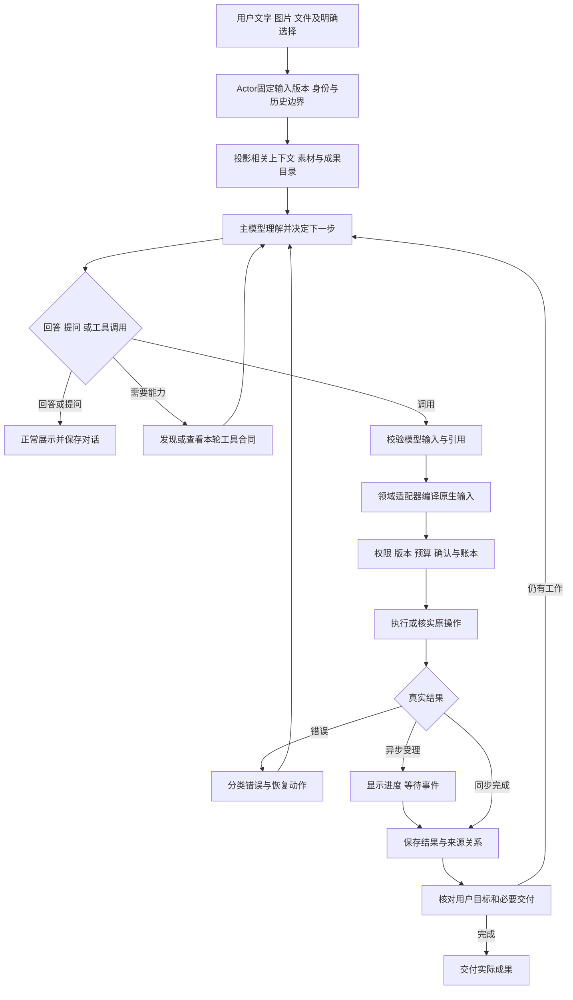

# 通用对话执行架构诊断与改进方案

> 后续实施以[最终改进方案与逐项风险关闭条件](TECH_通用对话执行架构最终改进方案.md)为准；本文保留为诊断依据。

2026-11-20。状态：诊断与推荐设计，供评审；未实施业务变更。

深度补充见[完整流程对照、逐文件修改清单与迁移风险](TECH_通用对话执行架构深度设计与迁移风险.md)。该补充细化 Grok 的调用准备、权限、并发和纠错，给出我们各边界的兼容要求及负面影响。

目标是让同一个对话框可靠处理问答、资料理解、工具操作、图片创作和多轮修改。保留已有的原文保存、成果版本、素材权限、执行账本和故障续接，调整模型使用它们的方式。用户已明确授权整体诊断和方案设计，没有要求保留每一个旧调用步骤，也没有授权本轮部署。

## 1 诊断基线与结论

- 本项目基线：`4ca37b6703aef49147bec23a533ebb2acc769cc0`，最新 `origin/main`，已合入上轮检查的 `c0a8defa` 新后端。主工作树仍为旧版，未用它替代诊断基线。
- Grok Build 基线：官方仓库 `xai-org/grok-build`，`2bdd1d6a6369de0e8c68132ea4539e9abd9e14a8`。结论限定于读到的源码路径，不等同于整个托管产品的行为或成功率。
- 现有工具契约扫描覆盖业务目录、任务控制、Skill 控制及场景投影；不是宣称这 69 个名称会同时提供给模型。249 份 Schema 检查未发现悬空本地 `$ref`，受检 DashScope 转换保留参数定义。这不代表完成了所有 JSON Schema 语义、供应商兼容及线上行为验证。
- 最新离线复现见 [offline-probes.json](conversation-runtime-evidence/offline-probes.json)。无外部生成、真实查询或生产写入。

**核心结论：模型主导的通用循环已经存在。实际体验的短板，是围绕它的多个入口分别解释自然语言、展示不同合同、校验和修复各不相同。继续添加词语正则和专用控制步骤，会使不同场景之间的规则更难一致。**

推荐以现有 Actor 和模型循环为唯一执行主线，在其边界统一本轮上下文、模型可见合同、参数编译、错误恢复及结果证据。不新增第二个 Agent 平台，不重建业务账本。

## 2 用户需求与成功含义

| 编号 | 目标行为 |
|---|---|
| R1 | 用户使用自然表达；不必记住工具名、固定措辞、阶段名或内部字段。问答可直接回答，需要操作时实际调用工具。 |
| R2 | 当前文本、当前附件、相关历史、旧成果和新消息有明确身份；模型知道哪些只见到元数据、哪些实际看过。 |
| R3 | 上传图片后可明确编辑；多图用途不清时针对用途提问，不擅自全部传给生图。 |
| R4 | 多轮能选择某组方案、某条提示词或某张成图修改；继承未变要求，只覆盖明确修改部分。 |
| R5 | 搜索、业务查询、文件处理、定时任务、图片和视频共享可预测的调用与错误语义，仍遵守各领域权限和专业输入规则。 |
| R6 | 已提交、待确认、完成、失败和结果不明有真实依据。断线、重启或重试不能造成无依据的重复付费或写入。 |
| R7 | 缺资料、权限、能力和服务故障分别处理；用户只需补充真正影响结果的信息。 |
| R8 | 用真实任务、多种表达、多轮修改与故障注入证明改进，不能只以正确参数的单元测试数量衡量。 |

“任何信息”指统一接收和理解入口，不承诺现有工具能完成任何现实操作。能力范围外应能准确发现限制；模型理解和生成质量仍需实测。具体成功率、延迟和费用目标先测基线，再确定，不虚构大厂统一标准。

## 3 当前系统已经具备什么

现有主链为：用户消息与附件 → Conversation Actor claim 与输入快照 → 历史及资源清单 → Skill 与本轮工具选择 → 模型输出 → 控制动作或业务调用 → 原文编译、权限与资源核验 → 执行账本及业务处理器 → 工具结果、异步事件和前端投影。

| 现有实现 | 已有价值 | 本方案处理 |
|---|---|---|
| `handlers/chat/executor.py`、`context_snapshot.py`、`conversation_turn_runtime.py` | 可信操作者、固定历史边界、执行 token、命令及 checkpoint | 保留；补充统一的本轮模型上下文投影 |
| `tools/spec.py`、`registry.py`、`policy.py`、`dispatcher.py` | 业务目录、展示与授权分离、受控执行 | 保留；统一模型合同生成和校验入口 |
| `task_execution/content_objects.py`、`content_groups.py` | 完整正文、素材用途、版本与条目选择、原稿执行 | 保留账本和版本；减少模型必须操作的登记细节 |
| `task_execution/model_directed.py`、`direct_loop.py` | 已有模型主导循环，工作计划不自动构成执行许可 | 作为主线；不重新强制所有任务先计划再审批 |
| `tool_invocation_store.py`、`task_execution/*operations.py`、`pending_batch.py` | 原调用恢复、业务回执、异步状态、不确定结果核实 | 保留；统一错误动作与状态投影 |
| `skills/runtime.py`、`skills/context.py` | Skill 方法与权限区分、版本锁定、阶段退出 | 保留；方法不能把用户的编辑请求扩大为全套策划 |
| `chat_context/image_sources.py`、`task_execution/image_resources.py` | 历史图片定位、视觉可见性、真实文件与作用域核验 | 保留；同一份素材选择贯穿保存和执行 |
| 前端 `messageSender.ts`、`useImageUpload.ts`、`ChatImageControls.tsx` | 图片来源身份、实际配方详情、重试和状态展示 | 复用；后续只补充明确的选中对象及用户可读恢复动作 |

## 4 有证据的缺陷与系统性缺口

### D1 素材绑定与说明不一致 已复现

`content_groups.bind_group` 依赖措辞正则。相同单图、相同正文下，“保留这张图里的红色福字，把背景换成棕红色实木桌子”得到零个绑定素材，保存返回 `CONTENT_ATTACHMENT_USAGE_REQUIRED`；“参考这张图，保留主体……”能保存。

首次投影 `content_tools.model_tools(first_delivery=True)` 又告诉模型“后台关联当前原图”。`execution_engine.py:1720` 的报错要求逐条登记原图，却不指出 `document.items[i].materials`、`reference`、`usage` 的完整路径和可用值。

因果链：说明允许省略 → 后台未按该表达绑定 → 业务校验拒绝 → 报错不足以定位修复 → 模型猜字段。字段并非没有定义；`ContentItem.materials` 在模型 Schema 中存在。

### D2 自然表达的工具发现不可靠 已复现

`content_tools.discover` 以工具名英文分词、少量别名和整句包含匹配评分。受控权限上下文中：

| 查询 | 当前返回 |
|---|---|
| 换背景 | 无结果 |
| 图片 | 包含 generate_image |
| 帮我删除一个文件 | 仅 code_execute |
| 删除文件 | restore_file、code_execute，缺少 file_delete |
| file_delete | 能找到 file_delete |
| 查一下之前保存的提示词 | 无结果 |
| save_task_text | 命中 manage_scheduled_task，不提供该控制动作说明 |

这里是发现层的确定行为，不等于每次完整聊天都会失败：模型可能已有目标工具，或换查询词找到它。风险是即使理解正确，也需要额外试词，甚至走向更宽泛的代码工具。控制工具不在业务索引中，进一步放大了自查合同的困难。

### D3 自然语言理解分散在宿主辅助函数 已确认 分支影响需端到端评测

`content_tools.image_execution_request` 对“保留这张图里的福字，背景改成木桌”“第二张背景再浅一点”返回 false；`selects_previous_item` 对“把第二个方案做出来”返回 false，对“把第二个方案生成图片”返回 true。

前者主要控制受理前的叙述展示，并不直接启动或禁止图片任务，不能把 false 简化为模型一定不能改图。后者会参与本轮保存合同裁剪和旧成果选择保护。这些辅助判断与素材用途正则共同形成多个语义解释点，同义表达可能走不同分支。

改进重点是移除词语匹配对素材选择和合法输入形式的决定权；固定协议标记、安全边界和枚举仍可使用确定性校验，不需要删除所有正则。

### D4 校验入口不一致 已复现

Actor 控制动作使用 Pydantic；图片和策划有专门校验；通用子 Agent 使用 `agent/tool_args_validator.py` 的清洗逻辑。离线传入 `web_search(query='完整问题', domain_filter='example.com')` 后，限制字段被删除且无错误；`query` 传对象也可通过这一层。

这证明通用网关未完整执行其展示合同，不证明这些调用都会到达外部服务或绕过授权。问题在于失败位置不一致、条件可能被静默丢弃，模型难以建立稳定预期。

### D5 保存失败与通用调用缺少统一的无进展恢复 已复现

`_RepeatedToolCallGuard` 比较完整调用批次，猜测 attachments → image_usage → attachment_usage → image_refs 时连续返回 continue。`direct_loop.plan_guard_calls` 已对错误工作计划做过归一化，图片也已有 `ImageArgumentCorrection`，说明项目具备可复用的局部处理，但保存和其他工具未获得同等约束。

不是全局没有预算或停止机制，而是在同一根因下可以耗费多轮才被总预算终止。

### D6 模型合同与原生合同的转换由聊天循环手工协调 架构缺口

`execution_engine.py` 同时负责工具组装、内容登记、旧消息恢复、输入编译、Skill、错误回传、调用恢复与展示。`content_tools.model_tools` 又重写图片、视频、代码和保存入口的字段。业务原生 Schema 和模型可见 Schema 本来就可能不同；问题是二者的关联、校验顺序和错误格式没有成为统一合同。

文件长度本身不是缺陷。风险来自同一个调用跨越多个特殊分支后，原生处理器要求、模型说明和恢复逻辑容易失配。应该围绕职责提取边界，在同一执行链中工作，不新建平行执行器。

### D7 测试强度与用户体验标准之间仍有缺口

已有上下文、权限、版本、回放和私有真实案例测试，不能声称项目没有端到端意识。但离线回放固定工具参数不能证明模型面对同义表达、模糊指代和故障时能稳定选对输入。当前也没有本轮可据以宣称达到某个跨任务成功率的同条件模型基准。

## 5 对照 Grok Build 的具体实现

| 机制 | Grok 源码事实 | 对我们的启示与限制 |
|---|---|---|
| 工具参数 | `xai-tool-runtime/src/tool.rs` 的 Args 同时约束反序列化和 JsonSchema；调用前转换成具体参数类型 | 展示合同与执行输入应能追溯到同一类型或明确编译关系。不能把 Rust 类型安全等同于所有工具都拒绝未知字段 |
| Schema 生成 | `registry/types.rs:2160` 内联子结构；`xai-tool-types/src/types.rs:873` 测试保留原始 `$defs` | 我们当前引用完整，重点是持续防回归以及供应商投影后语义一致 |
| 工具发现 | `search_tool/mod.rs` 返回工具名、说明、完整 input_schema 和 ready/partial 状态 | 发现应带可直接使用的合同；查询无匹配、无权限与索引未就绪应区分，不能都表示“不支持” |
| 图片编辑 | `ImageEditInput` 接收 prompt、image、aspect_ratio；代码解析引用并保存实际结果 | 简单编辑的模型输入应直接。可把内部登记放到同一后台提交动作内，保留我们的账本 |
| 图片身份 | `turn.rs:1174` 每轮写入 AttachedImages；`image_edit/mod.rs` 将 [Image #N] 映射到真实来源 | 显示编号与真实资源分离有价值；这里的编号映射限当前消息，不能据此推断整个 Grok 产品不支持跨轮操作 |
| 错误 | `xai-tool-runtime/src/error.rs` 区分参数、权限、超时、限流、网络等，并要求可操作 detail，可附 details | 复用我们的 ToolResult，但统一所有入口的修复信息和执行状态 |
| 工具结果 | `ToolStream` 分 Progress 和唯一终态；`dispatch.rs` 对无终态报协议错误 | 用户进度与真实完成分离；我们的异步受理还需继续保留原有业务生命周期 |
| 循环恢复 | doom_loop 类型接收推理服务信号；采样器有单独、有限的恢复预算 | 不能复制成“所有无进展自动识别”。我们应先基于可观察的错误、输入版本和执行进展做判断 |

源码链接：

- [工具类型及调用前解码](https://github.com/xai-org/grok-build/blob/2bdd1d6a6369de0e8c68132ea4539e9abd9e14a8/crates/common/xai-tool-runtime/src/tool.rs#L375)
- [Schema 生成](https://github.com/xai-org/grok-build/blob/2bdd1d6a6369de0e8c68132ea4539e9abd9e14a8/crates/codegen/xai-grok-tools/src/registry/types.rs#L2160)
- [工具发现返回完整合同](https://github.com/xai-org/grok-build/blob/2bdd1d6a6369de0e8c68132ea4539e9abd9e14a8/crates/codegen/xai-grok-tools/src/implementations/search_tool/mod.rs#L290)
- [图片编辑及引用解析](https://github.com/xai-org/grok-build/blob/2bdd1d6a6369de0e8c68132ea4539e9abd9e14a8/crates/codegen/xai-grok-tools/src/implementations/grok_build/image_edit/mod.rs#L198)
- [结构化错误](https://github.com/xai-org/grok-build/blob/2bdd1d6a6369de0e8c68132ea4539e9abd9e14a8/crates/common/xai-tool-runtime/src/error.rs#L105)
- [终态要求](https://github.com/xai-org/grok-build/blob/2bdd1d6a6369de0e8c68132ea4539e9abd9e14a8/crates/common/xai-tool-runtime/src/dispatch.rs#L33)
- [推理循环恢复预算](https://github.com/xai-org/grok-build/blob/2bdd1d6a6369de0e8c68132ea4539e9abd9e14a8/crates/codegen/xai-grok-sampling-types/src/doom_loop.rs#L46)

公开建议的支持范围：OpenAI 建议已知参数交给代码、固定连续操作可合并、保持工具可理解，严格模式须满足供应商限制；Anthropic 强调面向任务的工具、可修正错误和真实任务评测。这些支持本方案的方向，不是必须复制的官方通用架构。

- [OpenAI Function calling](https://developers.openai.com/api/docs/guides/function-calling)
- [Anthropic 工具设计](https://www.anthropic.com/research/writing-tools-for-agents)
- [Anthropic Agent 评测](https://www.anthropic.com/research/demystifying-evals-for-ai-agents)

## 6 推荐通用流程

这是一条既有循环内的职责链，不是要求每次模型逐项调用的固定工作流。普通问题不强制登记成果，不增加通用意图分类模型前置轮，不要求全部任务创建计划或走独立审查。

### A 本轮上下文投影

复用 ContextAnchor、输入快照、资源清单、成果目录和原操作事实，生成一份一致的模型视图：当前消息、相关历史入口、用户明确选择、素材可用性与视觉是否已加载、成果版本、操作状态。

短编号只作为当前视图的易读别名，后台绑定已有 canonical identity，不能充当授权。历史原图或成图不在视觉上下文时，允许受控按需查看；先有身份和权限，再加载真实内容。摘要不替代正文，历史存在不等于用户选择。

无需把全部历史或正文每轮重复注入。当前结果和选中对象优先；目录分页、按 ID 精确读取、压缩后原文回读复用现有机制。不能因为“最近”就跨多个候选偷偷选图。

### B 模型负责语义 宿主负责可验证约束

主模型结合真实上下文区分理解图片、写方案、执行方案、修改成图、继续任务和新问题。工具调用本身表达要做的动作，不增加一个全局预分类器决定允许哪些工具。

宿主核对引用、用途、版本、权限、预算和真实回执。词语正则可保留为展示提示或旧格式兼容，不能拥有决定素材绑定、覆盖版本或切换合同形式的最终权力。更改先在开发测试与离线回放中对比，再移除决定性分支，不一次删除所有现有保护。

### C 统一模型可见合同

在现有 tools 层建立本轮合同构建边界，初步位置建议 `services/tools/model_contracts.py`。它从现有 ToolSpec、控制动作类型和可信执行上下文生成只读视图，不再维护另一份手写工具定义。

每份本轮合同含稳定工具身份、合同版本、当前可填写结构、前置条件、结果含义、校验器与原生编译器标识。控制动作仍交给原宿主处理，业务动作仍交给 ToolRuntime；“纳入统一视图”不意味着给控制动作绕过授权的业务分派能力。

模型输入与原生参数可以不同。例如模型传成果引用，后台读取原文并编译成供应商参数。必须分两次校验：先按该轮模型合同验证，再按原生合同验证编译结果。不能用原生 Schema 错误要求模型填写已被隐藏的内部字段。

模型供应商适配仅转换支持的语法；不能删掉 $defs、分支约束或业务字段来换取兼容。严格输出可用则启用，但运行时权限与语义校验仍不可省略。

### D 工具发现与合同自查

扩展现有 `find_available_tools` 的实现，复用业务目录和本轮控制合同：精确工具名优先；名称、用途、任务示例与中英文别名参与检索；对整句分词评分，不要求整句原样包含在描述中。首期使用现有目录与轻量检索即可，不默认引入向量库或额外付费模型。

工具名精确查询应能直接返回该合同；自然语言查询返回相关且当前获准的能力。已展示的控制动作也能查看准确用法。结果区分 found、no_match、unavailable、partial，附完整用法或确定的加载方式。未获准工具不泄露敏感定义，权限仍由 Registry/Policy 再检查。

实际展示的工具仍按上下文收敛，不把 69 个名称全部常驻。Skill 可以增加方法相关工具，但不能授予新权限。零命中不直接宣称平台无此能力，先允许目录内的合理重查或准确说明检索范围。

### E 原文保存与执行衔接

保留两种用户行为，统一流向同一账本：

1. 用户要方案、提示词或修订：使用已有 ContentDocument/ContentItem 保存并呈现同一份原文；已完成条目通过 content_source 执行。
2. 用户直接要求做图或编辑：推荐后续为现有生成能力增加明确的即时提交输入形式。模型填写完整编辑要求、明确素材选择和已确定规格；宿主先持久化成现有内容对象，再编译、校验和提交。用户不用先看到一份不需要的方案，内部也不会跳过原稿登记。

第二种属于模型协议调整，必须明确协议版本及兼容恢复；测试通过后按最终方案全量上线内测；不能用一个模糊的 `continue_execution=true` 推断要调用哪个业务工具。目标工具、动作和输入必须明确，不靠正文关键词选执行器。不强求把新工具命名为 image_edit，名称应服从现有能力和权限体系。

一次模型调用不代表保存事务和外部供应商请求可以原子完成。采用现有 checkpoint/operation reservation：先保存原文和稳定操作身份，再派发；中断后核实原操作。保存失败不派发；已受理不因界面或回传失败重发。

### F 多轮图片修改

必须区分三个对象：保存的提示词版本、执行所用输入图、执行输出成图。复用 ContentRecord、Asset/FileRef、图片任务配方及原操作 ID 记录关系，不用重新建一套媒体账本。

当用户说“把刚才第二张背景再浅一点”：模型先根据当前明确候选选择第二张成图及其实际配方。确认结果已完成并可访问，需要时加载视觉。以该成图作为编辑底图，保留用户没有修改的有效约束，保存新版本或派生稿，再提交新操作。旧版仍可对比。

当用户说“按原图重做第二个方案”：底图是所选方案关联的原图，不是上一版生成结果。“改第二条提示词，先不要生成”只更新文本，不产生图片任务。现有“只替换此次参考图”的行为可继续保留，不能因一次临时选择改变全部历史方案。

多组都有“第二张”且无法唯一定位时，问一个针对对象的问题，并提供候选缩略图或名称；不要求用户提供 UUID。若结果仍在生成，应明确等待，或基于已存在素材发起用户明确授权的新版本，不能假装看到未完成的成图。

用户中途更改要求：尚未提交的操作按输入版本失效；已受理操作按供应商能力决定能否停止，不能承诺撤回。旧结果完成后保留其来源，不冒充新要求的结果。新旧任务不能共用新的执行许可。

### G 错误与恢复

统一复用 ToolResult 的模型投影，控制动作也使用同一语义。推荐的错误内容：code、stage、具体 issue.path、当前允许结构或精简字段说明、state_changed、是否已受理、原 operation_id，以及服务端确定的 recovery.action。

| 情况 | 恢复动作 | 不允许的行为 |
|---|---|---|
| 结构错误且未派发 | repair_arguments，提供准确路径与允许值 | 猜字段、改正文或取消用户限制来通过 |
| 引用缺失或过期 | resolve_source，列出当前获准候选 | 选相似文件代替、退回纯文生图 |
| 多个有效目标 | ask_user，提出最小选择问题 | 靠最近顺序默认选择 |
| 无权限或需明确授权 | request_authorization 或 stop | 换工具、代码或 ID 绕过边界 |
| 服务限流 | wait，保留 retry_after 与总预算 | 立即循环重试 |
| 只读临时故障 | 按适配器定义的安全策略重试 | 把服务故障说成没有数据 |
| 付费/写入结果不明 | reconcile_operation | 新 call_id 重复提交 |
| 已受理或等待表单确认 | wait_existing/await_user | 把受理或表单当成完成 |
| 不能完成 | report_blocker | 编造成果或假称已执行 |

这些动作是可信宿主给出的恢复指引，不是模型自填的授权，也不能替代当前权限检查。业务字段的规范化仅在合同明确允许且等价时进行，保留原始参数和编译后参数；未知条件不得静默删除。

无进展判断使用工具/目标、固定输入版本、归一化错误类别与位置、执行或成果的实际变化；不能只看字符串是否完全相同。补充了所需来源、保存新合法版本或推进了原操作状态才算进展。合理的大批量独立查询、新任务和用户补充输入不得误计为循环。

参数纠错、网络重试、等待异步、推理重采样分别计预算；恢复 checkpoint 后仍沿用同一预算。使用现有图片修复边界作为起点，各工具可声明自己的安全次数，不制定适用于所有工具的盲目重试次数。

### H 结果交付与质量核对

执行事实用原生结果和账本；任务是否满足由模型对照用户目标核对，领域适配器补充可验证检查。图片存在不等于主体保真；文件已写入不等于文件可打开；查询成功不等于筛选口径正确。

确定性条件在代码验证，如文件存在且可读、尺寸/格式、来源/版本、行数与聚合口径。视觉保真和主观效果用实际图像检查及用户反馈，不能许诺生成模型绝不改动像素。失败只重做受影响项，先前完成的结果和计费保持。

进度投影复用现有事件，不让模型文字制造完成状态。普通回答继续流式展示，保存成果从已提交原文展示一次，不能为了可靠性让所有回复等待整轮完成。新增语义分支前记录实际延迟，不把本轮未测量的性能假设写成事实。

## 7 具体修改范围与实施批次

| 批次 | 修改位置及职责 | 完成条件 |
|---|---|---|
| B0 固定可复现基线 | 现有离线回放、真实任务评测脚本、工具与供应商版本记录 | 区分模型理解、发现、参数、来源、执行和交付失败；有可比较的基线 |
| B1 修复明确缺陷 | `content_tools.py`、`content_groups.py`、保存错误分支、`tool_args_validator.py`、repeat guard | D1/D2/D4/D5 用例通过；合法历史调用兼容，未知条件不丢失 |
| B2 统一合同与恢复入口 | `tools/model_contracts.py` 建议新增；`spec.py`、`catalog.py`、控制类型适配；`execution_engine.py`、`tool_loop_executor.py` 调用同一边界 | Actor 和子 Agent 对同一模型合同产生一致校验；错误能按当前合同修正；无第二执行器 |
| B3 统一当前上下文和素材选择 | `chat_context/image_sources.py`、`context_snapshot.py`、`content_objects.py`、`image_resources.py`、`direct_loop.py` | 同义表达不依赖固定词语；原图、成图、提示词版本唯一定位，视觉加载状态准确 |
| B4 简化即时任务和多轮修改 | `media.py` 模型投影、内容保存适配器、`compile_input`、操作账本入口；复用前端图片选择来源 | 模型一次明确提交可走保存→编译→提交；原先先策划再执行仍可用；不中断旧任务恢复 |
| B5 交付与质量评测 | `outcome_builder.py`、原事件投影、现有图片详情/引用组件、领域产物检查 | 刷新与事件重放一致，异步结果不重复展示；质量和失败原因可观测 |

不为重构拆文件而拆文件。B2 的新边界先包装现有调用路径，再迁移每类工具；旧分支只有在新入口覆盖并验证后删除。B3 不将现有授权检查迁移到模型。任何数据库新增字段优先使用现有版本化元数据，确需持久化关系时再单独审查迁移与回滚。

## 8 兼容与回滚

- 旧 ContentRecord、content_source、原生配方和 invocation 不原地重写；旧 checkpoint 按旧合同版本恢复。
- 新请求按服务端固定的协议版本选择合同，模型不能自行选择旧协议绕过规则。存下原始输入、投影合同身份及已编译输入证明，恢复不重新解释已受理请求。
- 对合同生成与发现先做开发测试和离线无副作用对比；测试通过后全量上线供内部人员验收，不设生产灰度或在线 shadow 阶段。对比不能发重复真实生成或写入，也不能额外结算。
- 参数严格化前统计实际合法旧调用，必要兼容只能是明确的等价迁移；不能把“历史上被忽略”视为永远合法。
- 回滚切回旧入口仅影响后续新请求；已经按新合同保存、受理或结果不明的任务继续由对应版本恢复/核实，不能交给旧入口重发。保留所需解码器和状态读取器直至活跃任务排空。
- 本方案不改变生产发布和验收流程，不新增云端生产能力、外部平台或 AOCI。

## 9 验收用例与测量

| 用例 | 必须观察的结果 |
|---|---|
| 普通问答、仅图片无明确动作、只问操作方法 | 不擅自产生付费任务；适当理解、回答或追问 |
| 单图换背景的多种同义表达 | 同一图片被明确选中；不依赖“参考”二字；正文和规格一致 |
| 多图含商品/风格/分析资料 | 用途保留；不将分析图静默变执行图 |
| 写多条提示词→修改一条→生成该条 | 完整原文未缩水；新旧版本可追踪；未改条目不重做 |
| 生成后“第二张再浅一点”与“按原图重做” | 分别使用选中成图与原图，不混淆底图 |
| 多组第二张、长会话压缩、历史不可见 | 唯一定位或最小追问；不能用摘要重造原稿 |
| 做一半换任务，旧图稍后完成 | 新要求生效；旧结果保留所属关系，不覆盖新任务 |
| 搜索、ERP 查询、导出、定时任务 | 正确工具和范围；口径、权限、真实文件、表单和生效状态正确 |
| 错字段、错类型、错引用、缺权限 | 具体修复信息；未发生不应发生的业务副作用 |
| 网络超时、受理回执丢失、重启及重复事件 | 核实原操作；无无依据重复提交，状态与计费可追踪 |
| 正确理解但工具实际不支持 | 准确说明能力缺口，不编造成功也不无效循环 |

真实模型评测固定模型版本、提示词、工具合同、附件和故障条件，多次运行。记录首次完成率、有效恢复率、指代/素材选择正确率、无效纠错轮数、任务总轮数、首次可见反馈/受理/最终交付耗时、模型与业务费用、用户追问次数及误报完成。

以最终结果和真实请求判定通过，允许不同的合法工具路径；不能仅比较模型有没有照抄预期步骤。生成质量与执行链可靠性分别评分，不把供应商失败或模型出图偏差都算成工具契约错误，也不以 HTTP 成功代表用户目标完成。

确定性回归要求已确认缺陷用例全部通过，现有权限、版本和不重复执行约束不能倒退。模型成功率和耗时门槛由 B0 的同条件基线确定；未经评测不宣称达到 Grok 或大厂水平。

## 10 本轮证据与尚未验证部分

- 新基线增加运行六组上下文/来源/续接/恢复/记录/Skill 单元测试：112 项通过，见 [context-tests.txt](conversation-runtime-evidence/context-tests.txt)。
- 上轮同一新后端链路：工具目录/权限/校验/结果等 1196 项通过；另组 213 项通过、4 项跳过，2 项因本地缺少 python-docx 失败。相关业务代码与本基线无差异，复用结果，不把环境失败当成业务缺陷。
- 本轮函数复现见 [offline-probes.json](conversation-runtime-evidence/offline-probes.json)，包括发现差异、语言辅助分支、单图绑定、保存说明、重复保护和参数清洗。
- 受检 Schema 见 [schema-audit.json](conversation-runtime-evidence/schema-audit.json)。只检查本地引用可达、显式 required 属性及受检转换保真，不能替代完整 JSON Schema 校验与供应商实测。
- 未发起真实图片生成、真实业务写入、付费模型批量评测或生产故障注入；前端只读代码分析，未作浏览器验收。现有录制回放和局部模型验收不等于对本方案全部任务的同条件成功率测量。

当前推荐决策是采用上述职责边界和渐进批次。即时提交输入形式、前端候选选择的具体交互、可持续评测预算和最终质量门槛，实施时需要形成具体可审查合同；本诊断不将它们冒充已经实现或已被用户逐项确认的行为。
